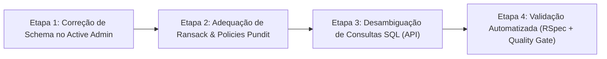

# PDR — Plano Diretor de Remediação: Active Admin & Estabilidade de Rotas Rails (HTTP 500)

> **Documento:** PDR (Project Delivery Record / Plano Diretor de Remediação)  
> **Status:** Proposto para Aprovação  
> **Versão:** 1.0.0  
> **Sistema:** Avalia Solar 2026 — Backend Ruby on Rails 7 (`AB0-1-back`)  
> **Classificação:** Estabilidade Operacional / Correção Cirúrgica de Falhas Críticas  

---

## 1. Contexto e Justificativa

Durante auditoria técnica e inspeção de logs, foram identificados múltiplos pontos de falha que geram a página de erro padrão do Rails (`public/500.html`):
> *"We're sorry, but something went wrong. If you are the application owner check the logs for more information."*

Esses erros decorrem de:
1. **Divergências de Schema no Active Admin**: Chamadas a colunas e métodos inexistentes (`pricings.price` vs `value`, `banner_addons.active` vs `is_active`, `banner_addon_subscriptions.payment_gateway` vs `payment_provider`, `admin_users.current_sign_in_at`).
2. **Incompatibilidades com Ransack 4.1.1**: Filtros em associações aninhadas ou campos não declarados em `ransackable_attributes` / `ransackable_associations` (`lead_wizard_fields`, `lead_wizard_field_options`, `sector_ratings`).
3. **Bloqueio de Autorização Pundit para Administradores**: A política `ReviewerPublicationPolicy` restringe ações ao autor original (`user_id == user.id`), gerando exceção não tratada quando acessada por um `AdminUser`.
4. **Arquivo Vazio no Active Admin**: `downloadables.rb` com 0 bytes, gerando rota inexistente ou quebrada.
5. **Ambiguidade em Consultas SQL PostgreSQL (`PG::AmbiguousColumn`)**: Rota pública e de API `/api/v1/local_solar_pages/:state/:city` falha com erro 500 ao consultar `featured` em escopos com `includes(:categories)`.

Este PDR estabelece o planejamento detalhado, entregáveis, requisitos e a ordem estrita de execução das correções.

---

## 2. Explicação do que Será Feito

A intervenção será executada em **4 etapas sequenciais**, seguindo o princípio da alteração cirúrgica mínima e preservação de compatibilidade retroativa:



### 2.1 Remediação das Divergências de Schema do Active Admin
- **`Pricings`**:
  - No model `Pricing`, adicionar `alias_attribute :price, :value` para assegurar que leituras e escritas transparentes funcionem tanto por `price` quanto por `value`.
  - Atualizar `app/admin/pricings.rb` para usar `value` com label correspondente e manter compatibilidade com filtros.
- **`BannerAddons`**:
  - No model `BannerAddon`, adicionar `alias_attribute :active, :is_active`.
  - No arquivo `app/admin/banner_addons.rb`, corrigir `column :is_active`, `filter :is_active`, `f.input :is_active` e `row :is_active`.
- **`BannerAddonSubscriptions`**:
  - No model `BannerAddonSubscription`, adicionar `alias_attribute :payment_gateway, :payment_provider`.
  - No arquivo `app/admin/banner_addon_subscriptions.rb`, alinhar para `payment_provider`.
- **`AdminUsers`**:
  - No arquivo `app/admin/admin_users.rb`, remover a referência `column :current_sign_in_at` e `filter :current_sign_in_at`, já que o Devise do model não utiliza `:trackable`.

### 2.2 Adequação de Ransack e Políticas de Autorização (Pundit)
- **`LeadWizardField` & `LeadWizardFieldOption`**:
  - Ajustar `app/admin/lead_wizard_fields.rb` e `app/admin/lead_wizard_field_options.rb` para utilizar filtros compatíveis com Ransack 4.1 ou habilitar explicitamente as associações encadeadas no model.
- **`SectorRating`**:
  - No model `SectorRating`, permitir busca por empresa e usuário ou reescrever os filtros do Active Admin para usar `company` e `user` diretamente.
- **`ReviewerPublicationPolicy`**:
  - No arquivo `app/policies/reviewer_publication_policy.rb`, conceder acesso explícito a instâncias de `AdminUser` em todas as ações (`show?`, `update?`, `destroy?`, `publish?`, `archive?`) e no `Scope#resolve`:
    ```ruby
    def show?
      admin? || owner?
    end
    ```
- **`Downloadables`**:
  - Configurar `app/admin/downloadables.rb` com a estrutura padrão do Active Admin para o modelo `Downloadable`.

### 2.3 Desambiguação de Consultas SQL (APIs / Controladores Públicos)
- Em `app/controllers/api/v1/local_solar_pages_controller.rb`, qualificar todas as referências às colunas de `Company`:
  - Linha 106: `filtered.where(companies: { featured: ... })`
  - Linha 215-217: `scope.where(companies: { verified: true }).count`, `scope.where(companies: { featured: true }).count`, `scope.where(companies: { sponsored: true }).count`.

---

## 3. Entregáveis (Deliverables)

1. **Código-fonte Corrigido**:
   - `AB0-1-back/app/models/pricing.rb` (com `alias_attribute`)
   - `AB0-1-back/app/models/banner_addon.rb` (com `alias_attribute`)
   - `AB0-1-back/app/models/banner_addon_subscription.rb` (com `alias_attribute`)
   - `AB0-1-back/app/admin/pricings.rb`
   - `AB0-1-back/app/admin/banner_addons.rb`
   - `AB0-1-back/app/admin/banner_addon_subscriptions.rb`
   - `AB0-1-back/app/admin/admin_users.rb`
   - `AB0-1-back/app/admin/lead_wizard_fields.rb`
   - `AB0-1-back/app/admin/lead_wizard_field_options.rb`
   - `AB0-1-back/app/admin/sector_ratings.rb`
   - `AB0-1-back/app/admin/downloadables.rb`
   - `AB0-1-back/app/policies/reviewer_publication_policy.rb`
   - `AB0-1-back/app/controllers/api/v1/local_solar_pages_controller.rb`
2. **Bateria de Testes Automatizados**:
   - Specs RSpec validando o carregamento dos recursos do Active Admin sem disparar 500.
   - Request spec cobrindo o endpoint `/api/v1/local_solar_pages/sc/florianopolis` garantindo resposta HTTP 200 JSON.
   - Policy spec para `ReviewerPublicationPolicy` garantindo autorização para `AdminUser`.
3. **Relatório de Verificação Pós-Correção**:
   - Execução do quality gate (`bin/quality`, RuboCop, Brakeman e RSpec).

---

## 4. Requisitos Mínimos (Critérios de Aceite e Qualidade)

1. Nenhuma rota corrigida pode retornar HTTP 500 ("We're sorry, but something went wrong...").
2. Todas as consultas SQL devem ser qualificadas com a tabela de origem para prevenir ambiguidades no PostgreSQL.
3. Zero alterações destrutivas em banco de dados (`db/schema.rb` permanece íntegro; não criar migrations desnecessárias).
4. Conformidade estrita com o style guide do repositório (RuboCop, max 120 caracteres, métodos concisos).
5. Cobertura de teste com status verde na suite RSpec.

| ID | Requisito Mínimo | Método de Validação |
| :--- | :--- | :--- |
| **REQ-01** | `/admin/pricings` deve carregar índice, detalhes e formulário com status HTTP 200. | Requisição GET autenticada como AdminUser no Active Admin. |
| **REQ-02** | `/admin/banner_addons` e `/admin/banner_addons/:id` devem exibir status ativo sem chamar método inexistente. | Validação de renderização de view e atributo `is_active`. |
| **REQ-03** | `/admin/banner_addon_subscriptions/:id` deve exibir os dados de pagamento sem falhar em `payment_gateway`. | Acesso à rota de visualização com fixture/registro real. |
| **REQ-04** | `/admin/admin_users` deve carregar sem referenciar colunas ausentes de Devise Trackable. | Acesso GET ao index de `AdminUser`. |
| **REQ-05** | Administrador deve conseguir visualizar e gerenciar `/admin/reviewer_publications/:id` sem bloqueio da policy. | Validação da política Pundit com `current_admin_user`. |
| **REQ-06** | `/api/v1/local_solar_pages/sc/florianopolis` deve retornar HTTP 200 com métricas de empresas em destaque calculadas. | Teste de requisição de API com parâmetros de localidade e vertical. |
| **REQ-07** | Arquivo `downloadables.rb` deve registrar o recurso no Active Admin ou ser formalmente removido caso depreciado. | Registro funcional no painel do Active Admin. |

---

## 5. Tasklist Faseada de Execução

- [ ] **Fase 1: Preparação e Preservação de Estado**
  - [ ] Verificar `git status` e branch ativa para assegurar isolamento de alterações.
  - [ ] Validar a existência de factories para `Pricing`, `BannerAddon`, `BannerAddonSubscription`, `Company` e `AdminUser`.
- [ ] **Fase 2: Model Aliases e Compatibilidade de Schema (Camada de Dados)**
  - [ ] Adicionar `alias_attribute :price, :value` em `Pricing`.
  - [ ] Adicionar `alias_attribute :active, :is_active` em `BannerAddon`.
  - [ ] Adicionar `alias_attribute :payment_gateway, :payment_provider` em `BannerAddonSubscription`.
- [ ] **Fase 3: Correções dos Recursos Active Admin (Camada de Apresentação)**
  - [ ] Corrigir `app/admin/pricings.rb`.
  - [ ] Corrigir `app/admin/banner_addons.rb`.
  - [ ] Corrigir `app/admin/banner_addon_subscriptions.rb`.
  - [ ] Corrigir `app/admin/admin_users.rb`.
  - [ ] Ajustar filtros em `app/admin/lead_wizard_fields.rb` e `lead_wizard_field_options.rb`.
  - [ ] Ajustar filtros em `app/admin/sector_ratings.rb`.
  - [ ] Implementar `app/admin/downloadables.rb`.
- [ ] **Fase 4: Políticas de Autorização Pundit (Camada de Segurança)**
  - [ ] Atualizar `app/policies/reviewer_publication_policy.rb` com suporte pleno a `AdminUser`.
- [ ] **Fase 5: Desambiguação SQL nas APIs Públicas (Camada de Controladores)**
  - [ ] Qualificar `companies.featured`, `companies.verified` e `companies.sponsored` em `app/controllers/api/v1/local_solar_pages_controller.rb`.
- [ ] **Fase 6: Testes, Validação e Quality Gate**
  - [ ] Executar specs direcionadas de cada recurso alterado.
  - [ ] Executar `bundle exec rubocop` e `bundle exec brakeman -q -w2`.
  - [ ] Gerar relatório final de validação com evidências de execução.

---

## 6. Matriz de Riscos e Procedimentos de Rollback

| Risco Identificado | Severidade | Medida de Mitigação | Estratégia de Rollback |
| :--- | :--- | :--- | :--- |
| Quebra de compatibilidade em código legado chamando `price` em `Pricing`. | Alta | Uso de `alias_attribute` no ActiveRecord mantendo ambos os nomes válidos. | Reverter commit cirúrgico via Git mantendo os métodos isolados. |
| Filtros do Active Admin não responderem em tempo hábil. | Média | Uso de índices existentes nas colunas nativas (`is_active`, `value`, `company_id`). | Restaurar a lista de filtros do commit anterior. |
| Erro de autorização indevido em `ReviewerPublication`. | Média | Condicional `user.is_a?(AdminUser)` explícita na política sem alterar permissões de usuários finais. | Manter comportamento restrito ao autor. |

