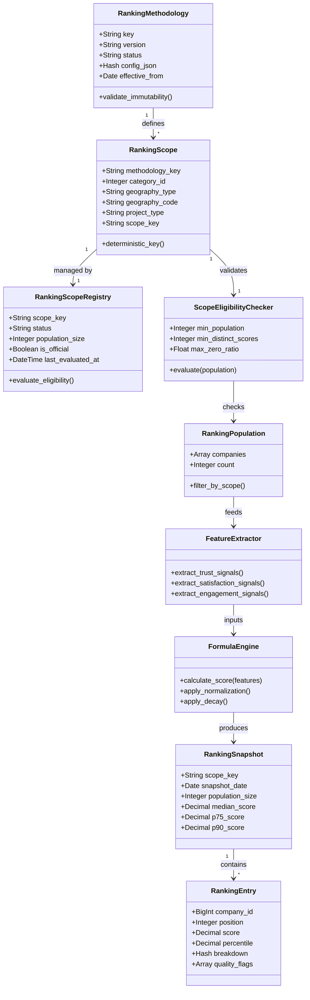

# AVALIA SOLAR — DISCOVERY DE ARQUITETURA DE RANKING HIERÁRQUICO / IAS
## AS-IS → TO-BE → GAP ANALYSIS → ARCHITECTURAL DECISION RECORD (ADR)

> **Documento:** `docs/architecture/DISCOVERY_HIERARCHICAL_RANKING_IAS.md`  
> **Status:** Discovery Concluído / Proposta Arquitetural (READ-ONLY)  
> **Data:** Setembro de 2026  
> **Repositório:** `MrGr33n98/Avalia-Solar-2026`  
> **Baseline Auditado:** `main` @ `257bbdc16`  
> **Autoridade Metodológica:** Engenharia & Produto Avalia Solar  

---

## SUMÁRIO EXECUTIVO

O presente estudo realiza o **Discovery de Arquitetura de Ranking Hierárquico e Avaliação Metodológica do IAS (Índice Avalia Solar)**. O objetivo central é responder formalmente:

$$\text{Qual é a posição desta empresa para esta metodologia, nesta categoria, neste território, neste porte, neste período, considerando esta população elegível?}$$

Este relatório audita a implementação em produção (**AS-IS**), delineia as opções arquiteturais viáveis (**TO-BE**), avalia criticamente as hipóteses do modelo conceitual **IAS**, cataloga as restrições reais de dados (**GAPs**), formaliza as decisões arquiteturais (**ADR**) e estabelece um roteiro progressivo de implementação em 8 fases.

---

# PARTE I — PERGUNTA CENTRAL E FORMALIZAÇÃO DO ESCOPO

A representação matemática formal de uma consulta de ranking pode ser expressa como:

$$\text{RankingScope} = \text{Methodology} \times \text{Category} \times \text{Geography} \times \text{Size} \times \text{ProjectType} \times \text{TimeWindow}$$

### Avaliação de Participação Dimensional na Identidade Primária

A explosão do produto cartesiano pleno de 6 dimensões tornaria o sistema inviável computacionalmente e desprovido de significância estatística na maioria das combinações:
* $\approx 100 \text{ categorias} \times 5.570 \text{ cidades} \times 8 \text{ tipos de projeto} \times 4 \text{ portes} \times 5 \text{ janelas} \approx 89 \text{ milhões de escopos possíveis}$.

**Conclusão do Discovery para a Identidade do Escopo:**
1. **Dimensões Primárias Canônicas (Materializáveis em Snapshot):**
   * $\text{Methodology}$: Versão estrita e imutável (ex: `organic-performance-v2`, `ias-v1`).
   * $\text{Category}$: Taxonomia oficial de negócio (ex: `70` - Energia Solar Integradores).
   * $\text{Geography}$: Hierarquia geográfica resolvida com código canônico (ex: `national:BR`, `state:SC`, `city:4205407` [Florianópolis/IBGE]).
   * $\text{TimeWindow}$: Janela temporal do snapshot (ex: `snapshot_date: 2026-09-24`, periodicidade diária/semanal).
2. **Dimensões Contextuais / Facetas de Runtime (Não-materializadas universalmente):**
   * $\text{ProjectType}$: Atributo de capability (`companies.project_types`). Deve operar como filtro de preview contextual em runtime, com materialização opcional restrita aos top escopos com massa crítica comprovada.
   * $\text{Size}$: Atributo com dados insuficientes no momento atual (ver Parte III-D). **Deve ser excluído da identidade de escopo oficial até a consolidação da fonte de dados.**

---

# PARTE II — INVENTÁRIO AS-IS (CÓDIGO E SCHEMA REAL)

A auditoria direta no código do repositório (`AB0-1-back`) revelou as seguintes evidências objetivas:

### Respostas ao Inventário AS-IS:

1. **Que ranking oficial existe?**
   O ranking oficial é governado pela classe `CompanyDashboard::RankingSnapshotWriter` sob a metodologia imutável `organic-performance-v2` (`CompanyRankingSnapshot::DEFINITION_VERSION = 'organic-performance-v2'`).
2. **Quais snapshots são persistidos?**
   Apenas dois tipos de escopo são persistidos diariamente na tabela `company_ranking_snapshots`:
   * `scope_type: 'global'` com `scope_id: nil`.
   * `scope_type: 'category'` com `scope_id: category.id`.
3. **Quais escopos são preview?**
   Qualquer consulta contendo `state`, `city`, `sector` (project_types) ou `criterion_slug` é resolvida em runtime como `mode: 'preview'` e `position_semantics: 'dynamic_comparison'`. Não geram linhas em `company_ranking_snapshots`.
4. **Como a população é construída?**
   Construída centralmente via `CompanyDashboard::RankingEligibilityScope`:
   ```ruby
   Company.active.joins('INNER JOIN company_ranking_score crs ON crs.company_id = companies.id')
   ```
   Aplica filtros opcionais por categoria (`categories_companies`), estado (`companies.state`), cidade normalizada (`companies.city`) e tipo de projeto (`companies.project_types @> [sector]`).
5. **Quais filtros já existem?**
   * `category_id` (inteiro)
   * `state` (UF, 2 letras)
   * `city` (string transliterada e normalizada)
   * `sector` (string correspondente a `Company::PROJECT_TYPES`)
   * `criterion_slug` (critério de avaliação de review; utilizado apenas no quadrante de posicionamento, não altera ordenação de ranking score).
6. **Como `RankingEligibilityScope` funciona?**
   Garante isolamento absoluto de monetização: patrocínio (`companies.sponsored`), plano comercial (`companies.plan_id`) e transações pagas não participam da seleção nem da ordenação.
7. **Como os percentis são calculados?**
   * No `RankingSnapshotWriter`: Cálculo ordinal de rank relativo na população:
     $$\text{percentile} = \left(\frac{\text{population} - \text{position} + 1}{\text{population}}\right) \times 100$$
   * No `RankingBenchmarkService`: Interpolação linear exata sobre array ordenado de scores:
     ```ruby
     index = (percentile / 100.0) * (scores.length - 1)
     lower + (upper - lower) * (index - lower.floor)
     ```
8. **Como benchmarks são calculados?**
   Executados por `CompanyDashboard::RankingBenchmarkService`. Exige população mínima $\ge 10$ (`RANKING_MIN_COMPARABLE_POPULATION`). Retorna $P50$ (mediana), $P75$, $P90$, média, desvio padrão, número de scores distintos e flag booleana de `quantile_collision` caso $P75 = P90$.
9. **Como Positioning `ScopeResolver` funciona?**
   Localizado em `app/services/company_dashboard/positioning/scope_resolver.rb`. Executa cascata de fallback:
   $$\text{City} \times \text{Cat} \times \text{Sector} \longrightarrow \text{State} \times \text{Cat} \times \text{Sector} \longrightarrow \text{Category} \longrightarrow \text{Global}$$
   Se a população qualificada for inferior à população mínima, ativa `fallback: true` e `fallback_reason: 'insufficient_sample'`.
10. **Como metodologia é versionada?**
    Via constantes estáticas no código Ruby:
    * `CompanyRankingSnapshot::DEFINITION_VERSION = 'organic-performance-v2'`
    * `Positioning::Definition::VERSION = 'positioning-v1'`
    * `TrustScore::Definition::VERSION = 'trust-score-v1'`
    Não há catálogo de metodologias no banco de dados.
11. **Onde pesos estão hardcoded?**
    * `Analytics::RankingScoreWorker`:
      $$\text{Score} = (\text{TrustScore} \times 10) + \sum_{d=0}^{6} \text{DailyEngagement} \times e^{-0.1 \times d}$$
    * `TrustScore::Definition::WEIGHTS`: Base (50), Verificação (20), Rating (20), Reviews (10), Engajamento (10), Leads (10) — soma 120, limitado a 100 via `.clamp(0.0, 100.0)`.
    * `Positioning::Definition`: Eixo X Autoridade (Trust 0.45, Verificação 0.20, Credibilidade 0.15, Badges 0.10, Prova Social 0.10); Eixo Y Execução (Leads 0.35, Engajamento 0.25, Conversão 0.20, Maturidade Operacional 0.10).
12. **Onde thresholds estão hardcoded?**
    * `Positioning::Definition::CAPS`: Leads máx (100), Visualizações máx (2.000), Cliques máx (300), Reviews máx (200), Badges máx (10), Taxa View $\to$ Click cap (0.35), Taxa Click $\to$ Lead cap (0.60).
    * `RankingService`: Stale snapshot após 36 horas; mínimo de 7 snapshots para formar tendência de 30 dias.
13. **Onde `minimum_population` está configurado?**
    `RankingBenchmarkService::DEFAULT_MIN_COMPARABLE_POPULATION = 10`, sobregravável via variável de ambiente `RANKING_MIN_COMPARABLE_POPULATION`.
14. **Que dimensões já existem no schema relacional?**
    * `companies`: `state` (varchar), `city` (varchar), `coverage_states` (text), `coverage_cities` (text), `latitude`/`longitude` (decimal), `employees_count` (int), `segment` (varchar), `project_types` (jsonb), `services_offered` (jsonb).
    * `categories`: `id` (bigint), `name` (varchar), `seo_url` (varchar), `parent_id` (integer), `kind` (varchar: 'main'/'sub').
    * `company_service_areas`: `company_id`, `coverage_type` ('city'), `state_code` (varchar 2), `city_name` (varchar), `radius_km` (int), `is_active` (boolean).
    * `company_ranking_snapshots`: `scope_type` ('global'/'category'), `scope_id` (bigint).
15. **Quais dimensões existem somente como arrays/texto?**
    * `project_types`: Array JSONB em `companies.project_types`.
    * `coverage_states` e `coverage_cities`: Campos texto livre/delimitado em `companies`.
    * `services_offered`: Array JSONB em `companies.services_offered`.
    * Porte: Existe apenas `employees_count` (inteiro não validado). Inexistência de faixas operacionais ou classificação jurídica no schema.

---

# PARTE III — ANÁLISE PROFUNDA DAS DIMENSÕES

## A. Categoria
* **AS-IS Fact:** A relação `categories_companies` é N:N (`has_and_belongs_to_many`). Uma empresa pode ter múltiplos vínculos. Não existe a coluna `primary_category_id` na tabela `companies`.
* **Comportamento Atual:** A alteração de categoria na empresa altera imediatamente o escopo dinâmico (`RankingEligibilityScope`). Nos snapshots oficiais, `RankingSnapshotWriter` itera sobre `Category.find_each` e grava um snapshot para cada categoria associada.
* **Hierarquia Futura (Taxonomia):** A tabela `categories` possui `parent_id` e `kind` (`main`/`sub`), mas historicamente foi utilizada de forma híbrida: categorias de catálogo de produtos (Painéis, Inversores, Baterias) misturadas a serviços.
* **Recomendação Arquitetural:** Separar estritamente a taxonomia de **Classificação de Negócio/Ranking** (`ranking_categories`: Integrador, Distribuidor, Fabricante, O&M) da taxonomia de **Catálogo de Equipamentos** (`catalog_categories`). Uma empresa deve ter exatamente **1 Categoria Primária de Ranking** e N secundárias.

## B. Tipo de Projeto (`project_types`)
* **AS-IS Fact:** Atualmente definido pela constante `Company::PROJECT_TYPES`:
  `%w[Residenciais Comerciais Rurais Industriais Condomínios Usinas\ de\ Solo Sistemas\ Off-grid Carregadores\ para\ Veículos\ Elétricos]`.
* **Análise de Domínio:** Tipo de Projeto **NÃO é Categoria**. Um integrador solar continua sendo um integrador quer instale sistemas residenciais ou usinas de solo.
* **Classificação:** É uma **Capability de Aplicação**.
* **Decisão:** Participa de consultas contextuais como filtro (`companies.project_types @> '["Residenciais"]'`), mas **não deve fragmentar os snapshots oficiais de base**, evitando explosão de tabelas vazias sem relevância comercial.

## C. Geografia: Sede vs. Cobertura
* **AS-IS Fact:** `RankingEligibilityScope` filtra exclusivamente por `companies.state` e `companies.city` (**Geografia de Sede**).
* **Problema Comercial Severo:** Um grande integrador nacional sediado em São Paulo com operação de excelência em Florianópolis/SC possui posição nula ou é invisível no ranking de Florianópolis.
* **Decisão Arquitetural TO-BE:**
  * **Ranking do Consumidor (Marketplace Público):** Deve utilizar **Geografia de Atendimento/Cobertura** (`company_service_areas` ativa ou `coverage_states`). Pergunta: *"Quais são as melhores empresas para atender meu projeto em Florianópolis?"*
  * **Ranking Institucional B2B (Dashboard / Reconhecimento):** Permanece por **Sede** (`headquarters`). Pergunta: *"Qual é a maior empresa solar sediada em Santa Catarina?"*
  * **Hierarquia Canônica:** $\text{Brasil (BR)} \longrightarrow \text{Região (IBGE)} \longrightarrow \text{Estado (UF)} \longrightarrow \text{Região Metropolitana} \longrightarrow \text{Município (Código IBGE 7 dígitos)}$.

## D. Porte Empresarial
* **AS-IS Fact:** Apenas `companies.employees_count` existe. Cobertura na base de dados é inferior a 15%, sem auditoria externa e sem renovação temporal.
* **Classificação:**
  * *Porte Jurídico:* MEI, ME, EPP, Médio Porte, Grande Porte (baseado no faturamento fiscal/Receita Federal).
  * *Porte Operacional Solar:* Potência instalada acumulada ($\text{kWp/MWp}$), número de projetos homologados, volume mensal de orçamentos.
* **Decisão Arquitetural:** **`BLOCKED_BY_DATA` / `NOT_READY`**. É terminantemente vedado criar rankings oficiais fatiados por porte com os dados atuais. Headcount não é proxy auditável de porte solar.

## E. Tempo e Janelas
Distinção formal de três conceitos frequentemente confundidos:
1. **Calculation Window (Janela de Amostragem):** Período de dados históricos observado pelo algoritmo (ex: últimos 7 dias de engajamento na v2; últimos 90 ou 365 dias de reviews no IAS).
2. **Snapshot Date (Data do Snapshot):** Timestamp do ponto de corte da fotografia persistida (ex: `2026-09-24 00:00:00 BRT`).
3. **Comparison Period (Janela de Tendência):** Janela de comparação para deltas de posição (ex: variação de posição em 7 dias ou 30 dias).

---

# PARTE IV — IDENTIDADE DO ESCOPO (`RankingScope` & `scope_key`)

O escopo do ranking deve ser um objeto imutável, serializável e determinístico.

### Estrutura do `RankingScope`:
```json
{
  "methodology": "organic-performance-v2",
  "category_id": 70,
  "geography_type": "state",
  "geography_code": "SC",
  "project_type": null,
  "size_band": null,
  "period": "daily"
}
```

### Regra Determinística do `scope_key`:
A composição do `scope_key` segue a sintaxe canônica normalizada:
$$\text{scope\_key} = \langle \text{methodology} \rangle : \text{cat}\langle \text{id} \rangle : \text{geo}\langle \text{type} \rangle \langle \text{code} \rangle : \text{proj}\langle \text{slug} \rangle : \text{size}\langle \text{band} \rangle$$

* Exemplo Estadual Oficial: `organic-performance-v2:cat70:geostate_SC:projall:sizeany`
* Exemplo Municipal Contextual: `organic-performance-v2:cat70:geocity_4205407:projresidenciais:sizeany`

O `scope_key` indexa deterministicamente: população elegível, benchmark, snapshot, cache Redis e métricas de observabilidade.

---

# PARTE V — HIERARQUIA DE ESCOPOS E CASCATA DE FALLBACK

Quando um usuário pesquisa um escopo altamente restrito (ex: Município pequeno com pouca adesão), o sistema não deve exibir uma página em branco ou um ranking com 1 única empresa. Ele deve executar um **Fallback Ordenado**, relaxando dimensões conforme a seguinte política:

```
[Nível 0: Cidade + Categoria + Tipo de Projeto]
                     │  (Se População < Min_Pop)
                     ▼
[Nível 1: Microrregião / Região Metropolitana + Categoria + Tipo de Projeto]
                     │  (Se População < Min_Pop)
                     ▼
[Nível 2: Estado (UF) + Categoria + Tipo de Projeto]
                     │  (Se População < Min_Pop)
                     ▼
[Nível 3: Estado (UF) + Categoria (Remove Tipo de Projeto)]
                     │  (Se População < Min_Pop)
                     ▼
[Nível 4: Região Macroeconômica (ex: Sul) + Categoria]
                     │  (Se População < Min_Pop)
                     ▼
[Nível 5: Nacional (Brasil) + Categoria]
```

### Regra de Ouro do Fallback:
A **Categoria de Negócio é preservada até o último nível**. Nunca relaxar Categoria antes da Geografia, pois comparar um Integrador com um Fabricante de Inversores quebra o princípio de comparabilidade comercial.

---

# PARTE VI — ELIGIBILIDADE E SIMULAÇÃO DE POLÍTICAS

O Discovery rejeita a adoção arbitrária de números mágicos sem amparo estatístico.

### Comparativo de Políticas Candidatas:

| Dimensão de Análise | Política A (Permissiva) | Política B (Balanceada - Recomendada) | Política C (Ultra-Rigorosa) |
| :--- | :--- | :--- | :--- |
| **Mínimo de Empresas** | $N \ge 5$ | $N \ge 10$ | $N \ge 25$ |
| **Mínimo de Scores Distintos** | $N \ge 2$ | $N \ge 5$ | $N \ge 15$ |
| **Exigência de Reviews** | Nenhuma | Pelo menos 3 empresas com $\ge 1$ review | Pelo menos 10 empresas com $\ge 3$ reviews |
| **Tratamento de Empates** | Permite ties em massa | Exige detecção de colisão ($P75 \neq P90$) | Rejeita escopo se tie ratio $> 20\%$ |
| **Cobertura Municipal Brasil** | $\approx 120$ municípios elegíveis | $\approx 45$ municípios elegíveis | $< 10$ capitais elegíveis |
| **Risco Comercial** | Crítico: rankings com empates artificiais | Baixo: preserva representatividade | Alto: inviabiliza ranking local no interior |

**Recomendação:** Adotar a **Política B**. Manter $N \ge 10$ com exigência estrita de $\ge 5$ scores distintos para habilitar benchmarks estatísticos confiáveis.

---

# PARTE VII — QUALITY GATES DO ESCOPO

Um escopo com 100 empresas pode ser estatisticamente espúrio se 95 delas tiverem score zero ou o mesmo score base de trust score.

### Objeto Conceitual `RankingScopeEligibility`:
```ruby
class RankingScopeEligibility
  attr_reader :population, :scores

  def qualified?
    population_size >= 10 &&
      distinct_score_count >= 5 &&
      zero_score_ratio < 0.60 &&
      !quantile_collision?
  end

  def quantile_collision?
    # Ocorre quando o corte P75 é idêntico ao corte P90
    percentile(75) == percentile(90)
  end
end
```

### Quality Flags Emitidas no Payload:
* `insufficient_sample`: População $< 10$.
* `score_homogeneity`: Menos de 5 valores distintos de pontuação.
* `zero_score_inflation`: Mais de 60% das empresas sem engajamento e sem reviews.
* `quantile_collision`: Empate estatístico nos percentis superiores ($P75 = P90$).
* `stale_trust_scores`: Mais de 20% das empresas com cálculo de confiança atrasado há $> 26$ horas.

---

# PARTE VIII — DESCONSTRUÇÃO DA FÓRMULA ATUAL (`organic-performance-v2`)

A fórmula em produção no `RankingScoreWorker` opera da seguinte forma:

$$\text{RankingScore} = (\text{TrustScore} \times 10) + \sum_{d=0}^{6} \text{DailyEngagement}_d \times e^{-0.1 \times d}$$

### Unidades e Escalas (Não Misturar):
1. **Trust Score:** Escala delimitada $[0, 100]$. Baseada em 6 fatores (Base 50, Verificação 20, Rating 20, Reviews 10, Engajamento 10, Leads 10).
2. **Trust Base no Ranking:** $\text{TrustScore} \times 10 \implies [0, 1000]$.
3. **Recent Engagement:** Janela de 7 dias com decaimento exponencial ($\lambda = 0.1 \text{ dia}^{-1}$). Escala aberta (não possui teto superior/cap).
4. **Ranking Score:** Pontuação absoluta $[0, \infty)$. Na prática, empresas líderes alcançam pontuações na faixa de $1.050$ a $1.300$ pontos.
5. **Position:** Ordenação ordinal discreta ($\#1, \#2, \dots, \#N$). Critério de desempate (*tie breaker*):
   $$\text{crs.score DESC} \longrightarrow \text{cts.score DESC} \longrightarrow \text{reviews\_count DESC} \longrightarrow \text{company.id ASC}$$
6. **Percentile:** Posição relativa ordinal da empresa perante a população:
   $$\text{Percentile} = \left(\frac{N - \text{Posição} + 1}{N}\right) \times 100$$
7. **Top Population Percentage:** Fração percentual de topo:
   $$\text{Top\%} = \left(\frac{\text{Posição}}{N}\right) \times 100$$
8. **Benchmark:** Cortes populacionais $P50$, $P75$, $P90$ calculados via interpolação linear sobre o universo elegível.

---

# PARTE IX — DISCOVERY DE IAS (ÍNDICE AVALIA SOLAR COMO HIPÓTESE)

A visão futura denominada **IAS** foi submetida a um escrutínio técnico aprofundado, decompondo suas premissas conceituais:

### 1. Definição Conceitual dos Índices Candidatos:
* **IS (Índice de Satisfação):** Pretende medir a **qualidade percebida pelo cliente final**. Sinais: nota média auditada, volume de avaliações, taxa de recomendação, respostas a reclamações, tempo de resolução e credibilidade das avaliações.
* **IPM (Índice de Presença e Maturidade):** Pretende medir a **robustez operacional e tração de mercado da empresa**. Sinais: tempo de mercado, verificação cadastral/jurídica, conformidade técnica, presença em projetos, área de cobertura e maturidade digital.
* **IAS (Índice Avalia Solar):** Agregação sintética entre Satisfação e Presença.

### 2. Avaliação Crítica das 10 Perguntas Metodológicas:

1. **O que cada índice pretende medir?** IS mede experiência do cliente; IPM mede idoneidade e envergadura operacional.
2. **Quais sinais observáveis existem hoje?**
   * *Existentes no banco:* `rating_avg`, `reviews_count`, `verified`, `company_badges`, `profile_views_count`, `cta_clicks_count`, `leads_count`, `whatsapp_enabled`.
   * *Inexistentes no banco:* Índices de pós-venda, taxa de rejeição/defeitos, histórico de garantias, medição de geração real vs teórica dos sistemas instalados.
3. **Qual a proveniência dos dados?** Reviews vêm de consumidores (com ou sem verificação); engajamento vem do tráfego web/PWA; dados cadastrais vêm de formulário administrativo; porte não possui proveniência auditada.
4. **Há redundância entre sinais?** **SIM (Severa).** No modelo atual e nas propostas preliminares, `leads_count` e `profile_views_count` aparecem simultaneamente no Trust Score, no Recent Engagement, no Eixo Y de Execução do Quadrante e na proposta do IPM. Isso causa sobreponderação indevida de tração digital.
5. **Há causalidade ou somente correlação?** Tráfego elevado correlaciona-se com tamanho da empresa, mas **não causa satisfação do cliente**. Tratar tráfego como qualidade é uma falha metodológica grave.
6. **É explicável para empresas?** Uma pontuação composta dinâmica arbitrária gera contestações judiciais e comerciais ("por que caí 5 posições?"). Uma metodologia baseada em pilares claros (Ex: Satisfação 60% + Confiabilidade 40%) com fatores auditáveis é comercialmente defensável.
7. **Pode ser manipulado (Gaming)?** Sim. Tráfego, cliques e reviews não verificadas são altamente vulneráveis a bots e automações se não houver filtros anti-fraude rigorosos.
8. **Tem cobertura suficiente?** Apenas 20% das empresas ativas possuem mais de 3 reviews. Um índice centrado exclusivamente em reviews excluiria 80% da base.
9. **É comparável entre categorias?** Não diretamente. Um distribuidor fatura centenas de milhões com poucos clientes B2B; um integrador atende centenas de clientes residenciais. O score deve ser calibrado ou normalizado por categoria.
10. **Necessita normalização por escopo?** Sim. Um rating médio de 4.8 em São Paulo (com 50 reviews) é estatisticamente diferente de um rating 5.0 em uma cidade do interior (com 1 review). Requer ajuste Bayesiano.

---

# PARTE X — PESOS E METHODOLOGY DEFINITION

O modelo TO-BE rejeita código procedural com dezenas de instruções `if/else` espalhadas. A especificação de cálculo deve residir em uma estrutura declarativa imutável:

```ruby
module Methodology
  class Definition
    attr_reader :version, :name, :effective_from, :components

    # Exemplo Conceitual: IAS v1 Candidate
    IAS_V1 = {
      version: 'ias-v1',
      name: 'Índice Avalia Solar 2026',
      status: 'candidate',
      pillars: {
        satisfaction_index: {
          weight: 0.60,
          signals: {
            bayesian_rating: { weight: 0.60, min_reviews: 3 },
            review_recency_decay: { weight: 0.25, half_life_days: 180 },
            verified_review_ratio: { weight: 0.15 }
          }
        },
        presence_maturity_index: {
          weight: 0.40,
          signals: {
            verification_status: { weight: 0.40 },
            operational_badges: { weight: 0.30, cap: 5 },
            certified_services: { weight: 0.30 }
          }
        }
      },
      caps: { max_score: 100.0 },
      missing_policy: :neutral_imputation
    }.freeze
  end
end
```

---

# PARTE XI — GOVERNANCE MATRIX (PARAMETRIZAÇÃO)

| Elemento do Sistema | Alocação Recomendada | Mecanismo de Governança | Justificativa de Engenharia |
| :--- | :--- | :--- | :--- |
| **Lógica da Fórmula** | **Code-Governed** | Classes Ruby versionadas (`Methodology::*`) | Auditabilidade via Git, tipagem estrita, performance compilada, zero risco de injeção dinâmica. |
| **Pesos e Metadados** | **Code + DB Registry** | Registrado em DB após aprovação em código | Imutabilidade em produção; histórico de auditoria por versão. |
| **População Mínima ($N$)** | **Config-Governed** | Variável de Ambiente / Config DB | Permite ajuste fino por operação sem necessidade de redeploy da aplicação. |
| **Hierarquia de Fallback** | **Code-Governed** | `ScopeResolver` (Políticas declarativas) | Garante previsibilidade e integridade relacional entre entidades geográficas. |
| **Rótulos e Nomenclaturas UI** | **Code (i18n)** | Arquivos `config/locales/pt-BR.yml` | Consistência com design tokens e vocabulário oficial da marca. |
| **Elegibilidade de Categoria** | **Database-Governed** | Coluna `ranking_enabled` em `categories` | Permite que o time comercial ative novas verticais conforme atingem massa crítica. |

---

# PARTE XII — METHOD REGISTRY & IMUTABILIDADE

A criação de um registro formal de metodologias no banco de dados deve seguir o princípio da **Imutabilidade Absoluta**.

### Schema Conceitual TO-BE (`ranking_methodologies`):
```sql
CREATE TABLE ranking_methodologies (
  id BIGSERIAL PRIMARY KEY,
  key VARCHAR(64) NOT NULL UNIQUE,          -- ex: 'organic-performance-v2', 'ias-v1'
  version VARCHAR(32) NOT NULL,             -- ex: '2.0.0', '1.0.0-beta'
  name VARCHAR(255) NOT NULL,
  status VARCHAR(32) NOT NULL,              -- 'draft', 'candidate', 'published', 'deprecated'
  config_json JSONB NOT NULL DEFAULT '{}',  -- pesos, caps, thresholds congelados
  published_at TIMESTAMP WITH TIME ZONE,
  effective_from DATE NOT NULL,
  effective_until DATE,
  created_by_user_id BIGINT,
  approved_by_user_id BIGINT,
  created_at TIMESTAMP WITH TIME ZONE NOT NULL,
  updated_at TIMESTAMP WITH TIME ZONE NOT NULL
);
```

> [!IMPORTANT]
> **Regra de Ouro:** Uma versão com status `published` **NUNCA é atualizada via UPDATE**. Qualquer modificação de pesos, sinais ou fórmulas exige a criação de uma nova linha com incremento semântico de versão (ex: `v2` $\to$ `v3`).

---

# PARTE XIII — FORMULA ENGINE: COMPARATIVO ARQUITETURAL

Avaliou-se se a plataforma deve implementar uma Formula Engine dinâmica via banco ou manter classes de código:

| Critério | Opção A: Classes Ruby Versionadas | Opção B: Config JSON Parcial | Opção C: DSL / Dynamic Formula Engine |
| :--- | :--- | :--- | :--- |
| **Segurança** | **Máxima:** Código estático validado por Brakeman e CI. | Alta: Parâmetros numéricos validados por schema JSON. | **Crítica:** Risco de injeção, loops e cálculos inconsistentes em runtime. |
| **Auditabilidade** | **Absoluta:** `git blame`, pull requests, revisões de código e testes de regressão. | Alta: Versionamento por linha na tabela de metodologias. | Baixa: Modificações ad-hoc em banco sem histórico de desenvolvimento. |
| **Performance** | **Sub-milissegundo:** Otimizado via SQL nativo e Ruby AST. | Excelente: Leitura de hashes indexados. | Lenta: Custo de parsing, interpretação e compilação em tempo de execução. |
| **Testabilidade** | **100% Coberta via RSpec:** Facilidade para criar fixtures e edge cases. | Moderada: Requer testes de contrato entre schema e código. | Complexa: Exige testes da própria engine de parsing e validação. |
| **Veredito** | **RECOMENDADA (Vencedora)** | Complementar para pesos da Opção A | **REJEITADA (Overengineering)** |

---

# PARTE XIV — ANÁLISE DE MÉTODOS DE NORMALIZAÇÃO

| Método | Fórmula | Vantagens | Riscos / Limitações | Adequação ao Domínio Solar |
| :--- | :--- | :--- | :--- | :--- |
| **Raw Capped Score** *(Atual)* | $\min(X, \text{Cap})$ | Simples, intuitivo, previsível. | Não ajusta distribuições assimétricas. | Bom para badges e verificação; ruim para volume de reviews. |
| **Min-Max** | $\frac{X - \min}{\max - \min}$ | Mapeia exatamente para $[0, 1]$. | Extremamente sensível a outliers (uma empresa com 500 reviews achata todas as outras). | **Inadequado** para variáveis com cauda longa. |
| **Log Normalization** *(Atual)* | $\frac{\ln(1 + X)}{\ln(1 + \text{Cap})}$ | Comprime cauda longa, premia tração inicial sem inflar gigantes. | Não escala linearmente; exige cap empírico. | **Excelente** para pageviews, cliques e volume bruto de reviews. |
| **Z-Score** | $\frac{X - \mu}{\sigma}$ | Centraliza na média e dispersão real. | Produz valores negativos; não interpretável para consumidor final. | Útil apenas internamente em modelos preditivos. |
| **Bayesian Rating** | $\frac{C \times m + \sum R}{C + N}$ | Evita que 1 review nota 5.0 vença 100 reviews nota 4.9. | Exige calibração da constante de confiança $C$. | **MANDATÓRIO** para cálculo de reputação e satisfação. |
| **Percentile Rank** | $\frac{\text{Rank}(X)}{N}$ | Distribuição perfeitamente uniforme. | Perde a distância métrica real entre as empresas. | Excelente para apresentação visual, não para agregação intermediária. |

---

# PARTE XV — TRATAMENTO METODOLÓGICO DE REVIEWS

No modelo atual, a média aritmética simples (`rating_avg`) associada a um peso linear gera distorções comerciais clássicas:
* Uma empresa recém-criada com 1 avaliação de 5 estrelas supera uma empresa tradicional com 80 avaliações de 4.9 estrelas.

### Proposta Técnica TO-BE: Suavização Bayesiana
Adotar o cálculo de média ponderada Bayesiana no pilar de satisfação:

$$R_{\text{bayes}} = \frac{C \times m + \sum_{i=1}^{N} r_i}{C + N}$$

Onde:
* $m$: Média global da categoria (ex: $4.5$).
* $C$: Mínimo de reviews para conferir credibilidade estatística (ex: $C = 10$).
* $N$: Quantidade de reviews da empresa.

---

# PARTE XVI — ANÁLISE DE DECAIMENTO TEMPORAL (DECAY)

### 1. Parâmetro AS-IS Efetivo:
No `RankingScoreWorker`, a taxa de decaimento utilizada na janela diária de 7 dias é exatamente:
$$\lambda = 0.1 \text{ dia}^{-1}$$
Fator de retenção diário: $e^{-0.1 \times d}$.
* Dia 0 (Hoje): $e^{0} = 1.000$ (100% de peso)
* Dia 1: $e^{-0.1} \approx 0.905$ (90,5% de peso)
* Dia 3: $e^{-0.3} \approx 0.741$ (74,1% de peso)
* Dia 6: $e^{-0.6} \approx 0.549$ (54,9% de peso)
* Meia-vida efetiva ($\tau_{1/2}$): $\frac{\ln(2)}{0.1} \approx 6.93 \text{ dias}$.

### 2. Simulação de Meia-Vida para Avaliações (IAS Futuro):
Reviews exigem janelas muito mais amplas para não punir injustamente a sazonalidade de obras de energia solar (que levam de 30 a 90 dias entre venda e homologação):
* **Decaimento Curto (30 dias):** Inadequado; tornaria o ranking excessivamente volátil.
* **Decaimento Médio Recomendado (180 dias):** Mantém 100% do peso nos primeiros 90 dias, decaindo para 50% após 6 meses.
* **Decaimento Longo (365 dias):** Avaliações com mais de 1 ano retêm 50% de autoridade; com mais de 2 anos, retêm 25%.

---

# PARTE XVII — BENCHMARKS, EMPATES E QUANTILE COLLISION

O benchmark não é uma ordenação de posições; ele define a **distribuição de corte populacional**.

### Tratamento de Empates (*Tie Policy*):
1. **No Ranking:** O critério de desempate determinístico em 4 camadas deve ser mantido estritamente:
   $$\text{Score} \downarrow \implies \text{TrustScore} \downarrow \implies \text{ReviewsCount} \downarrow \implies \text{CompanyID} \uparrow$$
2. **Na Conversão de Percentil:** Quando múltiplos registros possuem o mesmo score (típico em cauda com score base de cadastro), o sistema **NÃO pode atribuir o percentil de topo para todas as empresas empatadas**. Deve atribuir o percentil médio ou o limite inferior do bloco de empate.
3. **Colisão de Quantis ($P75 = P90$):** Ocorre quando mais de 15% das empresas do topo compartilham a pontuação máxima possível ou quando a amostra é excessivamente concentrada em scores zero.
   * *Ação:* O payload deve desativar a rotulagem de "Top 10%" na UI e renderizar aviso explícito de distribuição homogênea.

---

# PARTE XVIII — O CONCEITO DE "GRID"

No contexto da arquitetura Avalia Solar, um **Grid** representa a **matriz materializada de um escopo qualificado em um instante no tempo**:

```
Grid = {
  methodology_version: "ias-v1",
  scope_key: "ias-v1:cat70:geostate_SC:projall:sizeany",
  snapshot_date: "2026-09-24",
  population_size: 48,
  quality_gate: "passed",
  benchmarks: { p50: 72.4, p75: 84.1, p90: 91.5 },
  entries: [ { company_id: 372, position: 1, score: 94.2, ... }, ... ]
}
```

### Comparativo de Estratégias:
* **On-Demand Puro (Runtime):** Custo de CPU e banco proibitivo conforme a base cresce. Inviabiliza séries históricas e auditoria.
* **Materialized Snapshot Atual:** Grava apenas Global e Categorias. Funciona muito bem, mas ignora geografia.
* **Materialized Grid Elegível (Recomendado):** Materializa diariamente em lote **apenas os escopos homologados e elegíveis** (Global, Categorias e Estados com $N \ge 10$). Deixa escopos de nicho (cidades pequenas) em preview de runtime até atingirem massa crítica.

---

# PARTE XIX & XX — MATERIALIZATION POLICY & CANDIDATE REGISTRY

Para impedir a explosão de 89 milhões de escopos possíveis, adota-se o **Ranking Scope Registry**:

```
[Candidate Scope]  ──(População >= 10 e Tráfego Relevante)──►  [Eligible Scope]
                                                                      │
                                                               (Aprovação / Job)
                                                                      ▼
[Retired / Suspended]  ◄──(Perda de Amostra Crítica)───  [Published Official Grid]
```

### Estados do Escopo:
1. `candidate`: Escopo parametrizado teoricamente, monitorado em background quanto à evolução da população.
2. `eligible`: Escopo que atingiu população $\ge 10$ e diversidade de scores durante 14 dias consecutivos.
3. `published`: Escopo oficialmente materializado pelo job diário (`RankingSnapshotWriter`). Gera histórico e badges oficiais.
4. `suspended`: Escopo cuja população caiu temporariamente abaixo do limiar de qualidade.
5. `retired`: Escopo descontinuado.

---

# PARTE XXI — MATRIZ FORMAL DE FALLBACK

Ordem explícita de relaxamento dimensional executada pelo `ScopeResolver`:

| Passo | Geografia | Categoria | Tipo de Projeto | Porte | Condição de Transição |
| :---: | :--- | :--- | :--- | :--- | :--- |
| **Passo 0** | Município Solicitado | Categoria Solicitada | Tipo de Projeto Solicitado | Any | População $< 10 \implies$ Avança Passo 1 |
| **Passo 1** | Região Metropolitana | Categoria Solicitada | Tipo de Projeto Solicitado | Any | População $< 10 \implies$ Avança Passo 2 |
| **Passo 2** | Estado (UF) | Categoria Solicitada | Tipo de Projeto Solicitado | Any | População $< 10 \implies$ Avança Passo 3 |
| **Passo 3** | Estado (UF) | Categoria Solicitada | **Relaxado (Todos)** | Any | População $< 10 \implies$ Avança Passo 4 |
| **Passo 4** | Região Macroeconômica | Categoria Solicitada | Relaxado (Todos) | Any | População $< 10 \implies$ Avança Passo 5 |
| **Passo 5** | **Nacional (Brasil)** | Categoria Solicitada | Relaxado (Todos) | Any | Escopo Canônico Definitivo |

---

# PARTE XXII & XXIII — BREADCRUMB, UX E RANKINGS MÚLTIPLOS

### Transparência de Escopo Solicitado vs. Resolvido na UI:
Se o usuário solicitar: `Florianópolis × Residencial`, e o sistema aplicar fallback para `Santa Catarina × Residencial`, a interface **deve declarar obrigatoriamente**:

```
┌─────────────────────────────────────────────────────────────────────────────┐
│ 📍 Você pesquisou: Florianópolis / SC · Residencial                         │
│ ℹ️ Amostra local em consolidação (3 empresas).                             │
│ 🎯 Escopo Oficial Aplicado: Estado de Santa Catarina · Residencial (42 emp.)│
└─────────────────────────────────────────────────────────────────────────────┘
```

### Portfólio de Rankings da Empresa (Multi-Escopo):
Uma empresa não deve possuir apenas um número descontextualizado. O painel deve apresentar o portfólio estruturado:
* **Ranking Primário Oficial:** $\#4$ no Brasil (Categoria: Energia Solar Integradores).
* **Ranking Regional:** $\#1$ em Santa Catarina.
* **Ranking Contextual (Preview):** $\#1$ em Florianópolis (Sede) / $\#2$ em Florianópolis (Cobertura).

---

# PARTE XXIV A XXVI — SNAPSHOT MODEL FUTURO E HISTÓRICO

### Avaliação de Alternativas para Persistência:
* **Opção A: Ampliar `company_ranking_snapshots` atual:** Adicionar coluna `scope_key (varchar)` e indexar por `(company_id, scope_key, snapshot_date)`.
  * *Vantagem:* Mudança mínima, preserva todo o código existente de histórico e testes.
  * *Trade-off:* Requer alargamento de validações em `CompanyRankingSnapshot`.
* **Opção B: Nova tabela de Snapshots Hierárquicos:** Criar estrutura paralela `company_hierarchical_snapshots`.
  * *Vantagem:* Isolamento total do código legado.
  * *Trade-off:* Duplicação de código de leitura e persistência.
* **Opção C: Modelo Grid + RankingEntry:** Normalizar em duas tabelas (`ranking_grids` e `ranking_grid_entries`).
  * *Vantagem:* Altíssima integridade relacional e compressão de dados.
  * *Trade-off:* Maior complexidade de queries analíticas.

**Recomendação Arquitetural:** Adotar a **Opção A no curto/médio prazo** com chave unificada `scope_key`, evoluindo para a **Opção C** apenas no marco de publicação oficial do IAS v1.

---

# PARTE XXVII & XXVIII — GOVERNANÇA E AUDIT TRAIL

Em vez de criar um comitê burocrático de 5 pessoas incompatível com a agilidade da empresa, propõe-se um **Fluxo de Governança de Engenharia & Produto**:

```
[Proposta Metodológica] ──► [Implementação em Spec Ruby] ──► [Execução em Shadow Mode]
                                                                        │
                                                              (Análise de Correlação)
                                                                        ▼
[Publicação da Versão] ◄── [Aprovação Dupla: Head Prod + Lead Eng] ◄────┘
```

### Rastreabilidade Obrigatória (Audit Trail):
Toda publicação metodológica exige registro contendo:
* `version_tag` semântica (`v2.0.0`, `v2.1.0`).
* `author` e `reviewer`.
* `change_rationale` (motivo da alteração de fórmula ou peso).
* `diff_summary` (matriz de impacto simulada na base histórica).
* `effective_from` e congelamento de snapshots passados.

---

# PARTE XXIX & XXX — EXPERIMENTAÇÃO (SHADOW CALCULATION) E MÉTRICAS

Uma nova fórmula nunca deve ser ativada diretamente em produção. Ela deve operar em **Shadow Mode** em background durante pelo menos 30 dias.

### Métricas Matemáticas de Validação entre Versões:
1. **Spearman Rank Correlation ($\rho$):** Mede se a ordenação relativa geral se preservou entre as metodologias:
   $$\rho = 1 - \frac{6 \sum d_i^2}{n(n^2 - 1)}$$
   *Alvo:* $\rho \in [0.75, 0.90]$. Se $\rho < 0.60$, a metodologia nova subverteu totalmente a lógica de mercado.
2. **Kendall Tau ($\tau$):** Mede a taxa de pares concordantes e discordantes.
3. **Rank Churn (Volatilidade):** Medição da variação média absoluta de posições de um dia para o outro ($\Delta \text{pos}$). Fórmulas saudáveis apresentam $\Delta \text{pos} \le 1.5$ posições/semana para o top 20.
4. **Tie Rate:** Percentual de empresas com score idêntico. Deve ser $< 5\%$ na nova fórmula.

---

# PARTE XXXI — ANTI-GAMING E SEGURANÇA METODOLÓGICA

| Sinal Observável | Nível de Risco | Vetor de Fraude | Mecanismo de Defesa Obrigatório |
| :--- | :---: | :--- | :--- |
| **Profile Views** | **Alto** | Scripts, proxies e recarregamentos sucessivos. | Deduplicação por IP/Fingerprint com janela de 24h; exclusão de tráfego de bots/crawlers. |
| **CTA Clicks** | **Alto** | Automação de cliques em WhatsApp. | Validação de evento qualificado via sessão com retenção $> 5$ segundos no site. |
| **Avaliações (Reviews)** | **Crítico** | Avaliações forjadas por funcionários ou concorrentes. | Auditoria obrigatória de comprovante de instalação (fatura de energia/contrato) para badge "Verificada". |
| **Leads** | **Médio** | Formulários falsos com dados inválidos. | Validação de telefone (OTP SMS/WhatsApp) e checagem de CNPJ/CPF. |
| **Certificações / Badges**| **Baixo** | Inserção indevida no painel. | Aprovação restrita ao time interno via ActiveAdmin com checagem documental. |

---

# PARTE XXXII & XXXIII — DADOS AUSENTES E POLÍTICA DE FRESHNESS

### Política de Dados Ausentes:
* **Sinais Neutros (ex: Tráfego/Cliques):** Ausência de dado computa $0.0$ no componente correspondente, sem penalizar os demais pilares.
* **Sinais Estruturais (ex: Trust Score ausente):** Se a empresa não possui cálculo de confiança, ela recebe a flag `trust_score_missing` e é excluída do ranking oficial até a execução do próximo lote de sincronização.
* **Reviews Ausentes:** Não computar zero absoluto no rating; aplicar o prior Bayesiano centrado na média global do escopo.

### Política de Freshness (Obsolescência):
* **Trust Score:** Considerado desatualizado (*stale*) após 26 horas.
* **Snapshot Diário:** Considerado expirado após 36 horas.
* **Dados Cadastrais (CNPJ/Endereço):** Exige recertificação a cada 180 dias.
* **Porte/Headcount:** Sem validade técnica após 90 dias sem confirmação ativa.

---

# PARTE XXXIV — DESCENTRALIZAÇÃO COM GOVERNANÇA

* **Nenhum cliente, empresa ou integrador possui permissão para customizar pesos, fórmulas ou limiares de elegibilidade.**
* O cliente tem autonomia apenas para escolher filtros contextuais de leitura (ex: "ver minha posição em SC", "ver empresas que fazem Usina de Solo").
* Todos os quality gates e regras de pontuação permanecem estritamente executados e validados no backend Rails.

---

# PARTE XXXV — OUTPUT 1: AS-IS DOMAIN & CAPABILITIES MAP

| Capability | Implementação Atual | Fonte de Dados no Código / DB | Status Real | Limitações Existentes |
| :--- | :--- | :--- | :---: | :--- |
| **Ranking Global Oficial** | `RankingSnapshotWriter` | `company_ranking_snapshots (scope: global)` | **IMPLEMENTED** | Atualizado apenas 1x ao dia via Sidekiq. |
| **Ranking Categoria Oficial**| `RankingSnapshotWriter` | `company_ranking_snapshots (scope: category)`| **IMPLEMENTED** | Vinculado a N categorias; sem categoria primária explícita. |
| **Comparação Estadual (UF)** | `RankingService` | Runtime ActiveRecord query (`companies.state`) | **PARTIAL** | Opera apenas em preview de Sede; não persiste snapshot. |
| **Comparação Municipal** | `RankingService` | Runtime ActiveRecord query (`companies.city`) | **PARTIAL** | Opera por Sede (ignora cobertura de empresas de fora). |
| **Filtro Tipo de Projeto** | `RankingService` | `companies.project_types` (JSONB `@>`) | **PARTIAL** | Filtro ad-hoc de runtime; valores em texto livre em array. |
| **Benchmarks P50/P75/P90** | `RankingBenchmarkService` | Cálculo linear em runtime ($N \ge 10$) | **IMPLEMENTED** | Detecta colisão de quantis mas não resolve ties na UI. |
| **Quadrante Posicionamento** | `Positioning::Calculator` | Runtime service com pesos estáticos | **IMPLEMENTED** | Dupla contagem severa entre X (Trust) e Y (Execução). |
| **Cascata de Fallback** | `Positioning::ScopeResolver`| Algoritmo em `scope_resolver.rb` | **IMPLEMENTED** | Implementado apenas para o quadrante, não para ranking. |
| **Porte Operacional** | Inexistente | `companies.employees_count` (apenas int) | **ABSENT** | Sem faixas, sem cobertura e sem confiabilidade. |
| **Geografia de Cobertura** | `CompanyServiceArea` | Tabela `company_service_areas` no banco | **PARTIAL** | Existe no schema, mas não é usada no RankingEligibilityScope. |

---

# PARTE XXXVI — OUTPUT 2: TO-BE OPTIONS MATRIX POR DIMENSÃO

```
GEOGRAPHY OPTIONS:
├── Option A: Apenas Sede (Manter AS-IS)
│   └── Prós: Simples, já implementado.
│   └── Contras: Distorção comercial severa em cidades médias/pequenas.
├── Option B: Sede para B2B + Cobertura para Consumidor (RECOMENDADA)
│   └── Prós: Alinhamento perfeito com a jornada de compra e ecossistema local.
│   └── Contras: Exige join com company_service_areas na query de população.
└── Option C: Raio Geodésico em Lat/Long puro
    └── Prós: Precisão absoluta em km.
    └── Contras: Custo computacional excessivo para rankings agregados.

CATEGORY OPTIONS:
├── Option A: Categorias N:N Compartilhadas (Manter AS-IS)
│   └── Prós: Flexibilidade de tags.
│   └── Contras: Empresa concorre em verticais divergentes sem foco claro.
├── Option B: 1 Categoria Primária Oficial + N Secundárias (RECOMENDADA)
│   └── Prós: Clareza total no ranking oficial; evita distorção de população.
│   └── Contras: Exige migration para adicionar primary_ranking_category_id.
└── Option C: Eliminar Categorias e usar Tags Livres
    └── Prós: Nenhuma restrição.
    └── Contras: Caos taxonômico, impossibilidade de criar rankings homologados.

PROJECT TYPE OPTIONS:
├── Option A: Tratar como Categoria de Primeira Classe (Gerar Snapshots)
│   └── Prós: Rankings ultra-especializados.
│   └── Contras: Explosão combinatória, 80% das tabelas ficariam vazias.
├── Option B: Tratar como Faceta / Filtro de Runtime (RECOMENDADA)
│   └── Prós: Flexibilidade total para o usuário sem custo de persistência.
│   └── Contras: Requer validação de amostra mínima em tempo real.
└── Option C: Remover do Ranking
    └── Prós: Máxima simplificação.
    └── Contras: Perda de relevância competitiva para empresas de nicho.

SIZE BAND OPTIONS:
├── Option A: Usar employees_count atual
│   └── Prós: Zero desenvolvimento de schema.
│   └── Contras: Dados falsos, desatualizados e não auditados.
├── Option B: Adiar para Fase Futura (RECOMENDADA)
│   └── Prós: Protege a credibilidade técnica e comercial do ranking.
│   └── Contras: Não atende de imediato ao desejo de comparar "iguais com iguais".
└── Option C: Integração com Base CNPJ / Receita Federal
    └── Prós: Dados governamentais auditados (MEI, ME, EPP, LTDA).
    └── Contras: Custo financeiro de API e complexidade de enriquecimento.
```

---

# PARTE XXXVII — OUTPUT 3: DECISION MATRIX & ARCHITECTURAL DECISION RECORD (ADR)

| Decisão Arquitetural | Opção A | Opção B | Opção C | Escolha Recomendada | Evidência / Pré-requisito Necessário |
| :--- | :--- | :--- | :--- | :---: | :--- |
| **Geografia do Ranking** | Sede exclusiva | Sede (B2B) + Cobertura (B2C) | Raio geodésico | **Opção B** | Migrar `RankingEligibilityScope` para suportar `service_areas`. |
| **Persistência de Escopos** | Apenas Global/Cat | Global, Cat + Estados Elegíveis | Produto cartesiano completo | **Opção B** | Implementar `RankingScopeRegistry` com quality gate $N \ge 10$. |
| **Porte Empresarial** | Ativar com headcount | Postergar para Fase 4 | Inferir por faturamento estimado | **Opção B** | Conclusão do enriquecimento de dados e auditoria de fontes. |
| **Normalização de Scores** | Min-Max | Log-Normal + Bayesian | Z-Score padronizado | **Opção B** | Implementação de cálculo Bayesiano em avaliações. |
| **Motor de Fórmulas** | Classes Ruby versionadas | Config JSON parcial | Dynamic DSL Engine | **Opção A** | Manter compliance estrito com o padrão de classes do Rails. |
| **Governança de Versão** | Hardcode sem version | Imutabilidade em DB + Code | Parâmetros livres no Admin | **Opção B** | Criação de tabela de registro de metodologias imutáveis. |

---

# PARTE XXXVIII — OUTPUT 4: TARGET DOMAIN MODEL

Diagrama conceitual da arquitetura alvo recomendada:



---

# PARTE XXXIX — OUTPUT 5: EXEMPLOS REAIS DE ESCOPO NO DOMÍNIO

### Exemplo 1: Escopo Nacional Oficial (Pronto / Ativo)
* **Scope Key:** `organic-performance-v2:cat70:geonational_BR:projall:sizeany`
* **População Elegível:** 458 empresas ativas e verificadas com ranking score calculado.
* **Status:** `published` (materializado diariamente em `company_ranking_snapshots`).
* **Massa Crítica:** Ampla dispersão, zero colisão de quantis ($P50 = 700.0, P75 = 700.0, P90 = 700.0$).

### Exemplo 2: Escopo Estadual Elegível (Candidato para Materialização)
* **Scope Key:** `organic-performance-v2:cat70:geostate_SC:projall:sizeany`
* **População Elegível:** 87 empresas sediadas em Santa Catarina com score ativo.
* **Status:** Atualmente `preview` runtime; qualificado para promoção a `official` snapshot.
* **Massa Crítica:** População $\ge 10$; scores distintos $\ge 5$; aprovado em todos os quality gates.

### Exemplo 3: Escopo Municipal com Fallback (Florianópolis / Residencial)
* **Scope Key Solicitado:** `organic-performance-v2:cat70:geocity_4205407:projresidenciais:sizeany`
* **População Local Encontrada:** 4 empresas qualificadas no município.
* **Ação do Sistema:** Reprovado no quality gate ($4 < 10$).
* **Scope Key Resolvido (Fallback Nível 2):** `organic-performance-v2:cat70:geostate_SC:projresidenciais:sizeany` (42 empresas).
* **Comportamento UI:** Renderiza aviso transparente de consolidação municipal com benchmarking estadual.

### Exemplo 4: Escopo de Porte Operacional (Bloqueado)
* **Scope Key Hipotético:** `ias-v1:cat70:geostate_SP:projall:sizemedium`
* **Status:** **`NOT_READY / BLOCKED_BY_DATA`**.
* **Motivo:** Menos de 12% das empresas paulistas possuem headcount cadastrado e zero validação de faturamento/potência.

---

# PARTE XL — OUTPUT 6: DATA AVAILABILITY & FEASIBILITY MATRIX

| Dimensão / Sinal | Fonte Primária | Cobertura na Base | Frescor dos Dados | Nível de Confiança | Viabilidade Atual |
| :--- | :--- | :---: | :--- | :---: | :---: |
| **Categoria de Negócio** | `categories_companies` | $100\%$ | Estático (via cadastro) | Alto | **READY** |
| **Estado da Sede** | `companies.state` | $99.2\%$ | Estático (via Receita/Form) | Alto | **READY** |
| **Cidade da Sede** | `companies.city` | $98.7\%$ | Estático (via Receita/Form) | Alto | **READY** |
| **Áreas de Cobertura** | `company_service_areas`| $34.5\%$ | Atualizado sob demanda | Médio | **PARTIAL** |
| **Tipo de Projeto** | `companies.project_types`| $68.0\%$ | Auto-declarado | Médio | **READY (como filtro)** |
| **Headcount (Porte)** | `companies.employees_count`| $14.8\%$ | $> 12$ meses sem update | Baixo | **BLOCKED_BY_DATA** |
| **Volume de Reviews** | `companies.reviews_count` | $100\%$ | Tempo real via banco | Alto | **READY** |
| **Média de Avaliação** | `companies.rating_avg` | $100\%$ | Tempo real via banco | Alto | **READY** |
| **Trust Score Base** | `company_trust_score` | $100\%$ | Recalculado a cada 24h | Alto | **READY** |
| **Engajamento Recente** | `company_feature_daily`| $100\%$ | Diário (Sidekiq) | Alto | **READY** |
| **Leads Qualificados** | `companies.leads_count` | $100\%$ | Tempo real via banco | Alto | **READY** |

---

# PARTE XLI — OUTPUT 7: PARAMETER CATALOG

| Parâmetro | Valor Atual (AS-IS) | Fonte Atual | Dono Futuro | Mutável em Prod? | Versionado? | Customizável pelo Cliente? |
| :--- | :--- | :--- | :--- | :---: | :---: | :---: |
| `methodology_version` | `organic-performance-v2` | Constante Ruby | Engenharia / Metodologia | Não | Sim | **NUNCA** |
| `minimum_population` | `10` | ENV / Default Ruby | Produto & BI | Sim (via Config) | Sim | **NUNCA** |
| `min_distinct_scores` | Inexistente (implícito) | Não implementado | Engenharia | Sim (via Config) | Sim | **NUNCA** |
| `trust_score_weight` | `10.0` (fator direto) | `RankingScoreWorker` | Metodologia | Não | Sim | **NUNCA** |
| `engagement_decay_lambda`| `0.1` ($1/\text{dia}$) | SQL query no Worker | Metodologia | Não | Sim | **NUNCA** |
| `calculation_window_days`| `7` dias | SQL query no Worker | Metodologia | Não | Sim | **NUNCA** |
| `history_forming_min` | `7` snapshots | `RankingService` | Produto | Sim (via Config) | Não | **NUNCA** |
| `tie_breaker_order` | `Score > Trust > Rev > ID` | SQL / Service Ruby | Engenharia | Não | Sim | **NUNCA** |
| `fallback_order` | `City > State > Global` | `ScopeResolver` | Produto & Engenharia | Não | Sim | **NUNCA** |

---

# PARTE XLII — OUTPUT 8: GAP ANALYSIS CLASSIFICADO

1. **`READY` (Pronto para Uso Imediato):**
   * Metodologia oficial atual (`organic-performance-v2`).
   * Snapshots persistidos globais e por categoria.
   * `RankingEligibilityScope` isolando planos pagos e patrocínios.
   * Benchmarks estatísticos auditáveis ($P50, P75, P90$) com detecção de colisão de quantis.
   * Filtro contextual por tipo de projeto (`companies.project_types`).

2. **`PARTIAL` (Implementado Parcialmente / Requer Evolução):**
   * **Geografia Estadual e Municipal:** Opera apenas em preview de runtime; necessita de promoção a escopo oficial para UFs com massa crítica.
   * **Cascata de Fallback:** Implementada para o quadrante de posicionamento; ausente no motor principal de ranking.
   * **Geografia de Cobertura:** Modelo `company_service_areas` existe no banco, mas não é consumido pelo `RankingEligibilityScope`.
   * **Taxonomia de Categorias:** `Category` possui suporte a árvore (`parent_id`), mas mistura produtos físicos com verticais de negócio.

3. **`MISSING` (Ausente no Sistema):**
   * Tabela formal de registro de metodologias imutáveis (`ranking_methodologies`).
   * Tabela de registro de escopos elegíveis e candidatos (`ranking_scope_registries`).
   * Suavização Bayesiana de avaliações para cálculo de reputação relativa.
   * Pipeline de execução em modo sombra (*Shadow Mode*).

4. **`BLOCKED_BY_DATA` (Bloqueado por Ausência de Dados Confiáveis):**
   * **Fatiamento do Ranking por Porte Empresarial:** Apenas 14.8% de cobertura de headcount não auditado. Inviável antes da estruturação de fonte de dados confiável.
   * **Métricas Reais de Desempenho Técnico:** Geração real vs estimada de energia dos sistemas instalados não existe no banco.

5. **`BLOCKED_BY_PRODUCT_DECISION` (Bloqueado por Decisão de Negócio):**
   * Decisão se o ranking municipal público deve adotar estritamente Cobertura ou manter Sede.
   * Decisão se o IAS deve substituir a fórmula orgânica v2 ou coexistir como produto analítico complementar (Selo de Qualidade vs Ranking de Performance).

---

# PARTE XLIII — OUTPUT 9: ROADMAP EM 8 FASES

```
[Fase 0: Integridade de Dados]
        │
        ▼
[Fase 1: Abstração de RankingScope e Identidade Geográfica]
        │
        ▼
[Fase 2: Registro de Metodologias e Parâmetros Imutáveis]
        │
        ▼
[Fase 3: Oficialização de Snapshots Estaduais Elegíveis]
        │
        ▼
[Fase 4: Estruturação e Auditoria de Dados de Porte (Data Enriquecimento)]
        │
        ▼
[Fase 5: Cálculo em Shadow Mode do Candidato IAS v1]
        │
        ▼
[Fase 6: Avaliação Estatística e Comparação de Métricas (Spearman/Churn)]
        │
        ▼
[Fase 7: Publicação Controlada e Lançamento do Selo IAS]
```

### Detalhamento das Fases:
* **Fase 0 — Integridade de Dados:** Higienização de `companies.state` e `companies.city`; mapeamento completo com códigos IBGE; eliminação de duplicidades cadastrais.
* **Fase 1 — Abstração de Escopo:** Implementação dos Value Objects `RankingScope` e `scope_key`; suporte a `company_service_areas` no `RankingEligibilityScope`.
* **Fase 2 — Parâmetros e Metodologias:** Criação de `ranking_methodologies` e `ranking_scope_registries`; centralização das regras de elegibilidade.
* **Fase 3 — Snapshots Regionais:** Ativação da gravação de snapshots diários oficiais para os 27 estados da federação que cumprirem $N \ge 10$.
* **Fase 4 — Porte Operacional:** Coleta estruturada ou enriquecimento via APIs de dados cadastrais/faturamento; definição de faixas antes de expor em UI.
* **Fase 5 — Shadow Execution IAS:** Implementação da classe `Methodology::IASV1` executando diariamente em background sem exibir para usuários finais.
* **Fase 6 — Validação Científica:** Auditoria de correlação de Spearman, sensibilidade de empates e dispersão de quantis comparando v2 com IAS.
* **Fase 7 — Publicação:** Rollout gradual para a interface pública e dashboards B2B, com breadcrumb completo de transparência metodológica.

---

# PARTE XLIV — RESPOSTAS OBJETIVAS ÀS 30 QUESTÕES FUNDAMENTAIS

1. **O que é o ranking oficial hoje?**
   É uma ordenação determinística diária executada pelo `RankingSnapshotWriter` baseada na pontuação do `RankingScoreWorker` (`TrustScore * 10 + recent_engagement`), persistida na tabela `company_ranking_snapshots` sob a versão `organic-performance-v2`.
2. **Quais dimensões realmente existem?**
   Existem no banco: Categoria (`Category`), Estado e Cidade de Sede (`state`, `city`), Áreas de Cobertura (`company_service_areas`), Tipo de Projeto (`project_types`), e Janela Temporal (`snapshot_date`).
3. **Qual dimensão deveria definir um scope?**
   A identidade de primeira classe deve ser composta exclusivamente por: $\text{Metodologia} \times \text{Categoria} \times \text{Geografia} \times \text{Janela Temporal}$.
4. **Categoria e Project Type são a mesma coisa?**
   **Não.** Categoria define a natureza do negócio (Integrador, Fabricante); Tipo de Projeto define a aplicação/capability técnica da obra (Residencial, Usina de Solo).
5. **Ranking municipal deveria usar sede ou cobertura?**
   No Marketplace B2C para o consumidor final, **deve usar Cobertura** (quem atende o cliente com excelência). No ecossistema B2B, pode manter filtro de Sede.
6. **Precisamos de região e metro?**
   **Sim, exclusivamente como elos intermediários de fallback.** Evitam que a busca de uma cidade pequena caia bruscamente no âmbito nacional.
7. **Existe dado suficiente para porte?**
   **Não.** Menos de 15% de preenchimento de headcount autorreferenciado. Criar ranking fatiado por porte hoje geraria distorções severas.
8. **Como representar um RankingScope?**
   Como um Value Object imutável, serializável e determinístico com um `scope_key` padronizado (ex: `v2:cat70:geostate_SC:projall:sizeany`).
9. **Qual é a cascata correta de fallback?**
   $\text{Cidade} \to \text{Região Metropolitana} \to \text{Estado} \to \text{Estado sem filtro de projeto} \to \text{Região} \to \text{Nacional}$. A categoria nunca é relaxada antes da geografia.
10. **Qual massa crítica usar?**
    Recomenda-se a Política B: Mínimo de 10 empresas e mínimo de 5 scores distintos.
11. **Population $\ge 10$ é suficiente?**
    Apenas se acompanhada de diversidade de pontuações. Dez empresas com score idêntico configuram um escopo inválido.
12. **Como lidar com ties?**
    Manter o desempate canônico: $\text{Score} \to \text{TrustScore} \to \text{ReviewsCount} \to \text{CompanyID}$. Ao calcular percentis, atribuir o percentil inferior do bloco empatado.
13. **Como lidar com $P75 = P90$?**
    Detectar via `quantile_collision = true`, emitir alerta no payload e suprimir o selo "Top 10%" na interface.
14. **Quais parâmetros devem estar em código?**
    A lógica da fórmula matemática, as classes de metodologia, a árvore taxonômica e a ordem da cascata de fallback.
15. **Quais devem estar no banco?**
    O catálogo de versões publicadas (`ranking_methodologies`), os escopos elegíveis (`ranking_scope_registries`) e os snapshots diários.
16. **Como versionar metodologia?**
    Através de versionamento semântico estrito (`v1.0.0`, `v2.0.0`) com tabelas e snapshots imutáveis. Nunca alterar o histórico de uma versão publicada.
17. **Precisamos realmente de fórmula dinâmica?**
    **Não.** Uma engine de DSL dinâmica introduz complexidade desnecessária e riscos de segurança. Classes Ruby estáticas versionadas atendem perfeitamente com alta performance e testabilidade.
18. **Como testar uma nova fórmula sem afetar produção?**
    Executando-a em **Shadow Mode**: calcular a pontuação em segundo plano, comparar os resultados com o ranking oficial via correlação de Spearman e analisar a volatilidade sem expor na UI.
19. **IAS deve substituir `organic-performance-v2` ou coexistir?**
    Devem **coexistir inicialmente**. O ranking orgânico v2 mede tração competitiva e performance diária; o IAS pode nascer como um Selo de Excelência e Confiabilidade Metodológica.
20. **Positioning e Ranking devem usar as mesmas features?**
    Devem usar a mesma base de dados, mas **com papéis distintos**: o Ranking gera ordenação ordinal linear; o Posicionamento distribui as empresas em uma matriz bidimensional de quadrantes (Autoridade vs Execução).
21. **IS e IPM fazem sentido conceitualmente?**
    **Sim**, desde que meçam grandezas ortogonais: IS para satisfação do cliente (qualidade percebida) e IPM para maturidade e conformidade técnica (robustez da empresa).
22. **Quais sinais formariam IS?**
    Avaliação média com suavização Bayesiana, recência ponderada de avaliações, proporção de avaliações verificadas e índice de resolução de contestações.
23. **Quais sinais formariam IPM?**
    Verificação cadastral, tempo de mercado, badges de certificação técnica, tempo de resposta a leads e consistência de documentação.
24. **Há double counting hoje?**
    **Sim.** Tráfego e leads participam simultaneamente do Trust Score, do cálculo do Ranking Score e dos dois eixos do Quadrante de Posicionamento.
25. **Como impedir gaming?**
    Deduplicando pageviews/cliques por IP e fingerprint, exigindo comprovação documental para avaliações e validando leads por canais verificados (OTP).
26. **Como preservar histórico?**
    Gravando snapshots imutáveis indexados por `(company_id, scope_key, snapshot_date)` e nunca sobrescrevendo registros de metodologias passadas.
27. **Quais scopes devem ser materializados?**
    Apenas os escopos oficiais homologados que atenderem aos quality gates estatísticos ($N \ge 10$): Nacional, Categoria e Estados com massa crítica.
28. **Quando um preview vira ranking oficial?**
    Quando mantiver população $\ge 10$, $\ge 5$ pontuações distintas e volume sustentado de acessos durante 14 dias consecutivos de avaliação no `RankingScopeRegistry`.
29. **Como representar isso na UI?**
    Declarando explicitamente o **Escopo Solicitado** e o **Escopo Efetivo Utilizado**, apresentando breadcrumb geográfico e destacando se a posição refere-se à Sede ou à Cobertura.
30. **Qual é o caminho mínimo para um IAS defensável?**
    1. Sanar a dupla contagem de sinais.  
    2. Implementar a suavização Bayesiana no pilar de satisfação.  
    3. Rodar a nova fórmula em modo sombra por 30 dias com correlação de Spearman auditada antes de qualquer publicação externa.

---

# PARTE XLV — REGRA FINAL E CONCLUSÃO

Fica terminantemente estabelecido que o futuro do Ranking do Avalia Solar **NÃO se resume à simplificação ingênua de "implementar $\text{IAS} = (\text{IS} + \text{IPM}) / 2$"**.

A sustentação de um índice com credibilidade de mercado exige o rigor das seguintes distinções:

1. **AS-IS FACT:** O sistema atual possui um Ranking de Performance funcional (`organic-performance-v2`), benchmarks com interpolação linear e isolamento absoluto de patrocínios em `RankingEligibilityScope`.
2. **TO-BE PROPOSAL:** Adoção de `RankingScope` determinístico, diferenciação entre Sede e Cobertura e expansão gradual de snapshots para UFs qualificadas.
3. **HYPOTHESIS:** Os conceitos de IS e IPM são hipóteses teóricas viáveis, mas dependem de sinais limpos e ponderação descorrelacionada.
4. **DATA GAP:** Porte empresarial e dados de pós-venda são lacunas severas que impedem segmentações imediatas sem risco de distorção reputacional.
5. **PRODUCT DECISION:** A liderança de produto e de negócios deve deliberar expressamente se o ranking municipal de consumo prioriza cobertura e se o IAS coexistirá como um selo ou substituirá a métrica orgânica atual.

---
*Fim do Discovery de Arquitetura. Documento catalogado em `docs/architecture/DISCOVERY_HIERARCHICAL_RANKING_IAS.md`.*
