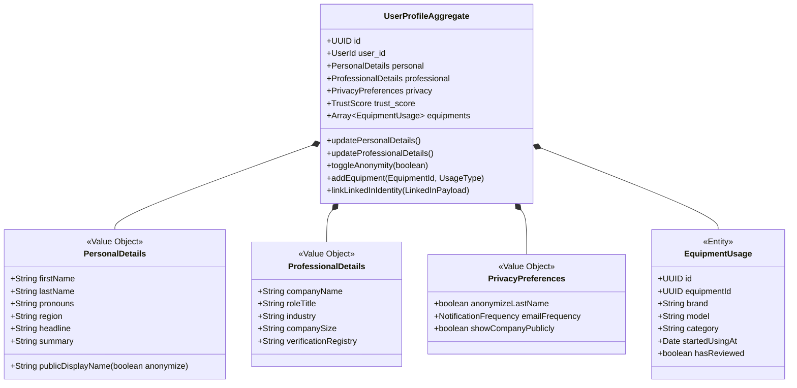
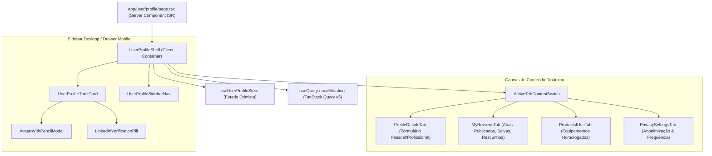
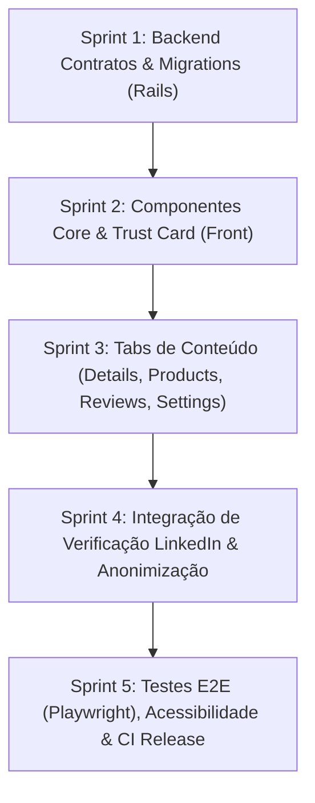

# PDR & Especificação Técnica — Central de Perfil & Reputação do Usuário B2B (Padrão G2)

> **Documento:** Product Definition & Technical Specification (PDR)  
> **Referência Visual/Estrutural:** G2 User Profile & Account Management (`g2-web/`)  
> **Plataforma de Destino:** Avalia Solar 2026 (`AB0-1-front` + `AB0-1-back`)  
> **Status:** Aprovado para Implementação Técnica  
> **Data:** 17 de Novembro de 2026  

---

## 1. PDR (Product Definition & Requirements)

### 1.1 Visão Geral do Produto
O **Avalia Solar 2026** é o portal de referência em reputação e avaliação de energia solar no Brasil. Até hoje, a área do usuário no frontend (`/review-dashboard/profile`) funcionava como um formulário administrativo simples e monocórdico.

Esta iniciativa transforma essa área na **Central de Reputação & Identidade B2B do Avaliador e Integrador**, espelhando o padrão internacional consolidado do **G2**:
* O usuário deixa de ser uma entidade anônima e passa a ter um **Card de Confiança (Trust Anchor)** com comprovação de senioridade, vínculos corporativos e verificação profissional via LinkedIn/CREA/CFT.
* Separação clara entre **Identidade Pessoal**, **Equipamentos Utilizados (Products I Use)**, **Minhas Avaliações (Reviews)** e **Privacidade com Anonimização Seletiva ("Felipe M.")**.

### 1.2 User Personas
1. **Integrador / Instalador Solar:** Deseja comprovar autoridade técnica, exibir equipamentos que homologa/instala e construir reputação pública para gerar leads de alto ticket.
2. **Engenheiro / Consultor Fotovoltaico:** Utiliza o portal para avaliar soluções, homologações de inversores e validar fabricantes.
3. **Consumidor Residencial / Comercial (B2B):** Avalia a empresa contratada, acompanha o status da sua avaliação e exige controle rigoroso sobre a visibilidade do seu nome para evitar exposição comercial.

### 1.3 Metas de Negócio & KPIs
| Métrica (KPI) | Situação AS-IS | Meta TO-BE (30 dias pós-lançamento) |
| :--- | :--- | :--- |
| **Taxa de Conclusão de Perfil (Profile Completion)** | 24% | **≥ 68%** |
| **Perfis com Verificação de Identidade (LinkedIn/Work Email)** | 5% | **≥ 35%** |
| **Equipamentos Cadastrados por Avaliador ("Products I Use")** | 0.4 produtos | **≥ 3.2 produtos por avaliador ativo** |
| **Engajamento com Avaliações (Rascunhos -> Publicadas)** | 42% | **≥ 75%** |
| **NPS do Usuário / Facilidade de Gerenciamento de Conta** | 61 | **≥ 84** |

### 1.4 User Stories (BDD / Gherkin)

#### US-01: Verificação de Identidade Profissional (LinkedIn OAuth)
```gherkin
Cenário: Integrador conecta perfil profissional do LinkedIn
  Dado que o usuário autenticado acessa a Central de Perfil
  Quando clica no botão "Verificar com LinkedIn" no Card de Confiança
  E conclui o handshake OAuth com sucesso
  Então o sistema armazena o token seguro e o cargo verificado
  E exibe o badge "Profissional Verificado LinkedIn" no Card de Confiança
  E incrementa o Trust Score do perfil em +25 pontos.
```

#### US-02: Anonimização Inteligente ("Felipe M.")
```gherkin
Cenário: Usuário opta por ocultar sobrenome em avaliações públicas
  Dado que o usuário está na aba "Configurações & Privacidade"
  Quando ativa o toggle "Exibir apenas primeiro nome e inicial"
  E clica em "Salvar Preferências"
  Então suas avaliações públicas passam a exibir "Felipe M." em vez de "Felipe Henriques Morais"
  E o status de verificação corporativa continua preservado sem quebrar o sigilo.
```

#### US-03: Mapeamento de Equipamentos Utilizados (Products I Use)
```gherkin
Cenário: Usuário adiciona um inversor ao seu catálogo de uso
  Dado que o usuário está na aba "Equipamentos Utilizados"
  Quando clica em "+ Adicionar Equipamento"
  E seleciona a marca "WEG" e o modelo "Inversor String 5kW"
  Então o equipamento é listado na sua estante com o badge "Homologado"
  E o sistema sugere um CTA contextual "Deixar Avaliação sobre este Equipamento".
```

---

## 2. GAP Analysis (AS-IS versus TO-BE)

| Dimensão | Situação AS-IS (`review-dashboard/profile`) | Situação TO-BE (Inspirada no G2) | Impacto / Esforço |
| :--- | :--- | :--- | :--- |
| **Layout & Ergonomia** | Coluna única monolítica com formulário corrido e rolagem longa | **Layout 2 Colunas Fluidas**: Sidebar Fixa com Trust Card + Canvas de Conteúdo dinâmico | 🔴 Alto / Médio |
| **Prova Social & Autoridade** | Sem tempo de casa ou destaque de cargo/empresa | **Card de Confiança**: Foto, Cargo, Empresa, Tempo de Membro (*Member since 2025*) | 🟡 Médio / Baixo |
| **Verificação Externa** | Apenas e-mail e senha convencionais | **Handshake de Verificação LinkedIn/CREA** com selo auditável | 🔴 Alto / Médio |
| **Gestão de Equipamentos** | Chips rudimentares sem filtros ou estados vazios ilustrados | **"Equipamentos Utilizados"**: Abas *Meus Equipamentos* e *Comparados*, busca e CTAs | 🟡 Médio / Médio |
| **Privacidade** | Sem opção de anonimização; dados ficam expostos | **Configurações Granulares**: Ocultar sobrenome, frequência de alertas (Imediato, Diário, Semanal, Nunca) | 🟢 Médio / Baixo |
| **Navegação** | Sem navegação por abas na URL | **Roteamento por Query/Hash (`?tab=...#main`)** com suporte a deep-linking e histórico | 🟡 Médio / Baixo |
| **Design System** | Estilos genéricos misturando classes legadas | **Design Tokens AS-EDS**: Claymorphism suave, cores institucionais e mobile-first | 🔴 Alto / Médio |

---

## 3. Domain-Driven Design (DDD) & Modelagem de Domínio

### 3.1 Bounded Context: `UserIdentityAndReputation`



### 3.2 Invariantes de Negócio & Regras do Domínio
1. **Regra de Exibição Pública:** Se `PrivacyPreferences.anonymizeLastName == true`, qualquer chamada pública da API ou renderização do perfil DEVE mascarar o sobrenome como `First Name + Inicial.` (ex: "Felipe M.").
2. **Cálculo de Trust Score:**
   * E-mail confirmado: +15 pts
   * Foto de perfil válida: +15 pts
   * Vínculo corporativo (Cargo + Empresa): +20 pts
   * Verificação LinkedIn / CREA aprovada: +30 pts
   * Pelo menos 1 equipamento cadastrado: +20 pts
   * *Total máximo: 100 pontos.*
3. **Integridade de Equipamentos:** Um usuário não pode cadastrar o mesmo modelo de equipamento mais de uma vez na categoria "Meus Equipamentos".

---

## 4. Contratos de API (REST / JSON OpenAPI 3.1)

### 4.1 `GET /api/v1/reviewer/profile`
Retorna os dados completos da Central do Usuário.

```json
{
  "data": {
    "id": "usr_99f2b8a1",
    "trust_anchor": {
      "full_name": "Felipe Henriques Morais Almeida",
      "display_name": "Felipe M.",
      "avatar_url": "https://cdn.avaliasolar.com.br/avatars/usr_99f2b8a1.webp",
      "role": "Founder",
      "company": "Avalia Solar",
      "member_since": "2025-01-17T00:00:00Z",
      "is_verified": true,
      "verification_type": "linkedin",
      "trust_score": 85,
      "connected_accounts": ["linkedin", "google"]
    },
    "personal_details": {
      "first_name": "Felipe Henriques",
      "last_name": "Morais Almeida",
      "pronouns": "He/Him",
      "region": "São Paulo, SP",
      "headline": "Founder at Avalia Solar | Solar Energy & Marketplace Trust",
      "summary": "Profissional focado em transparência e reputação no setor solar fotovoltaico."
    },
    "professional_details": {
      "company_name": "Avalia Solar",
      "industry": "Energia Solar & Renováveis",
      "company_size": "11-50",
      "role_function": "Diretoria / Executivo"
    },
    "privacy_settings": {
      "anonymize_last_name": true,
      "email_frequency": "weekly",
      "profile_visibility": "public"
    },
    "stats": {
      "reviews_count": 0,
      "saved_reviews_count": 2,
      "drafts_count": 1,
      "equipments_count": 3
    }
  }
}
```

### 4.2 `PATCH /api/v1/reviewer/profile`
Atualiza dados pessoais, profissionais ou de privacidade.

*Payload de Requisição:*
```json
{
  "personal_details": {
    "first_name": "Felipe Henriques",
    "last_name": "Morais Almeida",
    "pronouns": "He/Him",
    "headline": "Diretor de Operações e Homologação Solar"
  },
  "privacy_settings": {
    "anonymize_last_name": true,
    "email_frequency": "daily"
  }
}
```

---

## 5. System Design & Arquitetura Frontend

### 5.1 Diagrama de Componentes (Next.js 14 App Router)



### 5.2 Estratégia de Cache e Revalidação
* **Leitura Inicial:** Carregamento via TanStack Query com `staleTime: 5 * 60 * 1000` (5 minutos).
* **Mutações:** *Optimistic UI Update* imediato com rollback e toast de erro (`sonner`) caso a API Rails falhe.
* **Persistência de Tab:** URL Search Params sincronizados (`?tab=profile_details`, `?tab=products_used`). O usuário pode dar F5 ou compartilhar a aba sem perder a navegação.

---

## 6. Design System & Adaptação para o Avalia Solar

### 6.1 Mapeamento da Paleta de Cores Institucionais
O G2 usa tons escuros e cinzas neutros corporativos. No **Avalia Solar**, aplicamos a paleta com foco em energia limpa, luminosidade e elegância:

| Papel no Design | Token Avalia Solar | Hexadecimal | Equivalente no G2 |
| :--- | :--- | :--- | :--- |
| **Primária / Ação** | `brand.blue.DEFAULT` | `#2563EB` (Azul Royal) | `#1649E5` / Roxo G2 |
| **Hover Primário** | `brand.blue.hover` | `#1D4ED8` | Azul Escuro G2 |
| **Superfície Suave** | `brand.blue.soft` | `#EFF6FF` (Azul Gelo) | `#F4F5F7` |
| **Selo Verificado** | `brand.green.DEFAULT` | `#10B981` (Verde Esmeralda) | `#008060` |
| **Texto de Título** | `brand.navy` | `#0F172A` (Azul Meia-Noite) | `#1A202C` |
| **Texto Secundário** | `brand.muted` | `#64748B` (Ardósia Suave) | `#718096` |
| **Fundo de Página** | `brand.bg` | `#F8FAFC` | `#FAFAFA` |
| **Bordas / Divisórias**| `brand.border` | `#E2E8F0` | `#E2E8F0` |

### 6.2 Geometria, Espaçamento e Superfícies
* **Raios de Borda (Border Radius):**
  * Cards principais e canvas: `rounded-2xl` (16px) com borda fina cristalina `border border-slate-200/80`.
  * Inputs e Botões: `rounded-xl` (12px) com foco em anel `focus:ring-2 focus:ring-blue-500/20`.
  * Badges e Pills: `rounded-full` (9999px).
* **Elevação (Claymorphism & Soft Shadows):**
  * `box-shadow: 0 4px 20px -2px rgba(15, 23, 42, 0.05), 0 2px 6px -1px rgba(15, 23, 42, 0.02)`.
* **Tipografia:**
  * H1 (Título da Seção): `text-2xl font-bold text-brand-navy tracking-tight`.
  * H2 (Subseções): `text-lg font-semibold text-brand-navy`.
  * Labels: `text-sm font-medium text-slate-700`.
  * Help Texts / Hints: `text-xs text-brand-muted`.

### 6.3 Responsividade Mobile-First
* **Mobile (< 1024px):**
  * O Trust Card fica no topo, compacto em formato de barra de resumo (avatar menor 56x56px, nome, badge e barra de progresso horizontal).
  * O menu lateral de 10 abas se transforma em uma **Barra de Navegação Horizontal com Rolagem Suave (Snap Carousel Tabs)** ou um **Menu Dropdown / Drawer expansível**.
* **Desktop (≥ 1024px):**
  * Grid de 4 colunas: Coluna lateral fixa (1 coluna, 280px-320px) com o Trust Card vertical e navegação em lista + Canvas principal à direita (3 colunas).

---

## 7. Catálogo Modular de Componentes (`ComponentList`)

| Componente | Caminho do Arquivo | Função Principal |
| :--- | :--- | :--- |
| `UserProfileShell` | `components/user-profile/UserProfileShell.tsx` | Container responsivo com layout 2 colunas e sincronização de abas na URL |
| `UserProfileTrustCard` | `components/user-profile/UserProfileTrustCard.tsx` | Card lateral com avatar, nome, cargo, empresa, tempo de casa e botão LinkedIn |
| `UserProfileSidebarNav` | `components/user-profile/UserProfileSidebarNav.tsx` | Lista vertical de navegação com ícones, badges de contagem e estado ativo |
| `ProfileDetailsTab` | `components/user-profile/tabs/ProfileDetailsTab.tsx` | Formulário de dados pessoais, profissionais e headline |
| `ProductsIUseTab` | `components/user-profile/tabs/ProductsIUseTab.tsx` | Estante de equipamentos utilizados com estado vazio ilustrado e CTA |
| `MyReviewsTab` | `components/user-profile/tabs/MyReviewsTab.tsx` | Gerenciamento de avaliações (Publicadas, Salvas e Rascunhos) |
| `PrivacySettingsTab` | `components/user-profile/tabs/PrivacySettingsTab.tsx` | Toggle de anonimização ("Felipe M.") e frequência de alertas |
| `LinkedInVerifyButton` | `components/user-profile/LinkedInVerifyButton.tsx` | Botão interativo com estados de verificação e trust score |

---

## 8. TDD & Estratégia de Testes

### 8.1 Testes Unitários e de Componente (Jest + React Testing Library)
* `UserProfileTrustCard.spec.tsx`:
  * Deve renderizar nome, cargo e empresa corretamente.
  * Deve exibir "Membro desde [Data Formatada]".
  * Deve disparar modal de verificação ao clicar no botão do LinkedIn.
* `PrivacySettingsTab.spec.tsx`:
  * Deve permitir alternar o toggle de anonimização.
  * Deve enviar payload correto na mutação da API.
* `ProductsIUseTab.spec.tsx`:
  * Deve renderizar a ilustração de estado vazio quando não houver equipamentos cadastrados.
  * Deve listar os equipamentos com botão de remover e avaliar quando existirem dados.

### 8.2 Testes de Contrato de API (RSpec no Backend Rails)
* `spec/requests/api/v1/reviewer/profile_spec.rb`:
  * `GET /api/v1/reviewer/profile` autenticado deve retornar 200 e a estrutura JSON esperada.
  * `PATCH /api/v1/reviewer/profile` deve atualizar campos e validar constraints de tamanho.
  * Teste de segurança: Garantir isolamento do usuário (não permitir atualizar dados de outro usuário - IDOR prevention).

---

## 9. Tasklist & Roadmap de Execução



### Tarefas Detalhadas:
- [ ] **Task 1.1 (Back):** Validar colunas e campos no model `User` e `ReviewerProfile` (headline, pronomes, região, anonimize_last_name).
- [ ] **Task 1.2 (Back):** Implementar ou expandir serializer `ReviewerProfileSerializer` com dados de confiança e estatísticas.
- [ ] **Task 1.3 (Back):** Criar specs RSpec para endpoints `GET` e `PATCH` de profile.
- [ ] **Task 2.1 (Front):** Criar tokens e componentes atômicos (`UserProfileTrustCard`, `LinkedInVerifyButton`).
- [ ] **Task 2.2 (Front):** Implementar navegação responsiva `UserProfileSidebarNav` (Mobile Tabs vs Desktop Sidebar).
- [ ] **Task 3.1 (Front):** Desenvolver aba `ProfileDetailsTab` com validação Zod + React Hook Form.
- [ ] **Task 3.2 (Front):** Desenvolver aba `ProductsIUseTab` com empty state e catálogo de inversores/módulos.
- [ ] **Task 3.3 (Front):** Desenvolver aba `PrivacySettingsTab` com toggle "Exibir apenas primeiro nome e inicial".
- [ ] **Task 4.1 (Front/Back):** Conectar fluxo OAuth / Handshake simulado de verificação de credencial profissional.
- [ ] **Task 5.1 (QA):** Escrever suíte de testes E2E no Playwright (`tests/e2e/user-profile-g2.spec.ts`).
- [ ] **Task 5.2 (CI):** Executar quality gates locais e abrir PR sem quebrar testes existentes.

