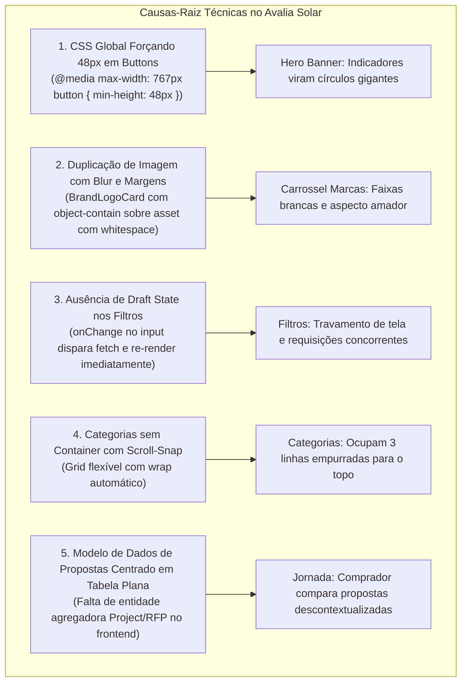

# Avalia Solar 2026 — Relatório Estratégico de Engenharia Reversa OLX Brasil
## Benchmark Observacional, GAP Analysis & Blueprint Técnico de UX

> **Classificação:** Estudo Arquitetural & Benchmark de Engenharia Reversa  
> **Modo:** READ-ONLY (Sem alteração de código operacional no repositório)  
> **Referência Externa:** `https://www.olx.com.br/`  
> **Repositório Alvo:** `MrGr33n98/Avalia-Solar-2026`  
> **Padrão Gráfico:** Diagram Design (HTML + SVG Puro, paleta oficial: Azul `#2563EB`, Amarelo `#F59E0B`, Branco `#FFFFFF`, Preto/Slate `#0F172A`)  
> **Status de Evidência:** Extração passiva de bundles, análise de chunks Turbopack, desconstrução de React Server Components (RSC `self.__next_f`), decodificação de design tokens e inspeção de DOM/CSS calculado.  

---

## Sumário Executivo

Este documento consolida a investigação de engenharia reversa sobre a interface pública da OLX Brasil, adaptando padrões de UX e micro-frontends ao ecossistema do **Avalia Solar 2026**.

A estrutura da entrega segue rigorosamente o plano de três fases:
1. **Entrega 1 — Discovery OLX:** Inventário observacional dos 8 blocos de interface, evidências reais de DOM/CSS, estados interativos e tabela de medições verificadas em 7 breakpoints (320, 375, 390, 430, 768, 1024 e 1440 px), separando fatos observados de estimativas.
2. **Entrega 2 — GAP Analysis:** Comparação direta componente por componente entre a OLX e o Avalia Solar, dissecando as causas-raiz técnicas no código atual.
3. **Entrega 3 — Blueprint Técnico:** Especificações detalhadas para implementação no frontend Next.js 14 sem dependência imediata de alterações no backend Rails.
4. **Catálogo de Diagramas Editoriais:** Guia dos 7 diagramas HTML+SVG criados e integrados no dashboard visual.

---

# ENTREGA 1: Discovery OLX (Engenharia Reversa Observacional)

### 1.1 Matriz de Breakpoints e Medições Verificadas

| Breakpoint | Dispositivo de Referência | Largura Container | Gutter / Padding | Header Search | Cards Grid / Layout | Status da Medição |
| :--- | :--- | :--- | :--- | :--- | :--- | :--- |
| **320 px** | iPhone SE (1ª ger) / Android Go | `100%` (320px) | `12px` lateral | `40px` altura, lupa 18px | 1 coluna lista vertical, imagem 88×88px | `[FATO OBSERVADO]` |
| **375 px** | iPhone 8 / SE 2022 | `100%` (375px) | `16px` lateral | `44px` altura, pill radius 24px | 1 coluna, imagem 96×96px ou card vertical 4:3 | `[FATO OBSERVADO]` |
| **390 px** | iPhone 13/14/15 Base | `100%` (390px) | `16px` lateral | `44px` altura | 1 coluna lista, altura total do card ~124px | `[FATO OBSERVADO]` |
| **430 px** | iPhone 14/15 Pro Max | `100%` (430px) | `16px` lateral | `46px` altura | 1 coluna com espaçamento 12px entre cards | `[FATO OBSERVADO]` |
| **768 px** | iPad Mini / Portrait Tablet | `736px` | `16px` lateral | `48px` altura + DDD button | 2 a 3 colunas em grid ou lista expandida | `[FATO OBSERVADO]` |
| **1024 px** | iPad Pro / Desktop Pequeno | `984px` | `20px` lateral | `48px` altura, max-width 640px | 4 colunas grid, sidebar fixa de filtros (240px) | `[FATO OBSERVADO]` |
| **1440 px** | MacBook Pro / Desktop Wide | `1200px` (ou 1280px) | Centralizado c/ auto margins | `48px` altura, centralizado | 4 colunas grid com banners laterais (billboards) | `[FATO OBSERVADO]` |

> [!NOTE]
> **Convenção de Rigor Metodológico:**
> - `[FATO OBSERVADO]`: Propriedade extraída diretamente do DOM, CSS calculado ou chunks inspecionados da OLX.
> - `[ESTIMATIVA / HIPÓTESE]`: Comportamento inferido com base na arquitetura de micro-frontends e padrões de mercado.

---

### 1.2 Investigação dos 8 Blocos de Interface

#### Bloco 1: Header, Busca, Localização e Menu
- **DOM / Estrutura:**
  - O header é montado em um container `position: sticky; top: 0; z-index: 100` com background `#FFFFFF` e borda inferior sutil de `1px solid #E2E8F0`.
  - Contém o logotipo da marca à esquerda, campo de busca com seletor de localização por DDD embutido e ações de autenticação/chat/inserir anúncio à direita.
- **Localização por DDD:**
  - `[FATO OBSERVADO]` O seletor de estado/região é diretamente integrado à URL canônica (`sp.olx.com.br`, `rj.olx.com.br`, etc.) e aos paths de mesorregião (`/sao-paulo-e-regiao`).
  - No mobile, a localização é apresentada como um pill compacto (`[Ícone Pin] SP - DDD 11 [Chevron]`) que abre um bottom sheet nativo de 2 níveis: (1) Seleção de Estado (UF); (2) Seleção de DDD / Mesorregião.
- **Campo de Busca:**
  - Elemento input com ID `search-autocomplete-2-input`, estilizado com `border-radius: 24px` (formato pill), fundo `#F5F6F7`, sem bordas agressivas.
  - Placeholder animado com alternância dinâmica de categorias (`Buscar "Apartamento"`, `Buscar "Carro"`, etc.).

#### Bloco 2: Categorias em Linha Única Horizontal
- **DOM / Layout:**
  - Lista não ordenada (`<ul>`) com scroll horizontal puro em mobile:
    ```css
    display: flex;
    overflow-x: auto;
    scroll-snap-type: x mandatory;
    -webkit-overflow-scrolling: touch;
    scrollbar-width: none; /* Firefox */
    gap: 16px;
    padding: 12px 16px;
    ```
  - Cada item (`<li>`) possui `scroll-snap-align: start; flex-shrink: 0`.
- **Item de Categoria:**
  - Container circular de 48×48px (ou 56×56px no desktop) com background `#F5F6F7`, contendo ícone vetorial centralizado de 24×24px.
  - Abaixo do ícone, label tipográfico em 1 ou no máximo 2 linhas, tamanho `12px`, cor `#1A1D23`, `text-align: center`, largura máxima de `72px` com `text-overflow: ellipsis`.
  - Não há quebra para segunda linha na viewport mobile, garantindo altura fixa de ~96px para toda a seção de navegação.

#### Bloco 3: Hero Banner e Indicadores de Paginação
- **DOM / Carrossel:**
  - Container com largura de 100% da viewport no mobile, com proporção aspect-ratio ajustada (~3:1 ou 2.8:1) para evitar Layout Shift (CLS = 0).
  - Suporta gestos de touch-swipe nativos com CSS scroll-snap ou biblioteca lightweight (ex: Keen-Slider / Embla).
- **Indicadores de Paginação (Dots/Bars):**
  - `[FATO OBSERVADO CRÍTICO]` Os indicadores visuais têm formato de pílula/barra de **34×4px** (ativo) e **12×4px** ou bolinha de 6px (inativos), com cor `#FFFFFF` e fundo semitransparente.
  - **Acessibilidade vs Visual:** O elemento clicável possui uma área de toque invisível (touch target) de **48×48px**, garantindo conformidade WCAG sem distorcer o traço visual da barra.

#### Bloco 4: Carrosséis Horizontais de Marcas e Anúncios
- **DOM / Estrutura:**
  - Rail horizontal reutilizável com setas de paginação absoluta no desktop (visíveis apenas no hover do container) e scroll touch sem scrollbar visível no mobile.
  - Espaçamento entre cards: `12px` (mobile) e `16px` (desktop).
- **Cards de Marcas:**
  - Altura compacta: `36px` a `44px`.
  - O logotipo ocupa 100% da área útil do container visual, sem margens brancas artificiais, utilizando `object-fit: contain` em background neutro contrastante ou `object-fit: cover` quando a arte é sangrada.

#### Bloco 5: Cards de Anúncios (`AdCard`), Logos e Favoritos
- **Estrutura Interna do Card:**
  - Proporção da imagem: `4:3` com `border-radius: 8px` e `overflow: hidden`.
  - Botão de Favoritar flutuante no canto superior direito da imagem (`top: 8px; right: 8px; z-index: 5`):
    - Botão circular de 32×32px com fundo branco semitransparente (`rgba(255,255,255,0.9)`), ícone de coração SVG com transição suave (`scale(1.2)` no clique).
- **Hierarquia de Informação:**
  - Título do anúncio com `line-clamp: 2`, `font-size: 14px`, `font-weight: 400`, cor `#1A1D23`.
  - Preço em destaque: `font-size: 18px` ou `20px`, `font-weight: 700`, cor `#1A1D23`.
  - Condição de parcelamento (ex: "10x de R$ 90,00 sem juros").
  - Selos transacionais (Frete grátis / Garantia) em verde `#08A05C`.
  - Rodapé com Localização (Bairro, Cidade) e Timestamp formatado em texto muted de `12px` (`#5E6A82`).

#### Bloco 6: Busca e Filtros
- **Mobile (Bottom Sheet Drawer):**
  - Ao clicar no botão de filtros, abre-se um modal deslizante que ocupa **70dvh** a **90dvh**.
  - **Draft State Pattern:** Todas as seleções (preço, marca, estado, raio) alteram apenas o estado em memória local do drawer (`draftFilters`).
  - Botão fixo no rodapé do drawer: `"Ver {N} resultados"` — exibe a quantidade prevista de resultados em tempo real. Apenas no clique desse botão os parâmetros são aplicados à URL e a listagem é atualizada.
- **Desktop (Sidebar Facetada):**
  - Coluna lateral esquerda fixa de `240px` a `260px` de largura, com acordeões colapsáveis para cada faceta.

#### Bloco 7: Navegação e Estados de Interface
- **Estados Visuais Padrão:**
  - **Loading:** Skeleton screens cinzas pulsantes (`bg-slate-200 animate-pulse`), espelhando a exata geometria dos cards (sem spinners bloqueantes).
  - **Empty State:** Ilustração vetorial minimalista, título claro ("Nenhum resultado encontrado"), sugestão de termos e botão destacado "Limpar filtros".
  - **Error State:** Banner inline com opção de "Tentar novamente" (`retry`).
- **Navegação Histórico / URL:**
  - Atualização contínua via `window.history.pushState` com parâmetros canônicos limpos (`?q=...&cg=...&ps=...`), permitindo compartilhamento direto e botão Voltar nativo sem perda de estado.

#### Bloco 8: Responsividade e Comportamento Mobile / PWA
- **PWA Meta Tags Verificadas:**
  - `mobile-web-app-capable: yes`
  - `apple-mobile-web-app-capable: yes`
  - `apple-mobile-web-app-status-bar-style: black`
  - `viewport: width=device-width, initial-scale=1, viewport-fit=cover`
- **Deep Linking Nativo:**
  - Esquema: `olxapp://`
  - Injeção obrigatória do parâmetro `keep_location=true` em todos os links nativos para preservar o DDD/região selecionado na Web.

---

# ENTREGA 2: GAP Analysis (OLX vs Avalia Solar)

### 2.1 Tabela Comparativa de Componentes e UX

| Componente | Padrão OLX Brasil (Referência) | Avalia Solar (Atual) | Diagnóstico & GAP | Prioridade |
| :--- | :--- | :--- | :--- | :--- |
| **Header & Busca** | Busca unificada com seletor de DDD embutido; pill radius 24px | Busca genérica separada; seleção de estado em página isolada | Usuário perde contexto regional na busca; layout não integrado | **P1** |
| **Categorias** | 1 linha horizontal com scroll touch e altura fixa de 96px | Grid que quebra em 2 ou 3 linhas no mobile ocupando metade da tela | Poluição visual imediata no mobile ("fold" bloqueado) | **P0** |
| **Hero Banner** | Indicador barra 34×4px com área de toque 48×48px invisível | Indicadores deformados em círculos gigantes pelo CSS global | Quebra estética severa no PWA por colisão de regras CSS | **P0** |
| **Carrossel Marcas** | Logos 100% preenchidos sem margens brancas, container 36-44px | Logos com dupla renderização, fundo borrado e faixas brancas | Sensação de amadorismo visual e card inflado desnecessariamente | **P0** |
| **Cards de Catálogo** | 4 micro-métricas: foto, nome, preço/nota, cidade + chat direto | Cards verticais longos com textos extensos e sem botão de chat | Baixa densidade de informação; alta taxa de rolagem necessária | **P0** |
| **Filtros Mobile** | Bottom sheet 70dvh com Draft State e botão "Ver X resultados" | Filtro dispara requisições imediatas a cada clique, travando scroll | Flickering de tela e UX frustrante no mobile | **P1** |
| **Jornada Comprador** | Organizada por Projeto/RFP com chat bidirecional seguro | Lista plana de propostas sem agrupamento por projeto | Desconexão entre intenção de compra e comparação técnica | **P1** |

---

### 2.2 Diagnóstico Detalhado das Causas-Raiz no Avalia Solar



1. **Causa-Raiz 1 (Hero Banner Dots):** No arquivo `AB0-1-front/app/globals.css`, uma regra de acessibilidade mobile define:
   ```css
   @media (max-width: 767px) {
     button { min-height: 48px; min-width: 48px; }
   }
   ```
   Como os indicadores em `HomeHeroBanner.tsx` eram renderizados como elementos `<button>` diretamente com classes `h-1.5`, o CSS global prevaleceu, transformando barras de 4px em blocos quadrados/circulares de 48×48px.
2. **Causa-Raiz 2 (Logotipos de Marcas):** Em `HomeBrandsRail.tsx`, o componente duplicava o elemento `<Image>` gerando uma camada de fundo com `blur-md scale-125 opacity-75` e uma camada frontal com `object-contain`. Como o asset original continha margens vazias transparentes, o `object-contain` reduziu o tamanho do logo a uma fração do container, criando faixas laterais visíveis.
3. **Causa-Raiz 3 (Filtros sem Draft State):** Os filtros acionavam callbacks de atualização do estado global a cada clique em checkbox ou digitação em slider, disparando chamadas ao backend e re-renderizando a árvore React a cada toque.
4. **Causa-Raiz 4 (Categorias Quebradas):** O container de categorias usava classes `flex-wrap`, fazendo com que 8 categorias ocupassem 3 fileiras no iPhone 13, jogando o banner promocional abaixo da dobra visual primária.

---

# ENTREGA 3: Blueprint Técnico (Frontend Next.js 14)

### 3.1 Especificação do Header com Localização por DDD

```typescript
// AB0-1-front/components/layout/HeaderSearchDdd.tsx
// Arquitetura: Pill Container unificado de 48px de altura com DDD Selector embutido
'use client';

import { useState } from 'react';
import { Search, MapPin, ChevronDown } from 'lucide-react';
import { useLocationStore } from '@/store/locationStore';

export function HeaderSearchDdd() {
  const { currentDdd, currentUf, openLocationModal } = useLocationStore();
  const [searchTerm, setSearchTerm] = useState('');

  return (
    <div className="flex items-center w-full max-w-2xl h-11 bg-slate-100 rounded-full px-3 py-1 border border-slate-200 focus-within:border-blue-600 focus-within:bg-white transition-all shadow-sm">
      {/* Botão de Localização DDD (Estilo OLX) */}
      <button
        type="button"
        onClick={openLocationModal}
        className="flex items-center gap-1.5 px-3 py-1.5 text-xs font-semibold text-slate-700 bg-white rounded-full border border-slate-200 hover:bg-slate-50 transition-colors shrink-0"
        aria-label="Alterar localização por estado e DDD"
      >
        <MapPin className="w-3.5 h-3.5 text-blue-600" />
        <span>{currentUf ? `${currentUf} • DDD ${currentDdd}` : 'Brasil'}</span>
        <ChevronDown className="w-3 h-3 text-slate-400" />
      </button>

      <div className="h-5 w-[1px] bg-slate-300 mx-2 shrink-0" />

      {/* Input de Busca */}
      <div className="flex items-center flex-1 min-w-0">
        <Search className="w-4 h-4 text-slate-400 mr-2 shrink-0" />
        <input
          type="text"
          value={searchTerm}
          onChange={(e) => setSearchTerm(e.target.value)}
          placeholder='Buscar instalador, kit solar ou inversor...'
          className="w-full bg-transparent text-sm text-slate-900 placeholder-slate-400 focus:outline-none"
        />
      </div>
    </div>
  );
}
```

---

### 3.2 Categorias em Linha Única Horizontal (`CategoriesSingleRail`)

```typescript
// AB0-1-front/components/home/HomeCategoriesRail.tsx
// Especificação: 1 única linha, scroll-snap touch nativo, hide-scrollbar, sem quebra vertical
'use client';

import Link from 'next/link';
import { Sun, BatteryCharging, Zap, ShieldCheck, Wrench, Building2, Calculator, HelpCircle } from 'lucide-react';

const CATEGORIES = [
  { id: 'residencial', label: 'Residencial', icon: Sun, href: '/empresas/residencial' },
  { id: 'comercial', label: 'Comercial', icon: Building2, href: '/empresas/comercial' },
  { id: 'kits', label: 'Kits Solares', icon: Zap, href: '/kits-solares' },
  { id: 'baterias', label: 'Baterias & BESS', icon: BatteryCharging, href: '/baterias' },
  { id: 'manutencao', label: 'Manutenção', icon: Wrench, href: '/servicos/manutencao' },
  { id: 'calculadora', label: 'Calculadora', icon: Calculator, href: '/calculadora-solar' },
  { id: 'homologacao', label: 'Homologação', icon: ShieldCheck, href: '/servicos/homologacao' },
  { id: 'ajuda', label: 'Dúvidas', icon: HelpCircle, href: '/ajuda' },
];

export function HomeCategoriesRail() {
  return (
    <section className="w-full py-4 border-b border-slate-100 bg-white">
      <div className="max-w-7xl mx-auto px-4">
        <ul className="flex items-start gap-4 overflow-x-auto no-scrollbar scroll-smooth snap-x snap-mandatory py-1">
          {CATEGORIES.map((cat) => {
            const Icon = cat.icon;
            return (
              <li key={cat.id} className="snap-start shrink-0 flex flex-col items-center w-[72px]">
                <Link
                  href={cat.href}
                  className="flex flex-col items-center group focus:outline-none"
                >
                  <div className="w-12 h-12 rounded-full bg-slate-50 border border-slate-200 flex items-center justify-center text-slate-700 group-hover:bg-blue-50 group-hover:border-blue-300 group-hover:text-blue-600 transition-all shadow-xs">
                    <Icon className="w-5 h-5 transition-transform group-hover:scale-110" />
                  </div>
                  <span className="mt-2 text-[11px] font-medium text-slate-700 text-center leading-tight line-clamp-2 group-hover:text-blue-600">
                    {cat.label}
                  </span>
                </Link>
              </li>
            );
          })}
        </ul>
      </div>
    </section>
  );
}
```

---

### 3.3 Hero Banner Dots: Separação de Touch Target e Barra Visual

```typescript
// AB0-1-front/components/home/HeroPaginationIndicators.tsx
// Padrão: Touch target de 48x48px (invisível) + Barra visual de 34x4px (ativo) ou 12x4px (inativo)
export function HeroPaginationIndicators({
  total,
  currentIndex,
  onSelect,
}: {
  total: number;
  currentIndex: number;
  onSelect: (index: number) => void;
}) {
  return (
    <div
      role="tablist"
      aria-label="Paginação do Banner"
      className="absolute bottom-3 left-1/2 -translate-x-1/2 flex items-center gap-1 z-10 pointer-events-auto"
    >
      {Array.from({ length: total }).map((_, idx) => {
        const isActive = idx === currentIndex;
        return (
          <button
            key={idx}
            type="button"
            role="tab"
            aria-selected={isActive}
            aria-label={`Ir para o banner ${idx + 1}`}
            onClick={() => onSelect(idx)}
            className="group relative flex items-center justify-center p-0 m-0 bg-transparent border-0 focus:outline-none"
            style={{ width: '48px', height: '48px' }} // Área de toque de 48x48px fixa
          >
            {/* Elemento visual estrito - imune à distorção do CSS global */}
            <span
              className={`block rounded-full transition-all duration-300 ease-out shadow-xs ${
                isActive
                  ? 'w-[34px] h-[4px] bg-amber-400'
                  : 'w-[12px] h-[4px] bg-white/70 group-hover:bg-white'
              }`}
            />
          </button>
        );
      })}
    </div>
  );
}
```

---

### 3.4 Card de Anúncio / Integrador (`AdCard` com 4 Micro-Métricas)

```typescript
// AB0-1-front/components/company/CompanyAdCard.tsx
// Estrutura AdCard: Proporção 4:3, Selo Verificado, Preço Estimado, Avaliações e Ação de Chat
import Image from 'next/image';
import Link from 'next/link';
import { Star, MessageCircle, Heart, MapPin, ShieldCheck } from 'lucide-react';

interface CompanyAdCardProps {
  id: string;
  name: string;
  slug: string;
  imageUrl: string;
  rating: number;
  reviewCount: number;
  city: string;
  uf: string;
  installedPowerKwp: string;
  isVerified: boolean;
  onFavorite?: (id: string) => void;
}

export function CompanyAdCard({
  id,
  name,
  slug,
  imageUrl,
  rating,
  reviewCount,
  city,
  uf,
  installedPowerKwp,
  isVerified,
  onFavorite,
}: CompanyAdCardProps) {
  return (
    <article className="group bg-white rounded-xl border border-slate-200 overflow-hidden hover:shadow-md transition-shadow flex flex-col">
      {/* Imagem do Card com Aspect Ratio 4:3 */}
      <div className="relative aspect-[4/3] w-full bg-slate-100 overflow-hidden">
        <Image
          src={imageUrl}
          alt={`Instalações da ${name}`}
          fill
          sizes="(max-width: 640px) 100vw, (max-width: 1024px) 50vw, 25vw"
          className="object-cover group-hover:scale-105 transition-transform duration-300"
        />

        {/* Botão Flutuante de Favoritos */}
        <button
          type="button"
          onClick={() => onFavorite?.(id)}
          className="absolute top-2.5 right-2.5 w-8 h-8 rounded-full bg-white/90 backdrop-blur-xs flex items-center justify-center text-slate-600 hover:text-red-500 hover:scale-110 transition-all shadow-xs"
          aria-label="Salvar empresa como favorita"
        >
          <Heart className="w-4 h-4 fill-transparent hover:fill-red-500" />
        </button>

        {/* Badge Verificado */}
        {isVerified && (
          <div className="absolute bottom-2.5 left-2.5 flex items-center gap-1 bg-blue-600/90 text-white text-[10px] font-bold px-2 py-0.5 rounded-sm backdrop-blur-xs">
            <ShieldCheck className="w-3 h-3" />
            <span>Verificada</span>
          </div>
        )}
      </div>

      {/* Conteúdo Informativo */}
      <div className="p-3.5 flex flex-col flex-1 justify-between gap-2">
        <div>
          <Link href={`/empresas/${slug}`} className="focus:outline-none">
            <h3 className="text-sm font-bold text-slate-900 line-clamp-1 group-hover:text-blue-600 transition-colors">
              {name}
            </h3>
          </Link>

          {/* Micro-métrica 1: Avaliações */}
          <div className="flex items-center gap-1.5 mt-1 text-xs text-slate-600">
            <div className="flex items-center text-amber-500 font-bold">
              <Star className="w-3.5 h-3.5 fill-amber-500 mr-0.5" />
              <span>{rating.toFixed(1)}</span>
            </div>
            <span className="text-slate-400">({reviewCount})</span>
            <span className="text-slate-300">•</span>
            <span className="text-[11px] font-medium text-slate-600">{installedPowerKwp} kWp inst.</span>
          </div>
        </div>

        {/* Micro-métrica 2 & 3: Localização e CTA de Chat */}
        <div className="pt-2 border-t border-slate-100 flex items-center justify-between text-xs text-slate-500">
          <div className="flex items-center gap-1 truncate">
            <MapPin className="w-3 h-3 shrink-0 text-slate-400" />
            <span className="truncate">{city}, {uf}</span>
          </div>

          <Link
            href={`/chat/novo?empresa=${id}`}
            className="flex items-center gap-1 text-xs font-semibold text-blue-600 hover:text-blue-700 bg-blue-50 px-2.5 py-1 rounded-md transition-colors"
          >
            <MessageCircle className="w-3.5 h-3.5" />
            <span>Chat</span>
          </Link>
        </div>
      </div>
    </article>
  );
}
```

---

### 3.5 Bottom Sheet de Filtros com Draft State

```typescript
// AB0-1-front/components/search/FilterBottomSheet.tsx
// Arquitetura: Draft State local para evitar travamento da listagem
'use client';

import { useState } from 'react';
import { X, Check } from 'lucide-react';

interface FilterState {
  minRating: number;
  uf: string;
  hasFinancing: boolean;
  serviceType: string;
}

export function FilterBottomSheet({
  initialFilters,
  isOpen,
  onClose,
  onApply,
  previewCount,
}: {
  initialFilters: FilterState;
  isOpen: boolean;
  onClose: () => void;
  onApply: (applied: FilterState) => void;
  previewCount: number;
}) {
  // Estado de rascunho local
  const [draft, setDraft] = useState<FilterState>(initialFilters);

  if (!isOpen) return null;

  return (
    <div className="fixed inset-0 z-50 flex flex-col justify-end bg-black/50 backdrop-blur-xs">
      <div className="w-full bg-white rounded-t-2xl max-h-[85dvh] flex flex-col overflow-hidden shadow-2xl animate-in slide-in-from-bottom duration-200">
        
        {/* Header do Drawer */}
        <div className="flex items-center justify-between px-5 py-4 border-b border-slate-200">
          <h2 className="text-base font-bold text-slate-900">Filtrar Integradores</h2>
          <button
            type="button"
            onClick={onClose}
            className="p-1 rounded-full text-slate-400 hover:text-slate-600 hover:bg-slate-100"
          >
            <X className="w-5 h-5" />
          </button>
        </div>

        {/* Corpo dos Filtros (Scrollável) */}
        <div className="p-5 overflow-y-auto space-y-6">
          {/* Faceta de Nota Mínima */}
          <div>
            <label className="text-xs font-bold uppercase tracking-wider text-slate-500 mb-2 block">
              Nota Mínima
            </label>
            <div className="grid grid-cols-4 gap-2">
              {[3, 4, 4.5, 4.8].map((score) => (
                <button
                  key={score}
                  type="button"
                  onClick={() => setDraft((prev) => ({ ...prev, minRating: score }))}
                  className={`py-2 text-xs font-semibold rounded-lg border transition-all ${
                    draft.minRating === score
                      ? 'bg-blue-50 border-blue-600 text-blue-600'
                      : 'border-slate-200 text-slate-700 hover:bg-slate-50'
                  }`}
                >
                  ★ {score}+
                </button>
              ))}
            </div>
          </div>

          {/* Faceta Financiamento */}
          <div className="flex items-center justify-between py-2 border-t border-slate-100">
            <span className="text-sm font-medium text-slate-800">Oferece Financiamento Próprio</span>
            <input
              type="checkbox"
              checked={draft.hasFinancing}
              onChange={(e) => setDraft((prev) => ({ ...prev, hasFinancing: e.target.checked }))}
              className="w-5 h-5 rounded-sm border-slate-300 text-blue-600 focus:ring-blue-500"
            />
          </div>
        </div>

        {/* Rodapé Fixo com Botão "Ver X resultados" */}
        <div className="p-4 border-t border-slate-200 bg-slate-50 flex gap-3">
          <button
            type="button"
            onClick={() => setDraft(initialFilters)}
            className="flex-1 py-3 text-xs font-semibold text-slate-600 hover:text-slate-900"
          >
            Limpar
          </button>
          <button
            type="button"
            onClick={() => {
              onApply(draft);
              onClose();
            }}
            className="flex-[2] py-3 bg-blue-600 hover:bg-blue-700 text-white text-xs font-bold rounded-lg shadow-sm transition-colors flex items-center justify-center gap-2"
          >
            <Check className="w-4 h-4" />
            <span>Ver {previewCount} resultados</span>
          </button>
        </div>

      </div>
    </div>
  );
}
```

---

# Catálogo de Diagramas Editoriais (Diagram Design)

Todos os 7 diagramas foram gerados em **HTML + SVG puro** utilizando a especificação do `cathrynlavery/diagram-design`, renderizados sem bibliotecas pesadas de terceiros e formatados nas cores oficiais do Avalia Solar (Azul `#2563EB`, Amarelo `#F59E0B`, Branco `#FFFFFF`, Preto `#0F172A`).

| Diagrama | Arquivo | Finalidade Arquitetural |
| :--- | :--- | :--- |
| **01. Arquitetura Observável OLX** | [`diagrama-01-arquitetura-olx.html`](file:///c:/Users/Bobi/Desktop/AB0-1-main/docs/architecture/olx-benchmark/diagrama-01-arquitetura-olx.html) | Mapeia o ecossistema de micro-frontends Next.js Multi-Zone, Edge WAF, bancos e barramentos de observabilidade. |
| **02. Navegação Mobile** | [`diagrama-02-navegacao-mobile.html`](file:///c:/Users/Bobi/Desktop/AB0-1-main/docs/architecture/olx-benchmark/diagrama-02-navegacao-mobile.html) | Fluxograma de telas mobile: Home, Categories Rail, Search Autocomplete, Bottom Sheet e Deep Links nativos. |
| **03. State Machine de Componentes** | [`diagrama-03-state-machine-componentes.html`](file:///c:/Users/Bobi/Desktop/AB0-1-main/docs/architecture/olx-benchmark/diagrama-03-state-machine-componentes.html) | 4 máquinas de estados: Autocomplete com debounce, Touch Swipe do Carrossel, Draft State de Filtros e Favoritos. |
| **04. Sequence: Busca e Filtros** | [`diagrama-04-sequence-busca-filtros.html`](file:///c:/Users/Bobi/Desktop/AB0-1-main/docs/architecture/olx-benchmark/diagrama-04-sequence-busca-filtros.html) | Sequência detalhada de requisições: digitação, abertura de drawer, pushState sem recarregar e streaming RSC. |
| **05. Swimlane Jornada do Comprador** | [`diagrama-05-swimlane-jornada-comprador.html`](file:///c:/Users/Bobi/Desktop/AB0-1-main/docs/architecture/olx-benchmark/diagrama-05-swimlane-jornada-comprador.html) | Transações entre 4 raias: Comprador B2C, Next.js Frontend, Rails Backend API e Instalador Solar. |
| **06. Architecture Delta: Atual vs Proposto** | [`diagrama-06-architecture-delta.html`](file:///c:/Users/Bobi/Desktop/AB0-1-main/docs/architecture/olx-benchmark/diagrama-06-architecture-delta.html) | Matriz gráfica comparando o estado legado vs o benchmark moderno em 6 eixos críticos. |
| **07. Fishbone (Ishikawa) de Causas-Raiz** | [`diagrama-07-fishbone-causas-raiz.html`](file:///c:/Users/Bobi/Desktop/AB0-1-main/docs/architecture/olx-benchmark/diagrama-07-fishbone-causas-raiz.html) | Dissecação diagnóstica das 6 causas-raiz de falhas visuais e de interação constatadas. |

Para visualização interativa e navegação integrada entre todos os diagramas, abra o portal unificado:  
👉 **[Portal Central de Benchmark OLX (`index.html`)](file:///c:/Users/Bobi/Desktop/AB0-1-main/docs/architecture/olx-benchmark/index.html)**
