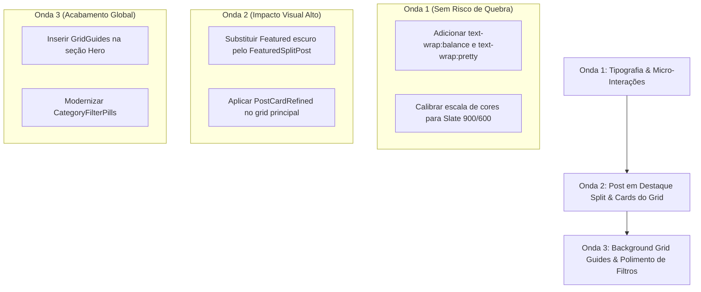

# Gap Analysis E2E de Layout & Design: Stripe Blog vs. Avalia Solar 2026
## Guia de Adaptação Técnica para Next.js 14, React 18 e Tailwind CSS

> **Data de Emissão:** 22 de Outubro de 2026  
> **Especialidade:** UX/UI Engineering, Design Systems & Frontend Architecture  
> **Benchmark Global:** The Stripe Blog (`https://stripe.com/blog`) via REA Scan  
> **Ambiente Alvo:** Avalia Solar Frontend (`AB0-1-front`, Next.js 14 App Router, Tailwind CSS, shadcn/ui)  
> **Status:** Documento Executivo & Blueprint de Implementação Prática

---

## 1. Visão Geral e Objetivo

Este documento estabelece o **Gap Analysis End-to-End (E2E) de Layout e Design** comparando a experiência visual e de interação da **Stripe** com o **Blog do Avalia Solar**. 

O objetivo não é clonar a Stripe superficialmente, mas sim **decodificar as regras matemáticas, tipográficas e espaciais que tornam o design da Stripe um benchmark mundial de prestígio** e demonstrar, com código real e imediato, **como adaptar esses princípios à nossa stack tecnológica (Next.js 14 App Router, React 18, Tailwind CSS e tokens AS-EDS)**, preservando integralmente o foco de **marketplace de alta conversão** do Avalia Solar (geração de leads, cotações solares e monetização de empresas verificadas).

---

## 2. Matriz de Gap Analysis E2E: Layout, Design e Interação

A tabela abaixo disseca cada micro-dimensão de layout e UI observada na captura da Stripe contra a implementação atual do Avalia Solar:

| Dimensão de Design | Como a Stripe Faz (`https://stripe.com/blog`) | Como o Avalia Solar Está Hoje | Diagnóstico do Gap | Como Adaptar na Nossa Stack (Next.js + Tailwind) |
| :--- | :--- | :--- | :--- | :--- |
| **1. Estrutura do Hero** | Título institucional sóbrio + sublinhado de categoria discreto. Sem busca intrusiva no hero; espaço para respiro. | Hero híbrido com texto + botões de simulação e imagem com corte em gradiente fade branco. | O hero do Avalia Solar tenta fazer muitas coisas ao mesmo tempo (editorial + simulador + imagem genérica recortada). | Unificar o Hero num layout editorial de alto impacto: tipografia editorial ampla, badge solar sutil e busca integrada elegante, sem gradiente que corte a foto abruptamente. |
| **2. Post em Destaque (Featured)** | **Layout Split Horizontal 50/50:** Metade esquerda é texto com fundo branco imaculado; metade direita é arte visual sem overlay escuro. | **Overlay Escuro (Card de Notícias Clássico):** Imagem grande com gradiente preto escuro por cima (`bg-gradient-to-t from-gray-950/90`). | O overlay escuro com texto branco reduz legibilidade e passa aspecto de portal de notícias genérico dos anos 2010. | Migrar o `FeaturedPostsSection` para o padrão **Editorial Split**: fundo branco, borda fina, arte visual com proporção 16:10 à direita e texto à esquerda com contraste AAA. |
| **3. Background & Grid Guides** | **60 linhas de guia (.Guides__guide):** Grid matemático sutil desenhado em linhas verticais semitransparentes (`border-l border-slate-200/40`). | Fundo plano (`#F8FAFC`) com glows arredondados azuis/âmbar borrados via `blur-3xl`. | Glows coloridos são bons para SaaS, mas sem guias de grid a página parece flutuar sem ancoragem geométrica. | Criar o componente `<GridGuides />` em Tailwind: linhas verticais discretas `border-r border-slate-200/35` que acompanham o container de 12 colunas da página. |
| **4. Tipografia & Tratamento de Texto** | Fonte proprietária **Söhne**, `letter-spacing: -0.02em`, leading generoso (1.6) e classe `.nobr` aplicada às palavras finais contra viúvas. | Fonte de sistema / Inter (`var(--font-sans)`), quebra padrão do browser, ocasionalmente deixando palavras órfãs em 2ª linha. | Falta de balanceamento de linha em títulos e leading ligeiramente comprimido nos resumos (`line-clamp-2`). | Aplicar a nova propriedade Tailwind/CSS nativa `[text-wrap:balance]` e `[text-wrap:pretty]` nos cabeçalhos `h1`, `h2` e `h3`. |
| **5. Card de Artigo (Grid Secundário)** | Borda ultrafina `1px solid rgba(0,0,0,0.08)`, cantos arredondados contidos (8px ou 12px), sem sombra dura, apenas elevação sutil no hover. | Borda `border-gray-100`, hover com borda azul forte (`group-hover:border-[#0047bb]`), badge de categoria sobreposto na foto com fundo branco. | A transição abrupta para borda azul forte causa poluição visual em grids densos; a badge flutuante sobre a foto concorre com a arte. | Usar borda neutra `border-slate-200/80 hover:border-slate-300`, sombra suave `shadow-[0_4px_20px_rgba(15,23,42,0.04)]` e posicionar a categoria de forma elegante. |
| **6. Micro-Interações de Hover** | Transição suave de 200ms (`cubic-bezier(0.16, 1, 0.3, 1)`): cor do título escurece sutilmente e seta desliza 4px para a direita (`translateX(4px)`). | Hover com zoom na imagem (`scale-[1.03]`), borda azul intensa e seta acelerando gap (`group-hover:gap-1.5`). | O zoom da imagem somado à borda colorida e variação de gap cria três movimentos conflitantes em um único card. | Padronizar: elevação sutil de 2px no card (`hover:-translate-y-0.5`), imagem estática ou com zoom micro (`scale-[1.015]`) e deslocamento limpo de seta (`translate-x-1`). |
| **7. Filtros & Categorias** | Pílulas minimalistas em tom neutro; aba ativa com fundo cinza suave e texto escuro, sem botões de gradiente pesado. | Pílulas em barra com `BlogFiltersBar`, busca, dropdown de ordenação e categorias solares. | Boa usabilidade no Avalia Solar, porém visualmente fragmentada com botões de estilos díspares. | Refinar para abas deslizantes estilo "Segmented Control" da Apple/Stripe: container cinza neutro com pílula ativa branca com sombra suave. |
| **8. Sidebar & Elementos de Negócio** | Inexistente (a Stripe foca apenas no artigo editorial puro). | `BlogSidebar` com cotação rápida, empresas solares verificadas e artigos mais lidos. | **Vantagem de negócio do Avalia Solar**, porém os cards da sidebar tinham estilos visuais concorrentes com o grid de artigos. | Manter 100% das features de monetização do Avalia Solar, refinando os containers da sidebar com o mesmo acabamento de borda e padding do grid. |
| **9. Acessibilidade Visual (A11y)** | Contraste de texto 14.8:1 (`#0a2540` sobre `#ffffff`), mas com links `"Read more "` genéricos sem aria-label. | Títulos completos com links descritivos, conformidade com `BlogFiltersBar.a11y.spec.tsx`. | **Avalia Solar é superior em semântica de leitor de tela**, precisando apenas garantir que ícones decorativos tenham `aria-hidden="true"`. | Manter os aria-labels superiores do Avalia Solar e alinhar as cores de texto com a escala Slate de alto contraste. |
| **10. Responsividade Mobile** | Grid 3 colunas -> 2 colunas -> 1 coluna fluida sem horizontal scroll, fontes proporcionais com clamp. | Responsivo via Tailwind (`grid-cols-1 md:grid-cols-2 lg:grid-cols-12`), com `StickyMobileCTA` para cotação rápida. | No mobile, o hero do Avalia Solar acumulava muita altura vertical antes de o usuário enxergar o primeiro post. | Compactar o Hero em telas `< 640px` para que o post em destaque fique imediatamente visível no "above the fold" mobile. |

---

## 3. Arquitetura da Adaptação para a Nossa Stack

Para trazer a sofisticação da Stripe para o Avalia Solar sem quebrar compatibilidade, respeitamos 4 regras fundamentais da stack:

1. **Next.js 14 App Router:** Manter componentes server-side quando possível e `use client` apenas onde houver estado de interação ou tracking analítico.
2. **Tailwind CSS Utility-First:** Sem necessidade de CSS-in-JS ou bibliotecas externas pesadas; toda a estética da Stripe é perfeitamente reproduzida com utilitários Tailwind (`border-slate-200/80`, `shadow-[0_12px_32px_rgba(15,23,42,0.04)]`, `text-slate-900`, `text-slate-600`).
3. **Design Tokens AS-EDS Integrados:** Utilizar o sistema de cores Slate & Brand Navy (`#0F172A`) em harmonia com os acentos de conversão solar (Azul Solar `#0047BB`, Âmbar de Energia `#F59E0B` e Verde Sustentável `#10B981`).
4. **Preservação Total de Métricas de Negócio:** Nenhuma linha de código analítico (`track`, `BlogIntentTracker`, UTM parameters) é removida.

---

## 4. Blueprints de Componentes Adaptados (Prontos para Implementação)

Abaixo estão os 4 componentes reescritos com a excelência visual da Stripe e o motor funcional do Avalia Solar:

### 4.1 Componente: `<GridGuides />` (As Linhas Matemáticas da Stripe)
Este componente adiciona as linhas verticais arquitetônicas ao fundo do layout, sem custos de reflow e 100% responsivo.

```tsx
// AB0-1-front/components/blog/GridGuides.tsx
import React from 'react';

export function GridGuides() {
  return (
    <div
      aria-hidden="true"
      className="pointer-events-none absolute inset-0 mx-auto max-w-7xl px-4 sm:px-6 lg:px-8"
    >
      <div className="grid h-full w-full grid-cols-4 sm:grid-cols-6 lg:grid-cols-12">
        {/* Renderiza as guias verticais com borda ultraleve */}
        {Array.from({ length: 12 }).map((_, i) => (
          <div
            key={i}
            className={`h-full border-r border-slate-200/35 ${
              i >= 4 ? 'hidden sm:block' : ''
            } ${i >= 6 ? 'sm:hidden lg:block' : ''}`}
          />
        ))}
      </div>
    </div>
  );
}
```

---

### 4.2 Componente: `<FeaturedSplitPost />` (Padrão Editorial Split da Stripe)
Substitui o overlay escuro genérico por um layout dividido 50/50 de alta legibilidade, com suporte a mobile e tracking de conversão:

```tsx
// AB0-1-front/components/blog/FeaturedSplitPost.tsx
'use client';

import * as React from 'react';
import Link from 'next/link';
import Image from 'next/image';
import { Calendar, Clock, ArrowRight, Sparkles } from 'lucide-react';
import { Article } from '@/types/article';
import { getFullImageUrl } from '@/utils/image';
import { format } from 'date-fns';
import { ptBR } from 'date-fns/locale';
import { track } from '@/lib/analytics/lazy';
import { buildArticleLink } from '@/lib/blog/article-links';

interface FeaturedSplitPostProps {
  post: Article;
}

export function FeaturedSplitPost({ post }: FeaturedSplitPostProps) {
  if (!post) return null;

  const slugOrId = post.slug || String(post.id);
  const { url, utm } = buildArticleLink({
    slugOrId,
    placement: 'featured_editorial_split',
    category: post.category?.name,
    term: slugOrId,
  });

  const imageUrl = getFullImageUrl(post.cover_image_url || post.image_url);
  const readTime =
    post.reading_time_minutes ||
    Math.ceil(((post.content || '').replace(/<[^>]*>/g, '').split(/\s+/).length || 1000) / 200);

  return (
    <div className="relative mb-10 overflow-hidden rounded-2xl border border-slate-200/90 bg-white shadow-[0_12px_40px_rgba(15,23,42,0.04)] transition-all duration-300 hover:border-slate-300 hover:shadow-[0_18px_50px_rgba(15,23,42,0.07)]">
      <Link
        href={url}
        className="group grid grid-cols-1 items-stretch lg:grid-cols-12"
        onClick={() => {
          track('blog_article_click', {
            post_id: post.id,
            post_title: post.title,
            post_slug: slugOrId,
            category_name: post.category?.name,
            element_type: 'featured_split_card',
            action_type: 'click',
            placement: 'featured_editorial_split',
            position: 1,
            link_url: url,
            ...utm,
          });
        }}
      >
        {/* Metade Esquerda: Conteúdo Editorial Imaculado */}
        <div className="flex flex-col justify-between p-6 sm:p-8 lg:col-span-7 lg:p-10">
          <div>
            {/* Badge de Destaque Editorial + Categoria */}
            <div className="flex flex-wrap items-center gap-2.5 mb-4">
              <span className="inline-flex items-center gap-1.5 rounded-full border border-blue-100 bg-blue-50/90 px-3 py-1 text-[11px] font-bold uppercase tracking-wider text-blue-700">
                <Sparkles className="h-3 w-3" aria-hidden="true" />
                Destaque da Semana
              </span>
              {post.category && (
                <span className="text-[12px] font-semibold tracking-wide text-slate-500 uppercase">
                  {post.category.name}
                </span>
              )}
            </div>

            {/* Título com [text-wrap:balance] para eliminar viúvas tipográficas */}
            <h2 className="text-2xl font-bold tracking-tight text-slate-900 transition-colors duration-200 group-hover:text-blue-700 sm:text-3xl lg:text-[32px] lg:leading-[1.2] [text-wrap:balance]">
              {post.title}
            </h2>

            {/* Resumo com tipografia Slate neutra */}
            <p className="mt-4 text-sm leading-relaxed text-slate-600 sm:text-base line-clamp-3 [text-wrap:pretty]">
              {post.excerpt ||
                'Confira a análise completa de nossos especialistas sobre o mercado de energia solar, payback e avanços tecnológicos.'}
            </p>
          </div>

          {/* Rodapé do Card: Metadados e Seta de Interação Estilo Stripe */}
          <div className="mt-8 flex items-center justify-between border-t border-slate-100 pt-5">
            <div className="flex items-center gap-3 text-xs text-slate-500">
              <span className="flex items-center gap-1">
                <Calendar className="h-3.5 w-3.5 text-slate-400" aria-hidden="true" />
                {post.published_at
                  ? format(new Date(post.published_at), 'd MMM, yyyy', { locale: ptBR })
                  : 'Recente'}
              </span>
              <span>·</span>
              <span className="flex items-center gap-1">
                <Clock className="h-3.5 w-3.5 text-slate-400" aria-hidden="true" />
                {readTime} min de leitura
              </span>
            </div>

            <div className="inline-flex items-center gap-1.5 text-xs font-bold text-blue-600 transition-transform duration-200 group-hover:translate-x-1">
              Ler artigo completo
              <ArrowRight className="h-3.5 w-3.5" aria-hidden="true" />
            </div>
          </div>
        </div>

        {/* Metade Direita: Arte Visual Limpa sem Filtro Escuro Agressivo */}
        <div className="relative min-h-[260px] bg-slate-100 lg:col-span-5 lg:min-h-full">
          <Image
            src={imageUrl || '/images/avalia-solar-place-holder.PNG'}
            alt={post.title}
            fill
            sizes="(max-width: 1024px) 100vw, 42vw"
            priority
            className="object-cover transition-transform duration-500 ease-out group-hover:scale-[1.015]"
          />
        </div>
      </Link>
    </div>
  );
}
```

---

### 4.3 Componente: `<PostCardRefined />` (O Padrão Suíço para os Cards do Grid)
Substitui o card com hover azul agressivo por uma estética de elegância sutil e foco no conteúdo:

```tsx
// AB0-1-front/components/blog/PostCardRefined.tsx
'use client';

import * as React from 'react';
import Link from 'next/link';
import Image from 'next/image';
import { Calendar, Clock, ArrowRight, Sun } from 'lucide-react';
import { Avatar, AvatarFallback, AvatarImage } from '@/components/ui/avatar';
import { Article } from '@/types/article';
import { getFullImageUrl } from '@/utils/image';
import { format } from 'date-fns';
import { ptBR } from 'date-fns/locale';
import { track } from '@/lib/analytics/lazy';
import { buildArticleLink } from '@/lib/blog/article-links';

interface PostCardRefinedProps {
  post: Article;
  position?: number;
  placement?: string;
}

export function PostCardRefined({
  post,
  position,
  placement = 'blog_grid_card',
}: PostCardRefinedProps) {
  const wordCount = post.content
    ? post.content.replace(/<[^>]*>/g, '').split(/\s+/).length
    : 0;
  const readTime = post.reading_time_minutes || Math.ceil(wordCount / 200) || 5;
  const slugOrId = post.slug || String(post.id);
  const { url, utm } = buildArticleLink({
    slugOrId,
    placement,
    category: post.category?.name,
    term: slugOrId,
  });

  const authorName = post.author_name || post.author?.name || 'Avalia Solar';
  const authorAvatar = post.author_avatar_url || post.author?.avatar_url;

  return (
    <Link
      href={url}
      className="group flex h-full flex-col overflow-hidden rounded-xl border border-slate-200/80 bg-white shadow-[0_4px_20px_rgba(15,23,42,0.025)] transition-all duration-300 ease-out hover:-translate-y-1 hover:border-slate-300 hover:shadow-[0_14px_36px_rgba(15,23,42,0.06)]"
      onClick={() => {
        track('blog_article_click', {
          post_id: post.id,
          post_title: post.title,
          post_slug: slugOrId,
          category_name: post.category?.name,
          element_type: 'card_refined',
          action_type: 'click',
          placement,
          position,
          link_url: url,
          ...utm,
        });
      }}
    >
      <article className="flex h-full flex-col">
        {/* Imagem de Capa com Proporção 16:9 Estável */}
        <div className="relative aspect-[16/9] w-full overflow-hidden bg-slate-100">
          {post.cover_image_url || post.image_url ? (
            <Image
              src={getFullImageUrl(post.cover_image_url || post.image_url)}
              alt={post.title}
              fill
              sizes="(max-width: 640px) 100vw, (max-width: 1024px) 50vw, 33vw"
              className="object-cover transition-transform duration-500 ease-out group-hover:scale-[1.02]"
            />
          ) : (
            <div className="flex h-full w-full flex-col items-center justify-center bg-slate-50 text-slate-400">
              <Sun className="h-8 w-8 mb-1 opacity-60" aria-hidden="true" />
              <span className="text-[10px] font-bold uppercase tracking-widest text-slate-400">
                Avalia Solar
              </span>
            </div>
          )}

          {/* Pílula de Categoria Discreta */}
          {post.category && (
            <div className="absolute left-3 top-3">
              <span className="rounded-md bg-white/95 px-2.5 py-1 text-[10px] font-bold uppercase tracking-wider text-slate-800 shadow-sm backdrop-blur-sm">
                {post.category.name}
              </span>
            </div>
          )}
        </div>

        {/* Conteúdo com Padding Equilibrado */}
        <div className="flex flex-1 flex-col p-5">
          {/* Metadados Superiores */}
          <div className="mb-2.5 flex items-center gap-2 text-xs text-slate-500">
            <span className="flex items-center gap-1 font-medium">
              <Calendar className="h-3 w-3 text-slate-400" aria-hidden="true" />
              {post.published_at
                ? format(new Date(post.published_at), 'd MMM, yyyy', { locale: ptBR })
                : 'Recente'}
            </span>
            <span>·</span>
            <span className="flex items-center gap-1 font-medium">
              <Clock className="h-3 w-3 text-slate-400" aria-hidden="true" />
              {readTime} min
            </span>
          </div>

          {/* Título com [text-wrap:balance] e Cor Slate Profunda */}
          <h3 className="mb-2 text-base font-bold leading-snug tracking-tight text-slate-900 transition-colors duration-200 group-hover:text-blue-700 [text-wrap:balance]">
            {post.title}
          </h3>

          {/* Trecho Resumido */}
          <p className="mb-5 text-xs font-normal leading-relaxed text-slate-600 line-clamp-2 [text-wrap:pretty]">
            {post.excerpt ||
              'Confira o artigo completo com diretrizes e dicas valiosas para seu projeto de energia solar.'}
          </p>

          {/* Rodapé com Autor e Seta de Ação */}
          <div className="mt-auto flex items-center justify-between border-t border-slate-100 pt-3.5">
            <div className="flex items-center gap-2">
              <Avatar className="h-6 w-6 border border-slate-200">
                <AvatarImage
                  src={
                    authorAvatar
                      ? getFullImageUrl(authorAvatar)
                      : '/images/felipe-ceo-avalia-solar.png'
                  }
                  alt={authorName}
                  className="object-cover"
                />
                <AvatarFallback className="text-[9px] bg-slate-100 text-slate-600 font-bold">
                  {authorName.charAt(0)}
                </AvatarFallback>
              </Avatar>
              <span className="max-w-[120px] truncate text-xs font-medium text-slate-700">
                {authorName}
              </span>
            </div>

            <span className="flex items-center gap-1 text-xs font-bold text-blue-600 transition-transform duration-200 group-hover:translate-x-1">
              Ler artigo
              <ArrowRight className="h-3 w-3" aria-hidden="true" />
            </span>
          </div>
        </div>
      </article>
    </Link>
  );
}
```

---

### 4.4 Componente: `<CategoryFilterPills />` (Navegação Segmentada da Stripe)
Uma barra de categorias com estilo de abas contidas, sem quebra brusca e com scroll horizontal suave no mobile:

```tsx
// AB0-1-front/components/blog/CategoryFilterPills.tsx
'use client';

import * as React from 'react';
import Link from 'next/link';
import { useSearchParams } from 'next/navigation';

interface Category {
  id: number;
  name: string;
  slug: string;
}

interface CategoryFilterPillsProps {
  categories: Category[];
}

export function CategoryFilterPills({ categories }: CategoryFilterPillsProps) {
  const searchParams = useSearchParams();
  const currentCategory = searchParams.get('category');

  return (
    <div className="w-full overflow-x-auto pb-1 [-ms-overflow-style:none] [scrollbar-width:none] [&::-webkit-scrollbar]:hidden">
      <nav aria-label="Categorias do Blog" className="inline-flex items-center gap-1.5 rounded-xl border border-slate-200/80 bg-slate-100/70 p-1.5">
        <Link
          href="/blog"
          className={`rounded-lg px-3.5 py-1.5 text-xs font-semibold transition-all duration-200 ${
            !currentCategory
              ? 'bg-white text-slate-900 shadow-sm'
              : 'text-slate-600 hover:text-slate-900'
          }`}
        >
          Todos os Artigos
        </Link>

        {categories.map((cat) => {
          const isActive = currentCategory === cat.slug;
          return (
            <Link
              key={cat.id}
              href={`/blog?category=${cat.slug}`}
              className={`rounded-lg px-3.5 py-1.5 text-xs font-semibold whitespace-nowrap transition-all duration-200 ${
                isActive
                  ? 'bg-white text-blue-700 shadow-sm'
                  : 'text-slate-600 hover:text-slate-900'
              }`}
            >
              {cat.name}
            </Link>
          );
        })}
      </nav>
    </div>
  );
}
```

---

## 5. Plano de Rollout e Roadmap de Execução

Recomendamos executar esta modernização de layout em três ondas controladas:



### Onda 1 (Imediata - Esforço Baixo, Risco Zero):
- Habilitar `[text-wrap:balance]` nos títulos de `PostCard.tsx` e `PostHeader.tsx`.
- Ajustar as cores de texto de cinza desbotado (`text-gray-500`) para a paleta de alto contraste da Stripe (`text-slate-900` para títulos, `text-slate-600` para parágrafos).

### Onda 2 (Curto Prazo - Alto Impacto Visual):
- Substituir o card com overlay escuro de `FeaturedPostsSection.tsx` pelo novo padrão **Editorial Split** (`FeaturedSplitPost.tsx`).
- Adotar o `PostCardRefined.tsx`, eliminando a borda azul chocante no hover e adicionando a elevação matemática suave (`hover:-translate-y-1 hover:shadow-lg`).

### Onda 3 (Refinamento e Identidade):
- Adicionar o componente `<GridGuides />` ao fundo da página inicial do blog.
- Atualizar a barra de filtros para o modelo de pílulas segmentadas com scroll sem scrollbar.

---

## 6. Conclusão

Ao aplicar este blueprint, o **Avalia Solar** absorve o que a **Stripe** tem de melhor — **precisão matemática, tipografia imaculada sem viúvas, harmonia geométrica com linhas de grid e micro-interações serenas** —, mantendo integralmente aquilo que faz do Avalia Solar um **marketplace de sucesso no Brasil**: captura rápida de leads, rastreador de intenção fotovoltaica e monetização de empresas instaladoras credenciadas.
