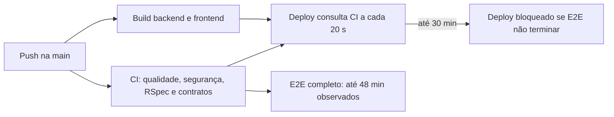

# Auditoria de performance do CI/CD — 12/11/2026

## Escopo e método

Leitura dos 20 runs mais recentes na `main` de `ci-web-backend.yml` e
`cd-production.yml`, dos jobs/steps do commit `239fbe7a19555d24090e07ff015b691bb19b5116`
e dos workflows, scripts, Dockerfiles e Compose de produção/teste.
Os percentis usam nearest-rank. Fila = `run_started_at - created_at`; execução =
`updated_at - run_started_at`. Runs sem início não entram no cálculo da fila.

## Baseline medido

| Amostra | Estados nos 20 runs | Fila p50 / p95 / máximo | Execução p50 / p95 / máximo |
|---|---|---:|---:|
| CI | 18 falhas, 1 cancelado, 1 enfileirado | 0 / 0 / 0 min* | 7,23 / 61,65 / 61,65 min** |
| CD produção | 19 falhas, 1 enfileirado | 0 / 62,93 / 62,93 min* | 5,95 / 40,72 / 40,72 min*** |

\* Entre os 19 runs que iniciaram; o run enfileirado foi excluído.
\** O p95/max inclui um CI cancelado após 61,65 min; somente entre as 18 falhas,
p50 foi 7,03 min e p95/máximo 8,55 min.
\*** Todos os 19 runs concluídos da amostra falharam. Estes números são tempo de
execução de falhas/bloqueios, não duração de deploys bem-sucedidos. O tempo
criação-conclusão do CD foi p50 7,25 min e p95/máximo 69,43 min, incluindo fila.

Não há deploy bem-sucedido nessa janela; portanto não há baseline válido de
lead time de produção bem-sucedida.

### Execução de referência — SHA `239fbe7a`

- CI: 12:10:29–13:12:08 UTC; concluído como cancelado.
- E2E: inicialização do Compose 5,17 min; instalação dos browsers 0,98 min;
  execução Playwright 48,15 min antes do cancelamento.
- RSpec: job 4,37 min; etapa RSpec 3,72 min.
- CD: execução total 37,03 min. Frontend Docker build 5,47 min; backend build
  1,07 min; publicação de cada imagem levou poucos segundos.
- Job de deploy ficou 30,77 min no gate `Verify CI Status`, fazendo 90 consultas
  separadas por 20 s. SSH, migrations e atualização de containers não começaram.

## Dez gargalos e evidência

| # | Gargalo | Evidência | Impacto confirmado ou limite |
|---:|---|---|---|
| 1 | Playwright completo no fluxo síncrono | Step levou 48,15 min; E2E depende de todos os gates; job usa 1 worker | Principal bloqueio observado para release saudável |
| 2 | Quatro projetos repetem Chromium | Configuração tem Chromium desktop, mobile, tablet e desktop custom; não há projeto WebKit | Trabalho repetido; o delta real por projeto não foi medido |
| 3 | O E2E reconstrói a stack Compose | `up --build` consumiu 5,17 min; sem cache remoto explícito no job | Tempo medido; miss de cache entre runners é provável, mas não medido diretamente |
| 4 | Espera fixa no startup E2E | `sleep 15` após `compose up` | Espera desnecessária quando readiness já está disponível |
| 5 | Browser não usado é instalado | O CI instalava Chromium e WebKit; todos os projetos configurados usam Chromium | Instalação observada: 0,98 min; parcela do WebKit não isolada |
| 6 | Polling do CI no deploy | 90 × 20 s; execução atual terminou no teto de 30 min sem iniciar SSH | Causa direta do bloqueio do deploy atual |
| 7 | Imagens são compiladas antes da aprovação do CI | Jobs de imagem e gate de CI correm em paralelo no CD atual | Builds de SHA que falha podem consumir ~6 min sem possibilidade de deploy |
| 8 | Exportação de cache Docker não estava configurada no CD produção | `cache-from` presente, `cache-to` ausente no workflow de produção | É uma lacuna de configuração; taxa de cache hit anterior não foi registrada |
| 9 | Dependências são instaladas em runners/jobs separados | `npm ci` aparece em fast-feedback, gates frontend e E2E; cache de npm é configurado | Reinstalação lógica confirmada; duração por instalação não foi extraída nesta amostra |
| 10 | Espera de runner em parte dos deploys | Fila CD p95 e máximo 62,93 min | Fila é separada do tempo de execução e não é corrigida por acelerar builds |

Outros dados: 17/19 CD concluídos falharam em `Verify CI Status`; 2 falharam no
build frontend. No CI, 17/18 falhas concluídas foram em RSpec e uma em RuboCop;
o E2E cancelado é contabilizado separadamente.

### Proteções existentes que precisam de trabalho separado

O workflow atual marca RuboCop, Bundler Audit, Gitleaks, lint frontend e `npm audit`
como não bloqueantes (`continue-on-error` ou `|| true`). Esta otimização não altera
esse comportamento nem trata um aviso como uma aprovação de segurança. Endurecer
esses checks requer primeiro corrigir o baseline de findings e medir o impacto no
CI; fica registrado como follow-up de segurança.

## Caminho crítico

O gargalo mais longo é o E2E completo. O polling de 30 minutos causa um segundo
bloqueio e é menor que o timeout de 60 minutos do job E2E. Os builds de imagem
estão fora do caminho crítico quando rodam em paralelo, mas são desperdiçados se
o CI falhar.

## Otimizações preparadas na branch

- Push/PR: E2E crítico no Chromium para sessão, descoberta SEO/SSR, financiamento
  e acesso à jornada de propostas.
- Suíte Playwright completa: agendada diariamente às 04:00 UTC e disponível por
  `workflow_dispatch`; continua bloqueando essa execução completa.
- `docker compose up --wait` substitui `sleep 15` e instala somente Chromium,
  usado pelos projetos atuais.
- CD passa a reagir à conclusão do CI e verificar o `workflow_run` exato, SHA,
  evento `push`, branch `main` e ancestralidade do SHA. Build só começa depois do
  gate aprovado; release frontend-only é classificado e encaminhado ao workflow
  que atualiza apenas frontend.
- Deploy frontend manual falha rápido se o CI ainda não iniciou/concluiu; não faz
  polling prolongado.
- BuildKit passa a exportar cache GHA separado para backend e frontend.
- Grupo de concorrência de produção continua sem cancelamento; CI obsoleto mantém
  cancelamento seguro.

## Medição depois das mudanças

Ainda não medida: a branch não foi publicada e nenhum workflow novo foi
executado no GitHub. Não apresentar uma melhoria percentual ou meta como resultado.
Após uma execução real, preencher:

| Métrica | Antes observado | Depois | Melhoria |
|---|---:|---:|---:|
| CI (falhas concluídas) | p50 7,03 min; p95 8,55 min | Pendente | Pendente |
| Playwright completo | 48,15 min até cancelamento | Pendente (execução agendada/manual) | Pendente |
| Playwright crítico | Não existia como categoria separada | Pendente | Pendente |
| Build frontend | 5,47 min | Pendente | Pendente |
| Build backend | 1,07 min | Pendente | Pendente |
| Deploy | Sem sucesso na amostra; polling 30,77 min | Pendente | Pendente |
| Lead time de produção | Sem deploy bem-sucedido na amostra | Pendente | Pendente |

## Riscos e validação

- O subset crítico foi selecionado para as jornadas de sessão, descoberta, quote
  de financiamento e propostas. A suíte completa permanece no agendamento/manual;
  o primeiro run real deve confirmar se o subset cabe no orçamento de CI.
- Mudanças em configuração de workflow só podem ser validadas por um run real do
  GitHub Actions. Este documento não considera parse YAML ou testes locais como
  prova de deploy.
- O gate falha fechado quando o CI associado está ausente, incompleto, pertence a
  outro SHA/branch ou não concluiu com sucesso. O deploy concorrente permanece
  serializado e o rollback existente não foi removido.
- Não houve acesso SSH nem alteração na VM durante esta auditoria.
