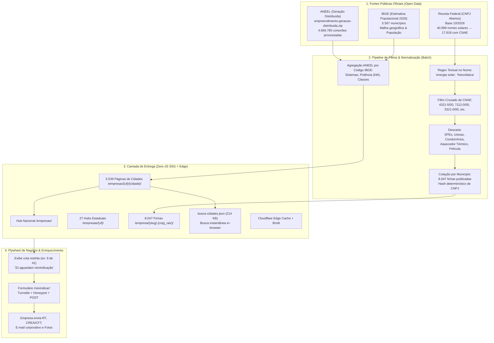

# PDR — Engenharia Reversa & Blueprint Arquitetural: `empresasenergiasolar.ia.br`

> **Documento:** Product Design / Engineering Reverse Engineering Report (PDR)  
> **Alvo:** `https://empresasenergiasolar.ia.br/empresas/`  
> **Data de Auditoria:** 19 de Novembro de 2026  
> **Status:** Concluído com Evidência Direta  

---

## 1. Resumo Executivo & Visão Geral

O site `empresasenergiasolar.ia.br` é um diretório nacional e portal de autoridade técnica em energia solar fotovoltaica. A plataforma não utiliza web scraping de concorrentes nem banco de dados dinâmico sob consulta pesada para os usuários finais; em vez disso, baseia-se em **três bases abertas oficiais do governo brasileiro** consolidadas através de um **pipeline de processamento batch pré-compilado em Next.js SSG (Static Site Generation) com arquitetura Zero-JS no cliente**.



---

## 2. Fontes de Dados (Data Ingestion & Open Data)

O site opera com três bases de dados abertas independentes, cruzadas por código IBGE e normalização de CNPJ:

### 2.1 Base de CNPJs da Receita Federal (RFB)
* **Origem:** Dados Abertos da Receita Federal (`dados.gov.br`), referência de release analisada: **10/2026** (carga de 20/10/2026).
* **Campos Extraídos:**
  * Razão Social e Nome Fantasia
  * CNPJ formatado (Matriz e Filial)
  * Situação Cadastral (`Ativa`) e Data de Abertura
  * Natureza Jurídica (ex: `2062 - Sociedade Empresária Limitada`)
  * Porte (`ME`, `EPP`, `Demais`)
  * Endereço cadastral (Bairro, CEP, Município, UF)
  * Telefone cadastral (fixo e celular)
  * CNAE Principal e CNAEs Secundários
* **Regras de Limpeza e LGPD (Privacidade):**
  * **Empresário Individual (MEI/EI):** se a empresa não tiver nome fantasia cadastrado, **não ganha ficha**, pois a razão social é o nome civil da pessoa física.
  * Quando ganha ficha, o nome civil é omitido e o endereço é restrito exclusivamente ao bairro (sem número ou logradouro completo).
  * Telefones que se repetem em múltiplos CNPJs sem marca em comum (telefones de contadores/escritórios contábeis) são expurgados na ingestão.

### 2.2 Base de Geração Distribuída da ANEEL
* **Origem:** Conjunto oficial *"Relação de empreendimentos de Mini e Micro Geração Distribuída"*, arquivo `empreendimento-geracao-distribuida.zip` baixado em `dadosabertos.aneel.gov.br`.
* **Volume:** **4.666.785 linhas** processadas no lote de 10/2026.
* **Agregação:**
  * Somatório por Código IBGE do Município (5.535 municípios com 10 ou mais instalações; menos de 10 instalações soma apenas no estado).
  * Potência acumulada (kW), quantidade de sistemas, distribuidora local.
  * Modalidade: Autoconsumo local, geração compartilhada, autoconsumo remoto.
  * Classe de consumo: Residencial, Comercial, Industrial, Rural.
* **Isolamento Ético e Jurídico:** A ANEEL não informa a empresa instaladora (o titular da conta é o consumidor final). O site explicitamente descarta dados de titular (nomes e CPFs que vêm mascarados) e nunca associa os números da ANEEL como se fossem obras da instaladora.

### 2.3 Base Demográfica e Geográfica do IBGE
* Estimativa de população dos 5.567 municípios brasileiros para 2026.
* Utilizada para derivar a métrica de densidade: `Instalações de energia solar por mil habitantes` exibida nos rankings e mapas dos estados.

---

## 3. O Algoritmo de Filtros e Cotas das Empresas

O pipeline de dados filtra uma base gigantesca da Receita através de 4 etapas sucessivas:

```
[Total de CNPJs no Brasil (~50+ Milhões)]
                  │
                  ▼
[40.999 CNPJs com Termos Solares no Nome]
                  │
                  ▼
[17.818 com CNAE de Serviço de Instalação/Engenharia]
                  │
                  ▼
[Expurgo: SPEs, Usinas, Condomínios, Térmico, Película]
                  │
                  ▼
[Cota Populacional Municipal: 8.047 Empresas Publicadas em 5.539 Cidades]
```

### Regras de Inclusão e Classificação por CNAE
* **Atividades Elegíveis:**
  * `4321-5/00` (Instalação e manutenção elétrica) — prioridade máxima.
  * `7112-0/00` (Serviços de engenharia).
  * `3321-0/00` (Instalação de máquinas e equipamentos industriais).
  * `4742-3/00` (Comércio varejista de material elétrico).
  * `4322-3/02` (Instalação de climatização/refrigeração com atuação solar).
* **Regra da Cota Municipal:**
  * Cada município possui uma cota de 1 a ~20 empresas publicadas (ex: São Paulo tem 19; Brasília 18; Florianópolis 9).
  * **Critério de desempate:** prioridade para empresas cujo CNAE principal é serviço; havendo mais empresas que a cota, é aplicado um sorteio determinístico por hash do CNPJ (garante que não favorece empresas antigas nem grandes).
  * As empresas que ficam fora da cota (ex: em Florianópolis, 9 publicadas e 32 aguardando) só entram na vitrine se o dono reivindicar o perfil.

---

## 4. Engenharia de Frontend & Arquitetura de Software

### 4.1 Zero-JS Static Site Generation (SSG)
Ao inspecionar o código-fonte de `https://empresasenergiasolar.ia.br/empresas/` e das páginas de empresas, constatamos uma engenharia focada em performance extrema:
* **Sem Framework Client-Side Hydration:** Não há scripts do Next.js de runtime (`main.js`, `webpack.js`, `framework.js`) nem `self.__next_f.push` (RSC) nas páginas de leitura.
* **Tamanho de Página:** Documentos HTML crus de ~25 KB a ~45 KB.
* **Inline CSS & Preload:** O CSS crítico é compilado e pré-carregado via `<link rel="stylesheet" href="/_next/static/css/..."/>`, com fontes WOFF2 em preload direto (`libre-franklin` e `fira-sans`).
* **JavaScript Mínimo:** Apenas scripts vanilla inline minúsculos para:
  1. Toggle de Dark/Light theme persistido em `localStorage` (`data-theme`).
  2. Consentimento de cookies essencial (`data-consent`).
  3. Menu mobile drawer vanilla com acessibilidade ARIA.

### 4.2 Mecanismo de Busca Inteligente (`busca-cidades.json`)
Em vez de implementar um backend dinâmico com endpoints de autocomplete sujeitos a latência e custos de infraestrutura, o site adota a seguinte arquitetura:

* **Endpoint:** `https://empresasenergiasolar.ia.br/busca-cidades.json`
* **Formato de Dados Compacto (Matriz Otimizada):**
  ```json
  [
    ["Florianópolis", "SC", "florianopolis", 9],
    ["São Paulo", "SP", "sao-paulo", 19],
    ["Várzea Paulista", "SP", "varzea-paulista", 6]
  ]
  ```
* **Tamanho:** **214 KB bruto** (comprimido em **Brotli/Gzip para ~40 KB** na CDN).
* **Motor de Busca In-Browser:**
  * Um script vanilla de ~30 linhas faz o `fetch('/busca-cidades.json')` apenas no primeiro foco do usuário no campo de busca.
  * Normalização rápida: `s.normalize('NFD').replace(/[\u0300-\u036f]/g, '').toLowerCase()`.
  * Suporta busca por nome da cidade e sufixo de estado (ex: `"curitiba pr"` ou `"rio grande"`).
  * Renderiza os resultados instantaneamente sem nenhuma requisição de rede adicional.

---

## 5. Estrutura de URLs & Programmatic SEO (pSEO)

A taxonomia do site foi construída para maximizar autoridade tópica e capturar tráfego de cauda longa (long-tail keywords):

| Nível | Padrão de URL | Quantidade de URLs | Função no Funil |
| :--- | :--- | :--- | :--- |
| **Hub Central** | `/empresas/` | 1 | Visão macro por regiões e estados |
| **Hub Estadual** | `/empresas/[uf]/` | 27 | Agrupador estadual com barras proporcionais |
| **Hub Municipal** | `/empresas/[uf]/[cidade]/` | **5.539** | Comparativo municipal com estatísticas ANEEL |
| **Ficha de Empresa** | `/empresa/[slug]-[cnpj_raiz]/` | **8.047** | Conversão local e dados de contato |
| **Dados ANEEL** | `/dados/[uf]/` | 27 | Transparência e autoridade de dados abertos |
| **Guias Normativos** | `/lei-14300/[slug]/`, `/conta-de-luz/[slug]/` | 57 | Autoridade técnica (Fio B, ART, inversor, etc.) |

### Schema.org e Dados Estruturados
Cada página de empresa injeta dois schemas JSON-LD rigorosos:
1. `BreadcrumbList`: rastreabilidade hierárquica `Início > Empresas > UF > Cidade > Empresa`.
2. `ElectricalContractor`:
   ```json
   {
     "@context": "https://schema.org",
     "@type": "ElectricalContractor",
     "@id": "https://empresasenergiasolar.ia.br/empresa/exemplo-12345678/#empresa",
     "name": "Nome Fantasia",
     "legalName": "Razão Social LTDA",
     "taxID": "XX.XXX.XXX/XXXX-XX",
     "foundingDate": "YYYY-MM-DD",
     "description": "Atividade principal registrada na Receita Federal: ...",
     "telephone": "+55...",
     "address": {
       "@type": "PostalAddress",
       "streetAddress": "Rua ..., Bairro",
       "addressLocality": "Cidade",
       "addressRegion": "UF",
       "postalCode": "XXXXX-XXX",
       "addressCountry": "BR"
     }
   }
   ```

---

## 6. Modelo de Conversão, Reivindicação & Ingestão Ativa

### 6.1 Os 3 Estados de Verificação
O site categoriza as fichas em 3 estados muito claros para o usuário e o Google:

```
[1. Indicada no Cadastro] (Cinza - Todas as 8.047 atuais)
          │  (Empresa acessa /reivindicar/)
          ▼
[2. Declarada pela Empresa] (Âmbar - Declarou atuação e dados)
          │  (Apresenta CREA/CFT e Responsável Técnico)
          ▼
[3. Registro Verificado] (Verde - Conferido manualmente no conselho)
```

### 6.2 O Formulário `/reivindicar/` e Proteção Anti-Abuso
* **Endpoint de Submissão:** `POST /api/formulario/`
* **Campos Requeridos:**
  * CNPJ e Nome do solicitante.
  * Validação de autoridade: E-mail no domínio próprio da empresa (`@suaempresa.com.br`) OU telefone fixo idêntico ao da Receita.
  * Declaração de vínculo e atuação em energia solar.
  * Opcional: Registro CREA/CFT da empresa, UF e nome/registro do Responsável Técnico.
* **Segurança e Anti-Bot:**
  * **Cloudflare Turnstile:** Carregamento dinâmico assíncrono sob interação (`pointerdown`, `keydown`, `focusin`), evitando peso de scripts no carregamento inicial.
  * **Honeypot Invisível:** `<div class="isca"><input name="site"></div>` (se preenchido por robô, o envio é sumariamente descartado).
  * **Rate Limiting:** Proteção de submissões por IP/sessão.

---

## 7. Lições e Oportunidades para o Avalia Solar 2026

Comparando com a arquitetura atual do **Avalia Solar 2026** (Next.js 14 App Router, Rails 7 API, PostgreSQL e ActiveAdmin), extraímos os seguintes aprendizados estratégicos:

### 1. Ingestão Automatizada de CNPJs (Pipeline de Expansão)
* O Avalia Solar pode implementar uma rake task/worker mensal que consome a base aberta da Receita Federal (CNPJ abertos) filtrada por CNAEs `4321-5/00` e `7112-0/00` para popular automaticamente perfis base (*unclaimed* / rascunho) de empresas instaladoras reais em todo o Brasil.

### 2. Cruzamento Contextual com Dados da ANEEL por Município
* Nas páginas de catálogo `/companies` ou nas páginas de cidades do Avalia Solar, exibir o selo de contexto de mercado com o número de usinas conectadas na cidade pela ANEEL agrega autoridade institucional instantânea ao comparador.

### 3. Busca Municipal Instantânea via Mini-JSON
* O modelo do `busca-cidades.json` (214 KB bruto / 40 KB comprimido) pode ser adotado na busca mobile e no drawer do Avalia Solar para seleção de estados e cidades, eliminando dezenas de queries desnecessárias na API Rails.

### 4. Camada de Confiança Escalonada (Indicada → Declarada → Auditada/G2)
* O modelo de estados (Indicada no CNPJ → Reivindicada com CREA/CFT → Auditada com Reviews Avalia Solar) cria uma esteira de onboarding que incentiva instaladores a criarem conta para sair da base passiva e ganharem destaque comercial.

---

### Conclusão

O `empresasenergiasolar.ia.br` é uma aula de **eficiência de custos e Programmatic SEO**: custos de servidor próximos de zero (servido via Cloudflare Pages/Vercel estático), dados 100% legítimos extraídos de bases abertas (RFB + ANEEL + IBGE) e uma estratégia de escassez (cotas municipais) que força os donos de empresas a reivindicarem e enriquecerem a base voluntariamente.

