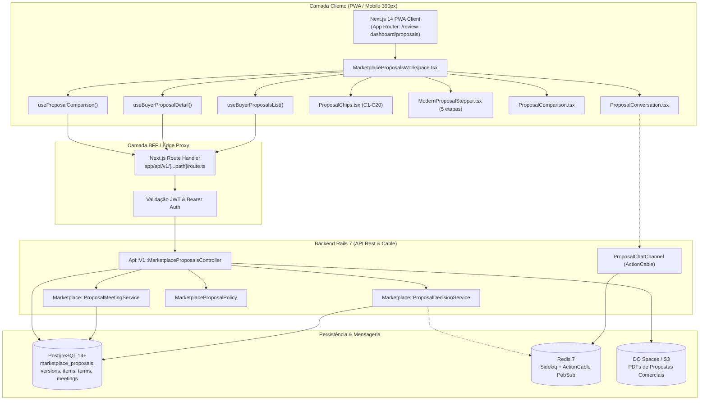
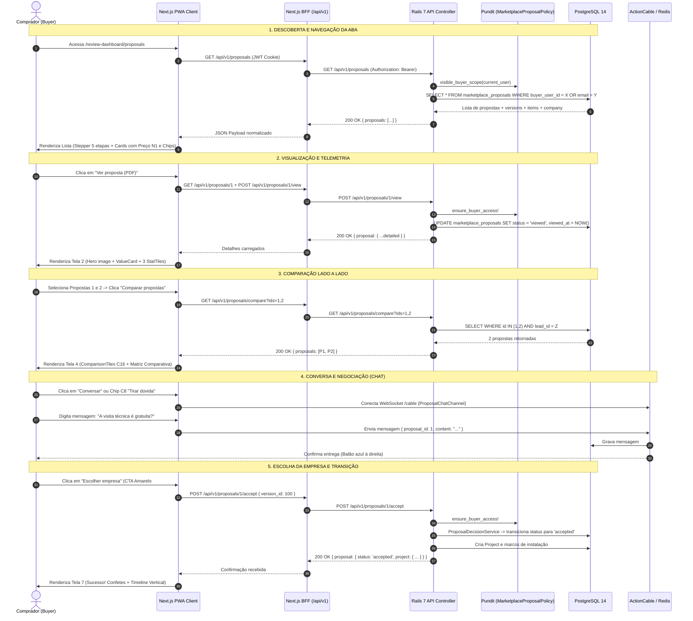

# ARQUITETURA — Fluxo de Propostas do Buyer (Avalia Solar)

> **Documento de Engenharia & Arquitetura de Software**  
> **Escopo:** Descoberta, navegação, comparação e decisão do comprador na aba de propostas (`/review-dashboard/proposals`).  
> **Baseline de código:** `AB0-1-back` (Rails 7 API), `AB0-1-front` (Next.js 14 App Router) e `docs/proposals/` (16/10/2026).

---

## 1. Architecture — Components & Connections

### 1.1 Diagrama de Componentes e Fronteiras de Rede


### 1.2 Responsabilidades de Cada Componente
- **`MarketplaceProposalsWorkspace.tsx`**: Orquestrador de estado do comprador. Gerencia URL params (`?proposal=:id&view=<screen>`), abas de status (`received`, `under_review`, `chosen`), drawer de filtros e layout responsivo.
- **`useBuyerProposalsList`**: Consume `GET /api/v1/proposals`. Agrupa propostas por projeto via `groupProposalsByProject()`, aplica filtros no cliente e cancela requisições pendentes via `AbortController`.
- **`useBuyerProposalDetail`**: Consume `GET /api/v1/proposals/:id`. Dispara `POST /view` automaticamente no primeiro acesso para telemetria e classificação de erros tipada (401, 403 IDOR, 404, 429).
- **`useProposalComparison`**: Gerencia array de IDs (2 a 3 propostas) em memória/localStorage e consome `GET /api/v1/proposals/compare?ids=1,2,3`.
- **`ProposalChips.tsx`**: Biblioteca tipada com os 20 micro-componentes de estado, métricas e identificação (C1 a C20).
- **`MarketplaceProposalsController`**: Controlador Rails com filtro de acesso IDOR estrito (`ensure_buyer_access!`) que garante que a proposta pertença a `current_user.id` ou `LOWER(leads.email) = LOWER(current_user.email)`.

---

## 2. IT Current-State — Legacy Landscape vs Modernization

| Dimensão | Estado Atual (As-Is) | Estado Modernizado (To-Be / Referência Visual) |
|---|---|---|
| **Arquitetura de Rotas** | Página única acoplada a query params: `/review-dashboard/proposals?proposal=:id&view=summary` | Mantém rota base com estados limpos, histórico de navegação navegável via breadcrumb `← Meus projetos` e animações de transição sem recarga. |
| **Descoberta de Propostas** | Card com 3 botões espremidos no mobile ("Ver proposta", "Conversar", "Escolher"), sem distinção de peso. | Card com 2 botões de alta ergonomia: Secundário à esquerda `Ver proposta (PDF)` + Primário à direita `Escolher empresa` (CTA amarelo `#FBBF24` 1.35x maior). |
| **Comparação** | Comparação em tabela funcional, mas com tags de cores conflitantes nas células e sem slots de substituição rápida. | 3 `ComparisonTiles` (C16) com botão `×` de remoção rápida, tabela comparativa com células neutras e borda `--brand` destacando apenas a coluna em foco. |
| **Stepper de Jornada** | Drawer colapsável no mobile com texto vertical. | Stepper horizontal de 5 etapas (Solicitação → Propostas → Em análise → Decisão → Projeto) com círculos numerados, datas e linha conectora contínua (telas 1 e 8). |
| **Chat e Mensagens** | Chat carregado em sub-view com navegação ambígua. | Thread isolada, sem BottomNav (D13), com chips de atalho (`Agendar visita`, `Tirar dúvida`, `Solicitar ajuste`) e composer fixo com botão de anexo. |
| **Segurança & IDOR** | Validação centralizada em `ensure_buyer_access!`. Tratamento de 403 exibia "Verifique sua conexão". | Tratamento tipado: 403 exibe tela amigável de restrição de segurança sem tentar retries cegos ou loops infinitos. |

---

## 3. Flowchart — Decision Logic

```mermaid
flowchart TD
  Start([Buyer entra em /review-dashboard/proposals]) --> CheckAuth{Autenticado & ReviewUser?}

  CheckAuth -- Não --> Login[Redirecionar /auth/entrar]
  CheckAuth -- Sim --> FetchList[GET /api/v1/proposals]

  FetchList --> HasProposals{Existem propostas?}
  HasProposals -- Não --> EmptyState[Exibe Estado Vazio: 'Suas propostas ficam aqui' + CTA Explorar Empresas]
  HasProposals -- Sim --> RenderList[Renderiza Stepper 5 etapas + Tabs + Cards de Proposta]

  RenderList --> ActionSelect{Ação do Buyer no Card}

  ActionSelect -- Clica no Card ou 'Ver proposta' --> OpenDetail[Carrega ?proposal=:id&view=summary<br/>Dispara POST /proposals/:id/view]
  ActionSelect -- Marca 'Comparar' (2 a 3) --> CompareReady[Habilita botão 'Comparar propostas']
  ActionSelect -- Clica 'Escolher empresa' --> ConfirmChoose[Abre Tela 7: Decisão e Escolha]

  CompareReady --> ClickCompare[Clica 'Comparar propostas' -> ?view=compare]
  ClickCompare --> FetchCompare[GET /api/v1/proposals/compare?ids=A,B,C]
  FetchCompare --> CheckSameLead{Mesmo projeto/lead?}
  CheckSameLead -- Não --> ErrorCompare[Erro: Só compare propostas da mesma solicitação]
  CheckSameLead -- Sim --> RenderCompareTable[Renderiza 3 ComparisonTiles C16 + Tabela 4 colunas]

  RenderCompareTable --> CompareChoice{Decisão no Comparador}
  CompareChoice -- 'Solicitar ajuste' --> RequestChangeFlow[POST /proposals/:id/request_change<br/>Abre chat com justificativa]
  CompareChoice -- 'Escolher empresa' --> ConfirmChoose

  OpenDetail --> DetailActions{Ação no Detalhe}
  DetailActions -- 'Conversar' --> OpenChat[?view=conversation<br/>Abre Thread sem BottomNav]
  DetailActions -- 'Ver PDF completo' --> OpenPdf[?view=complete<br/>Renderiza folha A4 + Contador C5]
  DetailActions -- 'Escolher empresa' --> ConfirmChoose

  ConfirmChoose --> SubmitAccept[POST /api/v1/proposals/:id/accept<br/>payload: { version_id }]
  SubmitAccept --> SuccessChoose[Tela 7: Sucesso! Ícone verde + Timeline vertical]
  SuccessChoose --> Tracking[Tela 8: Acompanhamento de obra<br/>?view=project]
  Tracking --> MilestoneInstall[Marcos de Visita -> Contrato -> Instalação]
  MilestoneInstall --> Concluded[Tela 10: Projeto Concluído!<br/>4 Métricas de Geração e Economia]
```

---

## 4. Sequence Diagram — Messages Over Time



---

## 5. Regras de Integridade e Recomendações Técnicas

1. **Nunca quebrar IDOR:** Todas as chamadas de detalhe, download e decisão devem passar por `ensure_buyer_access!`. Qualquer tentativa de acesso a propostas de terceiros deve retornar HTTP 403 e ser tratada no frontend sem loop.
2. **Comparação Restrita ao Mesmo Lead:** O endpoint `/compare` bloqueia comparação de propostas com `lead_id` diferentes para evitar misturar requisitos técnicos distintos (ex: sistema trifásico de 15 kWp com residencial monofásico de 5 kWp).
3. **Ergonomia do CTA Amarelo:** O botão "Escolher empresa" (`#FBBF24`) deve permanecer em posição de destaque primário à direita (`flex-[1.35]`), com tipografia `#0F172A` e peso 700+.
4. **Respeito à Decisão D13:** A tela de chat (`view=conversation`) nunca deve exibir `BottomNav` para evitar conflito de toque com o teclado virtual no mobile.
