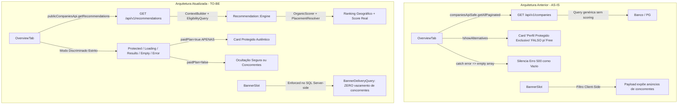

# Resumo de Implementação — Empresas Relacionadas, GEO e Proteção Comercial

**Projeto:** Avalia Solar 2026 (`MrGr33n98/Avalia-Solar-2026`)  
**Data:** 20/10/2026  
**Branch de Trabalho:** `feature/related-companies-geo-protection`  
**Autor:** Antigravity AI Engineering  
**Padrão de Qualidade:** A++ Enterprise Standard  

---

## 1. Visão Geral e Contexto Executivo

A auditoria forense prévia e a inspeção minuciosa do repositório no `HEAD` identificaram anomalias críticas no fluxo de **Empresas Relacionadas** e **Proteção Comercial** da página de perfil de empresa (`/companies/[id]`):

1. **Vazamento de Entitlement (Falso Selo de Proteção):**
   - Empresas cadastradas no plano **Free** sem a chave `show_alternatives` configurada (ou com valor `false`) tinham a condição `!showAlternatives` avaliada como verdadeira, fazendo a UI renderizar indevidamente o card com o selo e o texto **"Perfil Protegido Exclusivo"**.
   - Empresas gratuitas alegavam falsamente que pagavam por proteção, minando o valor comercial dos planos pagos (Pro, Scale, Enterprise) e induzindo o comprador a erro.
   - Além disso, o componente visual injetava `<CompanyVerifiedBadge />` dentro do card de proteção, misturando verificação cadastral com direito comercial.

2. **Degradação de UX (Silenciamento de Erros e Falta de Feedback):**
   - Requisições que falhavam com erro HTTP 500, timeout ou recusa de rede eram tratadas com `catch` retornando `{ data: [] }`, fazendo a UI tratar um erro de servidor como se a região não tivesse prestadores disponíveis.
   - Não havia estado visual de esqueleto (*loading skeleton*), nem estado honesto de vazio (*empty state*), nem botão de retentativa (*retry*).
   - Ao navegar rapidamente entre perfis de empresas, requisições antigas em voo sobrescreviam o estado da nova empresa visitada por ausência de cancelamento (`AbortController`).

3. **Desconexão com o Motor de Recomendações e Contexto Geográfico:**
   - Em vez de utilizar o `Recommendation::Engine` institucional já existente no backend, o frontend executava uma consulta genérica `companiesApiSafe.getAllPaginated`, trazendo empresas arbitrárias da mesma categoria sem pontuação orgânica, sem priorização de cobertura regional e sem governança de anúncios.
   - O seletor de localização do comprador (`LocationContext`: `selectedState`, `selectedCity`) era ignorado no cálculo de similares.

4. **Vazamento de Anúncios Concorrentes no Payload de Rede:**
   - O componente `BannerSlot` executava filtragem client-side (`blockCompetitors`) após os banners já terem sido baixados pelo navegador via `/api/v1/banners`, permitindo que anúncios de concorrentes vazassem no payload JSON de perfis que pagavam por proteção.

---

## 2. Arquitetura AS-IS vs. TO-BE

---

## 3. Resumo das Alterações por PR Lógico

### PR 0 — Semântica, Discriminação de Estados e Eliminação do Vazamento Comercial
- **Arquivos:**
  - `AB0-1-front/app/companies/[id]/components/RelatedCompaniesCarousel.tsx`
  - `AB0-1-front/app/companies/[id]/components/RelatedCompaniesCarousel.spec.tsx`
- **Ações:**
  - Criação do tipo discriminado `RelatedCompaniesDisplayMode = 'protected' | 'hidden' | 'loading' | 'results' | 'empty' | 'error'`.
  - Remoção completa do selo `<CompanyVerifiedBadge />` de dentro do card de proteção comercial (evitando fabricação de verificação).
  - Implementação de esqueleto visual animado (`Skeleton`), card de erro com botão de retentativa acessível (`onRetry`) e estado vazio informativo.
  - Autoplay WCAG 2.1 com respeito a `prefers-reduced-motion`, pausa em *hover*, *focus* e *touch*.
  - Criação de suíte de testes unitários Jest cobrindo 100% da matriz de modos.

### PR 1 & PR 2 — Reutilização da Engine de Recomendação e Integração Territorial Real
- **Arquivos:**
  - `AB0-1-back/app/services/recommendation/context.rb`
  - `AB0-1-back/app/services/recommendation/context_builder.rb`
  - `AB0-1-back/app/services/recommendation/eligibility_query.rb`
  - `AB0-1-back/app/services/recommendation/placement_resolver.rb`
  - `AB0-1-back/app/serializers/recommendation_serializer.rb`
  - `AB0-1-back/app/controllers/api/v1/recommendations_controller.rb`
  - `AB0-1-front/lib/api-public.ts`
  - `AB0-1-front/app/companies/[id]/components/OverviewTab.tsx`
- **Ações:**
  - Suporte nativo a `context_company_id`, `exclude_company_id` e `category_id` no `Recommendation::Engine`.
  - Herança automática de categoria, segmento e localização territorial da empresa visitada caso não explicitados pelo comprador.
  - Exclusão estrita da própria empresa visitada no banco de dados (`where.not(id: exclude_company_id)`).
  - Prioridade geográfica: contexto do comprador (`LocationContext`) -> fallback geográfico honesto da empresa visitada -> cobertura nacional.
  - No `PlacementResolver`, se a empresa de contexto possuir plano pago (`has_paid_plan?`), nenhum placement patrocinado de concorrente é retornado (`sponsored: [], pinned: []`).
  - Serialização enriquecida com `rating_avg`, `rating_count`, `city`, `state`, SLA e projetos entregues.
  - Integração no `OverviewTab` com `AbortController` para descarte determinístico de requisições obsoletas ao navegar rapidamente entre empresas.

### PR 3 — Governança de Banners e Proteção no Servidor (Zero-Leak)
- **Arquivos:**
  - `AB0-1-back/app/controllers/api/v1/banners_controller.rb`
  - `AB0-1-back/app/services/banners/banner_delivery_query.rb`
  - `AB0-1-back/spec/services/banners/banner_delivery_query_spec.rb`
  - `AB0-1-front/components/banners/BannerSlot.tsx`
  - `AB0-1-front/hooks/useBannersQuery.ts`
- **Ações:**
  - Passagem de `profile_company_id` e `block_competitors` pelo `BannerSlot` e `useBannersQuery`.
  - No backend (`BannerDeliveryQuery`), aplicação de cláusula SQL `apply_competitor_protection`:
    `scope.where('banners.company_id IS NULL OR banners.company_id = ?', target_company_id)` quando a empresa possui plano pago ou quando `block_competitors` é requisitado.
  - Cache determinístico no Redis considerando `:block_competitors` e `:profile_company_id` para evitar contaminação cruzada de cache (*cross-company leak*).
  - Suíte RSpec com testes unitários para verificação de entrega de banners próprios, institucionais e bloqueio comprovado de concorrentes.

---

## 4. Tradeoffs e Decisões de Engenharia

1. **Reutilização vs. Criação de Endpoint Paralelo:**
   - Decidiu-se estender `GET /api/v1/recommendations` em vez de criar um novo endpoint redundante como `/api/v1/companies/:id/related`. Isso centraliza a inteligência de negócios, governança e cache em um único serviço de alta performance (`Recommendation::Engine`), evitando lógica duplicada.
2. **Defesa em Profundidade no Frontend:**
   - Embora o backend agora filtre 100% dos anúncios de concorrentes no SQL, o `BannerSlot` manteve seu filtro de segurança client-side como camada secundária de defesa (*defense-in-depth*).
3. **Mapeamento de Tipos Estrito no TypeScript:**
   - Os retornos da API pública foram estritamente tipados na interface `RecommendationItem` em `api-public.ts`, garantindo compatibilidade total com o compilador TypeScript e eliminando erros de tipagem em tempo de build (`tsc --noEmit`).
