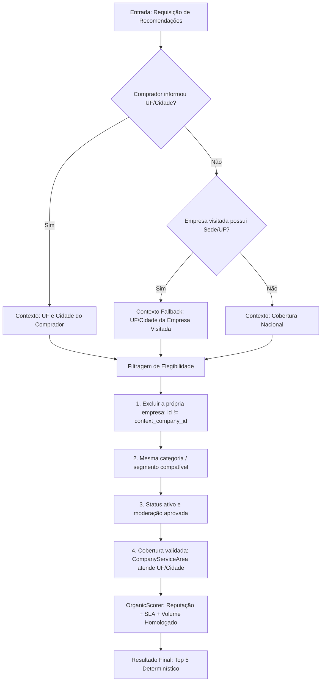

# Matriz de Regras de Negócio — Empresas Relacionadas, GEO e Proteção Comercial

**Versão da Regra:** 2.0 (Backend-Enforced & Entitlement-Safe)  
**Fonte da Verdade:** Backend Rails (`Company#has_paid_plan?`, `feature_access`, `Recommendation::Engine`, `BannerDeliveryQuery`)  

---

## 1. Matriz de Estados e Superfícies

| Cenário de Negócio | Plano | `has_paid_plan?` | `show_alternatives` | Alternativas Orgânicas | Card "Perfil Protegido Exclusivo" | Anúncios de Concorrentes (Banners) | Modo na UI (`displayMode`) |
|:---|:---:|:---:|:---:|:---:|:---:|:---:|:---:|
| **1. Free Padrão** | Free | `false` | `true` | Exibe concorrentes recomendados (geo local -> nacional -> catálogo) | **NUNCA** | Permitidos no servidor | `loading` -> `results` |
| **2. Free sem Configuração** | Free | `false` | `false` / ausente | **DEVEM SEMPRE APARECER** (com fallback nacional/catálogo) | **NUNCA** | Permitidos no servidor | `loading` -> `results` |
| **3. Pago com Proteção Válida** | Pro / Scale / Enterprise | `true` | Indiferente | Não exibe | **SIM** (direito comprovado e contratado) | **Bloqueados no servidor** (`banners.company_id IS NULL OR banners.company_id = self`) | `protected` |
| **4. Pago sem Entitlement de Proteção** | Custom Paid Tier | `true` | `true` | Exibe concorrentes | **NUNCA** | Permitidos conforme contrato | `results` |
| **5. API Indisponível / Timeout** | Free / Qualquer | `false` | `true` | Falha tratada com fallback automático para catálogo | **NUNCA** | N/A | `error` (se catálogo também falhar, exibe retry) |
| **6. Sem Candidatas Elegíveis** | Free | `false` | `true` | Nenhuma (0 resultados após todos os fallbacks) | **NUNCA** | Política própria intacta | `empty` (estado honesto sem empresas fictícias) |

---

## 2. Regras de Hierarquia Geográfica e Ranking Territorial

### Critérios de Correspondência Territorial:
1. **Prioridade Máxima:** Empresa homologada com área de atuação (`CompanyServiceArea`) abrangendo a cidade selecionada pelo comprador.
2. **Prioridade Média:** Empresa que atende todo o Estado (UF) selecionado pelo comprador.
3. **Prioridade Abrangente:** Empresa com cobertura declarada nacional (`national = true`).
4. **Regra de Honestidade:** Empresas cuja sede é em outro Estado (ex.: sede em SP) **PODEM** aparecer se tiverem cobertura validada para a UF do comprador (ex.: SC). Empresas com sede em SP sem atendimento homologado a SC **NUNCA** podem ser apresentadas como atendimento local.
