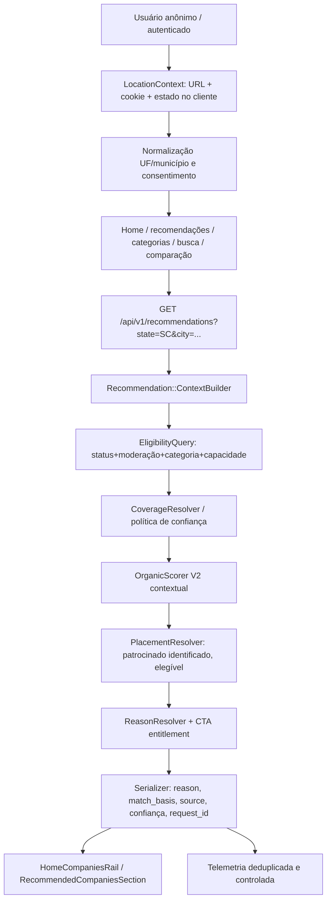

# Avalia Solar — Inventário técnico e arquitetura de recomendações por localização

- **Data da inspeção:** 20/10/2026
- **Repositório:** [MrGr33n98/Avalia-Solar-2026](https://github.com/MrGr33n98/Avalia-Solar-2026) — branch padrão (`main`).
- **Escopo:** descoberta pública de empresas, localização do usuário, Home web/PWA, aplicativo nativo, busca, cobertura, recomendação orgânica, patrocínios, administração, dados, testes e telemetria.
- **Método:** leitura e inspeção estática no código-fonte disponível. Nenhum acesso ao banco de produção, às requisições de produção ou execução de testes destrutivos foi realizado. As quantidades reais de empresas por UF, qualidade do preenchimento e flags de produção continuam não verificadas. Este documento não certifica o estado de um deployment.

---

## 1. Resumo Executivo

- **Achado P0-01 (Crítico):** a localização exibida no seletor da Home não governa as empresas em destaque. `HomeLocationBar.tsx` grava a UF em `localStorage` e redireciona para `/companies?state=UF`, enquanto `app/page.tsx` consulta empresas com `{status:'active',featured:true,limit:12}` e `HomeCompaniesRail.tsx` apenas exibe até nove desses registros. O parâmetro `stateCode` do rail afeta o título, não a seleção.
- **Achado P0-02 (Crítico):** `RecommendedCompaniesSection.tsx` chama `/api/v1/recommendations` com `segment` e `limit`, sem `state` e `city`. Existe recomendador Rails real, mas a seção não está integrada ao estado visual escolhido pelo usuário.
- **Ativo arquitetural reaproveitável:** `RecommendationsController` → `ContextBuilder` → `EligibilityQuery` → `OrganicScorer` → `PlacementResolver` → `ReasonResolver`/`CtaResolver` → `RecommendationSerializer`. A API já aceita `city`, `state`, `category_slug`, `segment`, `limit`.
- **Achado P0 de dados:** a presença de `companies.state` indica sede; a abrangência de atendimento é outro domínio. O repositório combina `companies.coverage_states`, `companies.coverage_cities` e `company_service_areas`. O ADR 0003 aponta a tabela relacional como fonte canônica-alvo, não como fonte já conciliada e adotada plenamente.
- **Diretriz:** um único contexto de localização explícito, um único contrato de elegibilidade territorial e ranqueamento contextual sobre empresas que efetivamente atendem à região. Patrocínios são slots comerciais declarados; não viram reputação nem certificação de cobertura.

---

## 2. Fluxo Atual Comprovado por Inspeção

```mermaid
flowchart LR
    A[Seletor HomeLocationBar] -->|localStorage user_state| B[Navegador]
    A -->|router.push| C[/companies?state=UF]
    D[Home SSR app/page.tsx] -->|featured:true, limit:12, sem UF| E[GET /companies]
    E --> F[CompanySearchQuery]
    F --> G[HomeCompaniesRail: 9 desktop / 6 mobile]
    H[RecommendedCompaniesSection] -->|segment, limit:8, sem UF| I[GET /recommendations]
    I --> J[ContextBuilder + Engine]
    B -. UF não é propagada .-> D
    B -. UF não é propagada .-> H
```

- A seleção altera a rota para o catálogo, em vez de atualizar contextualizadamente a Home.
- `defaultState="SC"` é mostrado em `app/page.tsx`, mas não é automaticamente incorporado às chamadas SSR da Home.
- No backend `ContextBuilder`, prioridade: parâmetros explícitos > perfil > cookies > headers > fallback nacional. O `localStorage` do browser não se converte automaticamente em cookie HTTP.
- `publicCompaniesApi.getRecommendations` está disponível e tem tipos definidos; a ligação com a seleção visual é a parte faltante.

---

## 3. Inventário por Camada (Caminhos Reais)

### 3.1 Frontend Next.js (`AB0-1-front/`)

| Caminho | Função | Diagnóstico / Ação |
| :--- | :--- | :--- |
| `components/home/HomeLocationBar.tsx` | UF no topo; lê query ou `localStorage`; redireciona ao catálogo | Transformar em estado compartilhado; disparar atualização da Home; não só navegar |
| `app/page.tsx` | SSR da Home e `getCompaniesDataCached` | Eliminar lista nacional desconectada do contexto; tornar cache por UF/localidade |
| `components/home/HomeCompaniesRail.tsx` | Vitrine compacta (9 web / 6 mobile) | Consumir resultados recomendados para a localidade; rótulo fiel à cobertura |
| `components/home/RecommendedCompaniesSection.tsx` | Recomendação com abas | Chama API sem localidade; refazer com chave reativa `[UF, cidade, segmento, categoria]` |
| `components/company/RecommendedCompanyCard.tsx` | Card de recomendação, impressões e CTA | Respeitar razão real e patrocínio; revisar dados vazios do objeto montado para comparação |
| `lib/api-public.ts` | Cliente e tipos de `getAll` e `getRecommendations` | Reutilizar; parametrizar cidade/UF, opção de cache e respostas de erro |
| `components/home/HomeCategoryRail.tsx` | Categorias destacadas | Propagar categoria escolhida ao discovery, sem fazer suposição de segment |
| `components/home/HomeSolutionsRail.tsx` | Tipos de solução | Propagar contexto; respeitar taxonomia oficial |
| `app/companies/CompaniesPageClient.tsx` | Lista, filtros e mapa | Preservar contexto ao navegar; distinguir filtro de sede x atendimento |
| `components/search/SearchCompanyListCard.tsx` | Cards de busca | Exibir cobertura legível, sem afirmar verificação inexistente |
| `components/search/MapProvider.tsx` | Busca por mapa | Resultado geográfico por coordenada é distinto de capacidade de atendimento |
| `lib/analytics/recommendations.ts` | Eventos de recomendação | Existe telemetria no cliente; validar pipeline e denominadores no servidor |
| `lib/company/coverage-label.ts` | Label de abrangência | Reconciliar com o contrato canônico, sem extrapolar atendimento |
| `__tests__/components/RecommendedCompaniesSection.test.tsx` | Testes de render/abas | Não verifica reação ao estado salvo nem coerência com cobertura |
| `components/home/HomeRails.spec.tsx` | Layout da Home | Verifica quantidade e aparência; não testa seleção territorial |

### 3.2 Backend Rails (`AB0-1-back/`)

| Caminho | Função | Diagnóstico / Ação |
| :--- | :--- | :--- |
| `config/routes.rb` | `GET /api/v1/recommendations` | Endpoint existente; preferir evolução compatível |
| `app/controllers/api/v1/recommendations_controller.rb` | Contexto, limite e serialização | Já recebe `city`, `state`, `category_slug`, `segment`; fortalecer validação |
| `app/services/recommendation/context_builder.rb` | Prioridade de origem da localidade | Explicitamente não lê `localStorage`; normalizar/validar UF e município |
| `app/services/recommendation/context.rb` | Value object do contexto | `state` faz uppercase; não valida UF/identidade municipal |
| `app/services/recommendation/eligibility_query.rb` | Candidatos por moderação/categoria/localidade | Revisar falso positivo de cobertura por cidade no filtro estadual |
| `app/services/recommendation/organic_scorer.rb` | Score contexto + qualidade | V1 soma geografia, categoria, verificação, rating e completude |
| `app/services/recommendation/engine.rb` | Ordenação + slots comerciais | Já existe; corrigir condições de limite, filtragem e determinismo |
| `app/services/recommendation/placement_resolver.rb` | Seleção de placements | `category_id` não é aplicado na consulta; regra quando estado ausente exige revisão |
| `app/services/recommendation/reason_resolver.rb` | Por que recomendar | Distinguir sede, cobertura declarada e validada; não dar claim forte sem prova |
| `app/services/recommendation/cta_resolver.rb` | CTA por segmento | Conferir com entitlement real (orçamento só se autorizado); rotas canônicas |
| `app/serializers/recommendation_serializer.rb` | Meta, data, reason, patrocinado, score | Contrato utilizável; evita inventar rating ausente; auditar campos derivados |
| `app/models/company.rb` | Dados da empresa, escopos legados | `serving_state` usa sede ou texto legado; não é mesmo contrato da área relacional |
| `app/models/company_service_area.rb` | Tipos `city`/`state`/`national`/`radius` | Seu `covers?` para `radius` confere UF sem cálculo real do raio: risco se utilizado sem critério |
| `app/services/coverage/coverage_resolver.rb` | Resolução territorial por contexto | Implementação canônica parcial; distingue sede, estado, cidade, nacional e raio não comprovado |
| `app/services/coverage/consumer_adapter.rb` | Feature flags por consumidor | Padrão flag off; verificar integração real antes de assumir cobertura canônica ativa |
| `app/services/coverage/shadow_comparator.rb` | Compara legado/canônico | Base de rollout em shadow para mensurar divergências |
| `app/queries/companies/company_search_query.rb` | GET companies via PostgreSQL | `state` filtra sede, `serves_state` usa `Company.serving_state` legado |
| `app/services/search/company_search_service.rb` | OpenSearch ou fallback SQL | Fluxo alternativo com boost comercial e filtro de cobertura; precisa de consistência semântica |
| `app/controllers/api/v1/companies_controller.rb` | GET listagem, featured, filtro, cache | Featured não recebe UF; chaves do index incluem UF; `/featured` é global |
| `app/services/company_dashboard/ranking_service.rb` | Ranking/reputação empresarial | Não substituir automaticamente pelo score de recomendações |
| `app/services/company_dashboard/ranking_eligibility_scope.rb` | População de ranking | Filtra sede; ranking oficial distinto da descoberta geográfica |
| `app/admin/companies.rb` | Gestão de empresas/cobertura | UI ainda grava campos legados `coverage_states`/`cities` |
| `app/admin/recommendation_placements.rb` | Patrocínios por empresa/UF/categoria/prazo | Já há tela administrativa e prévia; requer qualidade de elegibilidade/medição |

### 3.3 Aplicativo Nativo (`AB0-1-mobile/`)

- `src/app/index.tsx`: mantém cidade/estado de `AsyncStorage`/permissão de localização e envia ambos para `GET_HOME_DATA`.
- `src/lib/queries/home.ts`: GraphQL `companies(featured: true, city: $city, state: $state, limit: 10)`, que em `QueryType` encaminha aos filtros de busca (`city`/`state` de sede). Não é equivalente a empresas que atendem a UF.
- `src/features/home/components/FeaturedCompanies.tsx`: apresentação nativa separada; não modificar sem tarefa de paridade própria.

### 3.4 Estrutura de Dados Registrada no Schema

| Tabela | Campos relevantes | Estado |
| :--- | :--- | :--- |
| `companies` | `state`, `city`, `coverage_states`, `coverage_cities`, `segment`, `verified`, `featured`, `sponsored`, `moderation_status`, `rating_avg`, `rating_count` | Existente |
| `company_service_areas` | `company_id`, `coverage_type`, `state_code`, `city_name`, `radius_km`, `is_active` | Existente; preenchimento real não auditado |
| `recommendation_placements` | `company_id`, `category_id`, `placement_type`, `state_code`, `slot_position`, intervalo, impressões | Existente |
| `company_category_capabilities` | empresa, categoria, tipo de solução, capacidade, `verified` | Existente; aderência real a requisitos não auditada |
| `company_icp_profiles` | público PF/PJ, UFs/cidades-alvo, mínimos comerciais | Existente; é perfil comercial da empresa, não prova de cobertura ao comprador |
| `company_ranking_score` | score orgânico de ranking | Existente |
| `company_trust_score` | score de confiança e componentes | Existente |

---

## 4. Problemas Concretos a Investigar e Corrigir

| ID | Severidade | Evidência | Efeito | Correção Proposta |
| :--- | :--- | :--- | :--- | :--- |
| **P0-01** | Crítica | `HomeLocationBar.tsx` e `app/page.tsx` | UF visível não altera o destaque | Localização única e fetch territorial |
| **P0-02** | Crítica | `RecommendedCompaniesSection.tsx` | `/recommendations` chamado sem estado/cidade | UF/cidade na consulta e chave reativa |
| **P0-03** | Alta | `EligibilityQuery#fetch_matching_state_ids` | Cidade atendida pode contar como UF inteira | Semântica explícita de estado/cidade/nacional |
| **P0-04** | Alta | ADR 0003 + ActiveAdmin companies | Legado e relação sem writer/backfill confirmado | Auditar, reconciliar, dry-run, migrar gradualmente |
| **P0-05** | Alta | `CompanyServiceArea#covers?` | `radius` responde verdadeiro para UF sem geometria | Não usar como prova até validação técnica |
| **P0-06** | Alta | `ReasonResolver` | Pode dizer "Atende SC" a partir da sede | Rótulos com origem e grau de verificação |
| **P1-01** | Alta | `PlacementResolver` | Filtra UF somente se definida; categoria do placement não aparece como filtro; `pinned` calculado mas não consumido no Engine | Regras explícitas de elegibilidade/escopo |
| **P1-02** | Alta | `Engine` | Até 2 sponsored podem ser inseridos antes do loop respeitar limit | Limitar resultados em todas as fases |
| **P1-03** | Alta | `CtaResolver` + `RecommendedCompanyCard` | CTA primário por segmento pode não respeitar orçamento pago; algumas URLs `/empresas/` são legadas | Reusar entitlement e `buildCompanyPath` |
| **P1-04** | Média | `OrganicScorer` | Score de geografia estadual dá prioridade à sede sobre cobertura nacional, mesmo que ambas atendam local | Ajustar apenas após definir elegibilidade/confiança |
| **P1-05** | Média | `RecommendedCompanyCard` | Constrói `Company` com cidade, estado e descrição vazios para comparação | Adaptador seguro ou fetch por ID; não preencher dados falsos |
| **P1-06** | Média | Testes `engine_spec.rb` versus `cta_resolver.rb` | Expectativa "Solicitar orçamento" não coincide com mapping mostrado | Rodar suíte e alinhar contrato real, sem mascarar falha |
| **P1-07** | Média | UI de recomendação + `analytics/recommendations.ts` | Eventos frontend definidos, entrega/atribuição não provada | Validar evento -> receptor -> storage -> relatório |
| **P2-01** | Média | Cache SSR `unstable_cache` e API público | Possibilidade de resultado compartilhado/obsoleto se key não incluir UF | Cache segmentado pela localidade, sem PII |
| **P2-02** | Média | UI nativa GraphQL | Filtra sede, não cobertura | Paridade com backend quando produto exigir |

---

## 5. Arquitetura-Alvo (Sem Recriar o que Já Existe)



### 5.1 LocationContext: Contrato Sugerido

```typescript
interface DiscoveryLocation {
  state: string | null; // UF validada: SC, SP etc.
  city: string | null;  // Município canônico quando confirmado
  source: 'explicit' | 'profile' | 'saved' | 'geolocation' | 'default';
  status: 'confirmed' | 'suggested' | 'unknown';
}
```

- **Prioridade recomendada:** escolha explícita do usuário > preferência confirmada salva > perfil do usuário > sugestão por localização consentida > estado padrão apenas como sugestão visual.
- URL canônica `/?state=SC` como forma de compartilhamento/SSR; cookie `SameSite=Lax` com UF/cidade de baixa sensibilidade; `localStorage` apenas espelho para UX.
- API recebe `state=SC`, `city=...` explicitamente. Na ausência de confirmação, rotular "Destaques nacionais" e não inventar que recomendações são locais.
- Atualização do seletor deve atualizar listas sem navegar obrigatoriamente para `/companies`; CTA "Ver todas" mantém a mesma região nos filtros do catálogo.
- Quando a UF mudar, resetar cidade incompatível e requests desatualizados com `AbortController` e key por `[state, city, category, segment]`.

### 5.2 Elegibilidade e Cobertura

- Empresa ativa e moderada/aprovada, categoria compatível, dados mínimos reais.
- Área territorial correspondente com evidência de origem: atendimento nacional declarado, estadual, municipal, sede (sinal informativo, não prova universal de prestação).
- Verificação geral da empresa não equivale à validação territorial; marcar declarado, validado e desconhecido de forma distinta.
- Não incluir empresas de município isolado como atendem todo o estado.
- Não reutilizar `radius` até comprovar cálculo e política.
- Não misturar critérios de B2C instalação de placas com Mercado Livre de Energia: distinguir categoria, oferta, segmento e capacidade.

### 5.3 Score Contextual Orgânico

- Versionado (`OrganicScorer V2`) com componentes: aderência territorial autorizada, aderência à categoria/solução, relevância da necessidade, reputação com confiabilidade estatística, verificação de empresa, perfil/completude e frescor.
- Reputação sem reviews não vira 5 estrelas; plano/featured/sponsored não atua como multiplicador orgânico.
- Desempate determinístico e explicável por contexto.

### 5.4 Slots Patrocinados

- Somente empresas já elegíveis à localização e categoria.
- Filtros por UF, categoria, período, quota e exclusividade de slot antes de mesclar.
- `sponsored` claramente visível no card; score orgânico separado; logs e impressões auditáveis.
- Fallback orgânico seguro quando anúncios não forem elegíveis.

### 5.5 Experiência Visual Proposta

- Mantém 9 cards compactos desktop / 6 mobile PWA; nenhum dado fictício.
- Texto "Empresas que atendem SC" somente se critério territorial real for aplicado; senão "Empresas em destaque" ou "Destaques nacionais".
- Quantidade verdadeira na baixa densidade: jamais preencher com empresas fora do escopo sob rótulo local.
- Tooltip acessível "Por que esta empresa?" com fatos auditáveis: Sede em Florianópolis, Atendimento em SC declarado, Cobertura nacional declarada, Categoria compatível.

---

## 6. Plano de Entrega em PRs Reversíveis

| PR | Nome | Mudança Principal | Critério de Aceite Mínimo |
| :--- | :--- | :--- | :--- |
| **0** | **Discovery** | Artefatos de auditoria, queries read-only, mapa request→DB→render, divergências por UF | Dados reais medidos, riscos documentados, sem alteração funcional |
| **1** | **LocationContext** | Fonte única de estado/cidade no front, sincronismo SSR/client, escolha explícita prioritária | Trocar SC → SP → SC atualiza contexto e preserva no reload; sem localidade falsa |
| **2** | **Integração da Home** | Uma API contextual por superfície, adaptador entre serializer e cards, query key por UF | Home mostra empresas elegíveis à UF, até 9/6, com skeleton/empty legítimo |
| **3** | **Cobertura** | Reconciliar legacy/relacional, contrato canônico via flag/shadow, writer/backfill controlado | Falsos positivos/negativos medidos e aprovados antes de cutover |
| **4** | **Regras e Rotulagem** | Motivos auditáveis (`ReasonResolver`), categorias/capacidades, entitlement CTA, patrocínio | Nenhuma afirmação territorial ou reputacional indevida |
| **5** | **Observabilidade** | Tracking `request_id`, `alg_version`, UF, position, placement, deduplicação | Eventos verificados ponta a ponta e sem PII desnecessária |
| **6** | **Native Parity** | GraphQL/recomendador para app nativo | Mesmas regras territoriais com UX nativa apropriada |

---

## 7. Fontes Primárias Inspecionadas no Repositório

- **Frontend:**
  - [`AB0-1-front/app/page.tsx`](file:///home/felipe/.gemini/antigravity-ide/scratch/Avalia-Solar-2026/AB0-1-front/app/page.tsx)
  - [`AB0-1-front/components/home/HomeLocationBar.tsx`](file:///home/felipe/.gemini/antigravity-ide/scratch/Avalia-Solar-2026/AB0-1-front/components/home/HomeLocationBar.tsx)
  - [`AB0-1-front/components/home/HomeCompaniesRail.tsx`](file:///home/felipe/.gemini/antigravity-ide/scratch/Avalia-Solar-2026/AB0-1-front/components/home/HomeCompaniesRail.tsx)
  - [`AB0-1-front/components/home/RecommendedCompaniesSection.tsx`](file:///home/felipe/.gemini/antigravity-ide/scratch/Avalia-Solar-2026/AB0-1-front/components/home/RecommendedCompaniesSection.tsx)
  - [`AB0-1-front/components/company/RecommendedCompanyCard.tsx`](file:///home/felipe/.gemini/antigravity-ide/scratch/Avalia-Solar-2026/AB0-1-front/components/company/RecommendedCompanyCard.tsx)
  - [`AB0-1-front/lib/api-public.ts`](file:///home/felipe/.gemini/antigravity-ide/scratch/Avalia-Solar-2026/AB0-1-front/lib/api-public.ts)
- **Backend:**
  - [`AB0-1-back/app/controllers/api/v1/recommendations_controller.rb`](file:///home/felipe/.gemini/antigravity-ide/scratch/Avalia-Solar-2026/AB0-1-back/app/controllers/api/v1/recommendations_controller.rb)
  - [`AB0-1-back/app/services/recommendation/context_builder.rb`](file:///home/felipe/.gemini/antigravity-ide/scratch/Avalia-Solar-2026/AB0-1-back/app/services/recommendation/context_builder.rb)
  - [`AB0-1-back/app/services/recommendation/engine.rb`](file:///home/felipe/.gemini/antigravity-ide/scratch/Avalia-Solar-2026/AB0-1-back/app/services/recommendation/engine.rb)
  - [`AB0-1-back/app/services/recommendation/eligibility_query.rb`](file:///home/felipe/.gemini/antigravity-ide/scratch/Avalia-Solar-2026/AB0-1-back/app/services/recommendation/eligibility_query.rb)
  - [`AB0-1-back/app/services/recommendation/placement_resolver.rb`](file:///home/felipe/.gemini/antigravity-ide/scratch/Avalia-Solar-2026/AB0-1-back/app/services/recommendation/placement_resolver.rb)
  - [`AB0-1-back/app/services/recommendation/reason_resolver.rb`](file:///home/felipe/.gemini/antigravity-ide/scratch/Avalia-Solar-2026/AB0-1-back/app/services/recommendation/reason_resolver.rb)
  - [`AB0-1-back/app/services/recommendation/cta_resolver.rb`](file:///home/felipe/.gemini/antigravity-ide/scratch/Avalia-Solar-2026/AB0-1-back/app/services/recommendation/cta_resolver.rb)
  - [`AB0-1-back/app/models/company_service_area.rb`](file:///home/felipe/.gemini/antigravity-ide/scratch/Avalia-Solar-2026/AB0-1-back/app/models/company_service_area.rb)
  - [`AB0-1-back/spec/services/recommendation/engine_spec.rb`](file:///home/felipe/.gemini/antigravity-ide/scratch/Avalia-Solar-2026/AB0-1-back/spec/services/recommendation/engine_spec.rb)
- **Documentação & Decisões Arquiteturais:**
  - [`docs/adr/0003-fonte-canonica-cobertura-atendimento.md`](file:///home/felipe/.gemini/antigravity-ide/scratch/Avalia-Solar-2026/docs/adr/0003-fonte-canonica-cobertura-atendimento.md)
  - [`docs/adr/0004-politica-confianca-cobertura.md`](file:///home/felipe/.gemini/antigravity-ide/scratch/Avalia-Solar-2026/docs/adr/0004-politica-confianca-cobertura.md)
  - [`docs/ranking-v2/FEATURE_FLAGS_MATRIX.md`](file:///home/felipe/.gemini/antigravity-ide/scratch/Avalia-Solar-2026/docs/ranking-v2/FEATURE_FLAGS_MATRIX.md)
