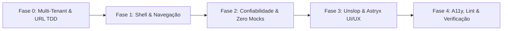

# Plano de Implementação: Refatoração do Dashboard Avalia Solar

**Código do Recurso:** 017-dashboard-unslop-astryx  
**Versão:** 1.0.0  
**Data:** 23/11/2026  
**Documentos Relacionados:** [spec.md](./spec.md) | [PRD](../../docs/prd/PRD_DASHBOARD_UNSLOP_ASTRYX_REFACTOR.md)

---

## 1. Visão Geral da Execução

A implementação é dividida em **5 fases estruturadas**, seguindo **TDD (Test-Driven Development)**: primeiro escrevemos ou atualizamos os testes automatizados para definir os contratos esperados e, em seguida, realizamos a implementação precisa nos arquivos do frontend.

---

## 2. Detalhamento das Fases

### Fase 0 — Multi-Tenant, Seleção por `company_id` & TDD (P0)
- **Objetivo:** Garantir que `/dashboard?company_id=XYZ` selecione de forma determinística e segura a empresa correspondente, respeitando o isolamento multi-tenant e prevenindo IDOR.
- **Etapa TDD:**
  - Criar `AB0-1-front/app/dashboard/__tests__/company-selection-multitenant.spec.tsx`.
  - Definir cenários de teste:
    1. Usuário com múltiplas empresas acessa `?company_id=372` -> seleciona empresa 372.
    2. Usuário com empresa 100 salva no `localStorage` acessa `?company_id=372` -> URL tem precedência; altera a empresa ativa para 372 e atualiza persistência.
    3. Usuário acessa `?company_id=999` (empresa à qual NÃO tem acesso) -> bloqueia acesso indevido, emite aviso de permissão, não vaza dados e mantém a empresa do usuário ou exibe seletor.
    4. Usuário admin acessa `?company_id=372` -> permite visualização administrativa.
- **Implementação:**
  - Em `AB0-1-front/context/CompanyContext.tsx`:
    - Adicionar método `selectCompanyById(id: number | string)` e helper `hasCompanyAccess(id: number | string): boolean`.
    - Garantir que a seleção persista no `localStorage` e chame `companyAccessApi.selectActiveCompany`.
  - Em `AB0-1-front/app/dashboard/page.tsx`:
    - Integrar leitura de `searchParams.get('company_id')`.
    - Se presente e diferente de `activeCompany?.id`, validar acesso contra `companies`.
    - Se válido, selecionar e sincronizar. Se inválido, emitir notificação de segurança e manter o isolamento do tenant.

### Fase 1 — Consolidação da Arquitetura & Navegação (P0/P1)
- **Objetivo:** Estabelecer `EnterpriseDashboard` como shell exclusivo, aposentar código legado não utilizado e unificar fontes de navegação.
- **Implementação:**
  - Isolar `CompanyDashboardModern.tsx` e assegurar que não haja dependências circulares ou imports vivos.
  - Alinhar abas: garantir que a rota `info` e `product-general` correspondam à mesma visualização de `CompanyInfo`, eliminando abas fantasmas no `TabsContent`.
  - Revisar `config/navigation.ts` para agrupamento funcional por tarefas operacionais (Presença e Reputação, Oportunidades, Minha Empresa, Ferramentas, Configurações).
  - Implementar ação no botão "Ajuda" na toolbar/sidebar: abrir modal de suporte ou redirecionamento amigável para a Central de Ajuda/WhatsApp Avalia Solar.

### Fase 2 — Confiabilidade de Dados & Eliminação de Mocks (P0)
- **Objetivo:** Eliminar 100% dos dados estáticos fictícios que poderiam aparecer em rotas de produção e tratar KPIs sem métricas.
- **Implementação:**
  - Em `AB0-1-front/app/dashboard/components/DashboardCharts.tsx`:
    - Remover as constantes de dados mock (`salesData`, `categoryData`, `performanceData`).
    - Exigir dados reais via props `data`.
    - Adicionar fallback visual para dados vazios ou ausentes ("Nenhum dado registrado para o período").
  - Em `AB0-1-front/app/dashboard/components/OverviewTab.tsx`:
    - Atualizar o KPI "Tempo médio de resposta":
      - Se houver métrica, formatar (ex: "X min").
      - Se ausente, exibir *"Não configurado"* com tooltip explicativo e botão para configurar canais de atendimento, em vez de `—` travado.
  - Escrever teste unitário `AB0-1-front/app/dashboard/__tests__/dashboard-charts-clean.spec.tsx`.

### Fase 3 — Refatoração Visual (Diretrizes Unslop & Astryx) (P1)
- **Objetivo:** Substituir efeitos visuais espalhafatosos por um painel operacional técnico, calmo e consistente.
- **Implementação:**
  - Em `AB0-1-front/app/dashboard/components/FeatureGuard.tsx`:
    - Redesenhar o componente com card sóbrio de borda neutra e fundo de alto contraste.
    - Remover gradientes fluorescentes, múltiplos blurs e glows.
    - Remover alegações hiperbólicas sem comprovação ("Até 4x mais visualizações", "8x mais leads").
    - Estruturar em: (1) Nome do recurso, (2) Benefício funcional, (3) Plano necessário (ex: Pro), (4) Botão de upgrade claro.
  - Em `AB0-1-front/app/dashboard/components/OverviewTab.tsx`:
    - Modernizar o cabeçalho: substituir a saudação infantil por um cabeçalho operacional objetivo com nome da empresa, plano ativo e período de apuração.
    - Suavizar paleta de cores: unificar superfícies em escala neutra e usar acento solar consistente (âmbar corporativo).
    - Espaçamento estrito baseado na grade de 4px e cantos concêntricos proporcionais.

### Fase 4 — Acessibilidade, Qualidade de Código & Verificação Final (P1)
- **Objetivo:** Conformidade WCAG 2.1 AA, resolução de problemas de ESLint e validação completa sem regressões.
- **Implementação:**
  - Adicionar `aria-label` e `title` a botões de ícone (botão de download de gráficos, toggle de visualização, fechar painéis).
  - Adicionar alternativa tabular semântica (`<table>`, `<caption>`, `<thead>`, `<tbody>`) para os dados dos gráficos em `OverviewTab` e `DashboardCharts`.
  - Corrigir uso de `` em `CompanyAiStudio.tsx` substituindo por `<Image />` do `next/image` ou SVG vetorial.
  - Executar suíte completa de testes: `npm test`.
  - Executar ESLint nos componentes alterados: `npx eslint ...`.
  - Executar typecheck: `npm run typecheck`.

---

## 3. Gestão de Riscos e Mitigações

| Risco | Impacto | Mitigação |
| :--- | :--- | :--- |
| **Quebra de sessão em usuários sem `company_id`** | Alto | O fallback do `CompanyContext` mantém a seleção padrão de `companies[0]` ou cookie salvo quando o query param for nulo. |
| **Falso positivo de IDOR para administradores** | Médio | Validação explícita de `user.role === 'admin' \|\| user.role === 'super_admin'` para permitir impersonation de suporte. |
| **Gráficos quebrarem por falta de dados** | Baixo | Adição de fallbacks defensivos e renderização de estado vazio antes de chamar Recharts. |

