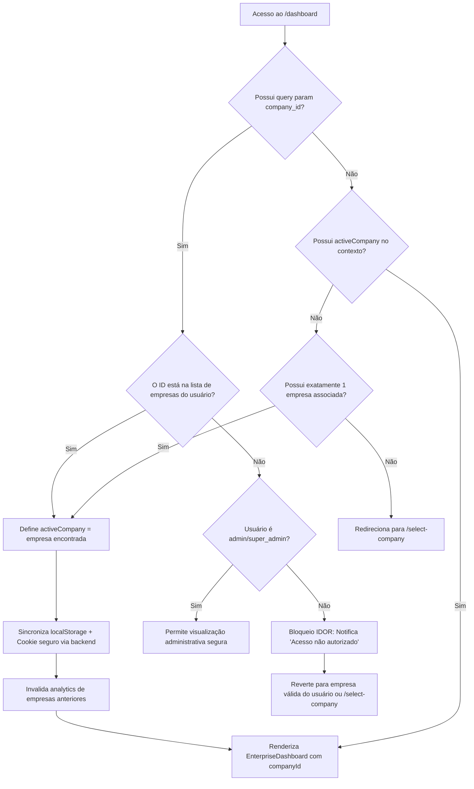

# Especificação Técnica: Refatoração do Dashboard Avalia Solar (Unslop & Astryx)

**Código do Recurso:** 017-dashboard-unslop-astryx  
**Versão:** 1.0.0  
**Data:** 23/11/2026  
**Documento Relacionado:** [PRD_DASHBOARD_UNSLOP_ASTRYX_REFACTOR.md](../../docs/prd/PRD_DASHBOARD_UNSLOP_ASTRYX_REFACTOR.md)

---

## 1. Contexto e Objetivos Técnicos

A presente especificação técnica detalha a implementação das correções de arquitetura, segurança multi-tenant, acessibilidade, confiabilidade de dados e refinamento visual do Dashboard Avalia Solar, seguindo os princípios de craft do **Unslop** e design tokens do **Astryx**.

### Problemas Resolvidos:
1. **Falha de Resolução Multi-Tenant por URL (`company_id`):** O parâmetro de consulta `company_id` era preterido em favor de valores cacheados no `localStorage`, quebrando links diretos e gerando risco de visualização incorreta de dados empresariais.
2. **Duplicação de Shells e Navegação Fragmentada:** Coexistência de `EnterpriseDashboard`, `DashboardLayout` e `CompanyDashboardModern`, com rotas inconsistentes (`info` vs `product-general`) e botão de Ajuda inoperante.
3. **Mocks de Dados em Produção:** Dados estáticos no `DashboardCharts.tsx` e KPIs com valor estático `—`.
4. **Ruído Visual (Slop):** Excesso de glows, cores saturadas simultâneas, claymorphism agressivo e claims publicitários não comprovados no `FeatureGuard`.
5. **Erros de Acessibilidade e Lint:** Botões de ícone sem acessibilidade, falta de alternativa tabular em gráficos, e uso de `` não otimizado em `CompanyAiStudio.tsx`.

---

## 2. Contratos de Interface e Comportamento

### 2.1 Seleção Multi-Tenant e Sincronização de Estado (`CompanyContext` & `dashboard/page.tsx`)

#### Fluxo de Resolução de Empresa:

#### Contrato de Segurança Multi-Tenant:
- O frontend NUNCA deve solicitar ou renderizar dados analíticos de uma empresa para a qual o usuário não possua membership comprovada no array `companies` retornado por `companiesApi.mine()`, exceto quando o usuário possuir papel administrativo (`role === 'admin'` ou `role === 'super_admin'`).
- A troca de empresa deve chamar `invalidateAnalyticsAvailability` tanto para o ID anterior quanto para o novo ID, garantindo que nenhum gráfico exiba dados residuais de outro tenant em memória.

### 2.2 Unificação de Shell e Navegação

1. **Shell Canônico:**
   - O componente `EnterpriseDashboard` (`app/dashboard/components/EnterpriseDashboard.tsx`) é estabelecido como o único shell do dashboard empresarial.
   - O componente `CompanyDashboardModern.tsx` é descontinuado e isolado de qualquer rota ativa.
   - O layout legado `DashboardLayout` é restrito exclusivamente à visualização de administradores do sistema quando aplicável.
2. **Matriz de Navegação Única (`config/navigation.ts`):**
   - Agrupamento orientado a tarefas operacionais:
     - **Presença e Reputação:** Visão Geral (`overview`), Avaliações (`reviews`), Selos de Confiança (`avalia-badges`), Widgets de Reputação (`marketing-widgets`, `trust-widget`).
     - **Oportunidades & Leads:** Leads e Oportunidades (`leads`), Intenção de Compra (`buyer-intent`), Prospecção (`prospects`).
     - **Minha Empresa:** Dados da Empresa (`info`), Categorias (`categories`), Produtos & Serviços (`products`), Materiais & Mídia (`materials`, `media`).
     - **Ferramentas & IA:** Assistente de IA (`ai-assistant`), Campanhas (`campaigns`), Análise de Estilo (`style-analysis`).
     - **Configurações:** Equipe (`team`), Configurações Gerais (`settings`), Plano & Assinatura (`plan`).
3. **Mapeamento de Abas (`info` vs `product-general`):**
   - A aba canônica para dados gerais da empresa é `info`.
   - Caso uma navegação legada solicite `product-general`, ela deve ser renderizada transparentemente na mesma visualização de `CompanyInfo`, sem inconsistências visuais ou abas em branco.
4. **Ação do Botão de Ajuda:**
   - O botão "Ajuda" na toolbar/sidebar deve disparar um diálogo modal informativo ou redirecionar para o canal de suporte oficial e FAQ da Avalia Solar.

### 2.3 Confiabilidade de Dados (Fim dos Mocks)

1. **`DashboardCharts.tsx`:**
   - Remoção completa das constantes `salesData`, `categoryData` e `performanceData`.
   - Todas as visualizações (`AreaChart`, `BarChart`, `LineChart`) devem operar exclusivamente sobre props recebidas via parâmetro `data: Array<Record<string, unknown>>`.
   - Quando `data` for indefinido, nulo ou vazio (`length === 0`), deve ser renderizado um estado vazio elegante:
     - Ícone neutro de gráfico.
     - Mensagem objetiva: *"Nenhum dado registrado para o período selecionado."*
     - Sem dados falsos simulando receita ou fontes energéticas irrelevantes.
2. **KPI "Tempo Médio de Resposta" (`OverviewTab.tsx`):**
   - Caso o backend forneça métrica real (`metrics.avg_response_time`), exibir o valor formatado (ex: "25 min", "2 horas").
   - Caso a empresa não possua canal de chat configurado ou não haja interações, exibir o estado explícito *"Não configurado"* ou *"Sem interações"*, acompanhado de tooltip/ajuda informando como integrar WhatsApp/Chat para monitorar o tempo de resposta.

---

## 3. Diretrizes de Design: Padrão Unslop e Astryx

### 3.1 Unslop Pass (Limpeza e Sobriedade)
- **Eliminação de Slop:**
  - Zero efeitos de "glow" colorido ou sombras projetadas com cores fluorescentes.
  - Zero gradientes multicoloridos concorrentes em botões, cartões ou textos.
  - Eliminação de transições genéricas (`transition-all` indiscriminado) e cantos exagerados em cartões operacionais.
  - Paywall de `FeatureGuard` sóbrio: remover textos de propaganda inflada ("Até 4x mais visualizações") e focar em comunicação técnica direta:
    - Identificação clara do recurso bloqueado.
    - Benefício operacional direto.
    - Plano mínimo necessário (ex: "Disponível no Plano Pro").
    - Botão de upgrade com chamada para ação limpa.

### 3.2 Astryx Design Guidelines
- **Espaçamento e Layout:**
  - Grade estrita de 4px (`gap-2` = 8px, `gap-4` = 16px, `gap-6` = 24px).
  - Padrão concêntrico de raios: cantos internos com raio menor que cantos externos.
  - Cores neutras estruturantes com uma cor de acento solar consistente (âmbar corporativo). Cores semânticas exclusivas para status (verde sucesso, vermelho alerta, âmbar pendente).

### 3.3 Acessibilidade (WCAG 2.1 AA)
- Todos os botões contendo apenas ícones devem possuir `aria-label` e atributo `title`.
- Gráficos de visão geral devem disponibilizar alternância ou resumo tabular oculto com tags semânticas (`table`, `caption`, `thead`, `tbody`) para leitores de tela.
- Todas as tags `` em `CompanyAiStudio.tsx` e componentes do dashboard devem ser migradas para `<Image />` do `next/image` ou SVG vetorial.

---

## 4. Estratégia de Testes (TDD & Regressão)

A suíte de testes em Jest (`AB0-1-front`) validará os seguintes comportamentos obrigatórios:
1. `company-selection-multitenant.spec.tsx`:
   - Seleção automática da empresa quando `company_id` válido é passado na URL.
   - Prioridade da URL sobre valores anteriores em `localStorage`.
   - Bloqueio imediato quando `company_id` pertence a outra empresa sem autorização.
   - Sincronização correta de cookies e invalidação de cache analítico.
2. `dashboard-charts-clean.spec.tsx`:
   - Validação de que `DashboardCharts` não renderiza mocks estáticos.
   - Renderização adequada de estados vazios informativos.
3. `accessibility-and-navigation.spec.tsx`:
   - Validação de presença de `aria-label` em botões de ícone do dashboard.
   - Validação da consistência das rotas e abas de navegação.

