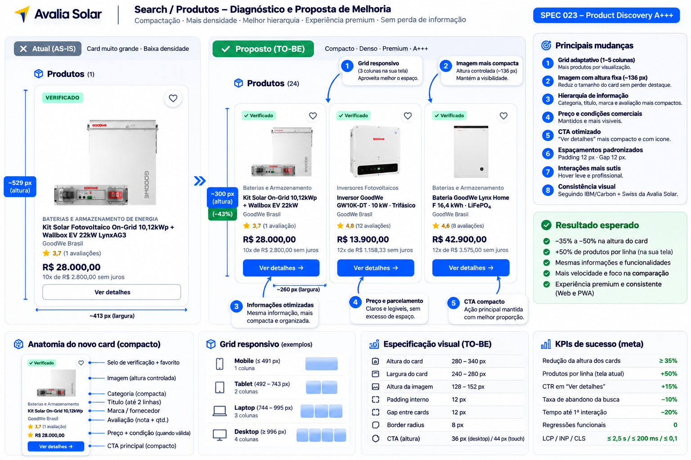

# 6. Design System — especificação TO-BE

## 6.1. Anatomia do novo card compacto

A representação abaixo demonstra a organização proposta. Os dados comerciais são ilustrativos, baseados na captura apresentada.

```text
┌──────────────────────────────┐
│  ✓ Verificado            ♡   │
│                              │
│        IMAGEM PRODUTO        │  136 px
│                              │
├──────────────────────────────┤
│ Baterias e armazenamento    │
│ Kit Solar Fotovoltaico       │
│ On-Grid 10,12kWp + Wallbox... │
│ GoodWe Brasil                │
│ ★ 3,7 (1 avaliação da empresa)│
│                              │
│ R$ 28.000,00                 │
│ Parcelamento, quando válido  │
│ ┌──────────────────────────┐ │
│ │     Ver detalhes     →   │ │
│ └──────────────────────────┘ │
└──────────────────────────────┘
```

A proposta preserva a categoria, identificação do produto, fornecedor, reputação, verificação, preço, condições comerciais válidas, favoritos e navegação.

## 6.2. Tipografia

| Elemento | Desktop | PWA | Peso |
|---|---:|---:|---:|
| Título da seção Produtos | 18 px | 16 px | 600 |
| Contador de produtos | 12 px | 12 px | 400 |
| Categoria | 11 px | 11 px | 500 |
| Nome do produto | 14 px | 14 px | 600 |
| Marca/fornecedor | 12 px | 12 px | 400–500 |
| Nota | 12 px | 12 px | 600 |
| Quantidade de avaliações | 11–12 px | 12 px | 400 |
| Preço | 18 px | 16–18 px | 700 |
| Parcelamento | 11–12 px | 12 px | 400 |
| Badge | 10–11 px | 11 px | 600 |
| CTA | 12 px | 13 px | 600 |

Manter a família tipográfica oficial do Avalia Solar. Não introduzir novas fontes ou dependências para essa implementação.

## Referência visual


O mockup é conceitual: produtos adicionais, preços e notas são ilustrativos; não reproduzir esses valores no código. O selo e a reputação devem indicar explicitamente a empresa. CTA, cores e geometria seguem tokens reais confirmados na W0; o botão azul do mockup é referência visual, não autorização para alterar a hierarquia global.

## Estados e interação
Normal, hover, focus-visible, pressed, carregando, favorito ativo/inativo, erro de imagem, sem preço, sem avaliações, sem verificação e textos longos. Usar object-contain; preservar nome completo por quebra de linha ou mecanismo acessível também por teclado e touch. Sem tooltip exclusivo de hover. Garantir contraste, foco visível e alvos touch de 44 px.
