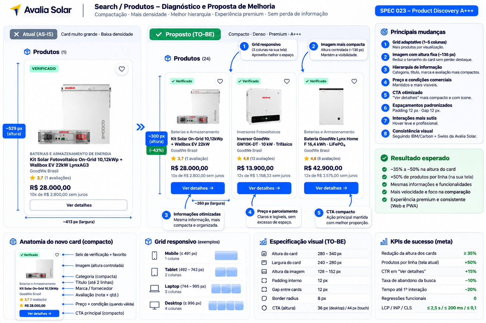

# Avalia Solar — SPEC 023 (proposta)
## Search Product Discovery · Compact Premium UI/UX A+++

**Status:** diagnóstico e especificação; implementação pendente.
**Escopo:** `/search`, todas as marcas, produtos, categorias, consultas e cardinalidades; Web App e PWA.
**Referência:** commit auditado `408ea189738be1500500f1adcd294a9df2b83607`, não confirmado como deploy atual.

## Como usar
1. Copiar esta pasta para `specs/` após verificar disponibilidade do número 023.
2. Fornecer ao agente o [prompt de execução](18-AGENT-PROMPT.md).
3. Começar pela W0 read-only. Prosseguir conforme autorização, TDD e gates definidos.
4. Registrar evidências no relatório 21.

## Referência visual

O mockup contém exemplos ilustrativos, não dados de produção. Nenhum teste, alteração no repositório ou medição de runtime foi realizado ao montar este pacote.

## Índice
- [00-SOURCE-SPEC](00-SOURCE-SPEC.md)
- [01-AS-IS-INVENTORY](01-AS-IS-INVENTORY.md)
- [02-ROOT-CAUSE-ANALYSIS](02-ROOT-CAUSE-ANALYSIS.md)
- [03-GAP-ANALYSIS](03-GAP-ANALYSIS.md)
- [04-PRD](04-PRD.md)
- [05-QUICK-WINS](05-QUICK-WINS.md)
- [06-UI-UX-SPEC](06-UI-UX-SPEC.md)
- [07-DESIGN-TOKENS](07-DESIGN-TOKENS.md)
- [08-RESPONSIVE-GEOMETRY](08-RESPONSIVE-GEOMETRY.md)
- [09-COMPONENT-CONTRACTS](09-COMPONENT-CONTRACTS.md)
- [10-PERFORMANCE-BUDGET](10-PERFORMANCE-BUDGET.md)
- [11-TDD-STRATEGY](11-TDD-STRATEGY.md)
- [12-BDD-SCENARIOS](12-BDD-SCENARIOS.md)
- [13-TEST-MATRIX](13-TEST-MATRIX.md)
- [14-TASKLIST](14-TASKLIST.md)
- [15-ACCEPTANCE-CRITERIA](15-ACCEPTANCE-CRITERIA.md)
- [16-DEFINITION-OF-DONE](16-DEFINITION-OF-DONE.md)
- [17-ROLLBACK-PLAN](17-ROLLBACK-PLAN.md)
- [18-AGENT-PROMPT](18-AGENT-PROMPT.md)
- [19-SKILLS-MAP](19-SKILLS-MAP.md)
- [20-KPIS-AND-ANALYTICS](20-KPIS-AND-ANALYTICS.md)
- [21-EXECUTION-REPORT-TEMPLATE](21-EXECUTION-REPORT-TEMPLATE.md)

## Precedência e decisões
O documento 00 preserva a SPEC fornecida na íntegra. Os módulos organizam o conteúdo e complementam lacunas operacionais (critérios, rollback, matriz, relatório). Em conflito, priorizar integridade comercial, acessibilidade, isolamento de escopo e os contratos confirmados em W0. Metas são propostas; validar com dados reais. Não copiar valores de exemplo para produção. A variante compacta não autoriza alterar outros consumidores do card.
